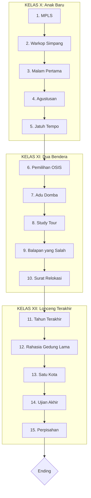

# Cerita: "Lonceng Pulang"

## Premis

Di halaman belakang SMA Negeri 3 Wirabumi ada gedung tua yang terkunci. Konon di dalamnya tergantung lonceng sekolah
pertama, yang dulu dibunyikan tiap jam pulang. Sudah puluhan tahun tidak ada yang membunyikannya. Kata Pak Ujang si penjaga,
"Lonceng itu cuma bunyi kalau sekolah ini benar-benar mau pulang ke pemiliknya."

Pemain datang sebagai anak baru dari desa. Selama tiga tahun dia belajar, bekerja, jatuh cinta, berantem, dan pada akhirnya
ikut menyelamatkan sekolah dari rencana relokasi yang akan mengubah lahannya jadi superblok.

Ada **tiga benang cerita** yang berjalan bersamaan dan saling menyilang:

1. **Sekolah**: naik kelas, persahabatan, rival Bram, misteri Gedung Lama, rencana relokasi.
2. **Rumah & usaha**: utang Om Darto, membesarkan Warkop Simpang dan properti lain.
3. **Jalanan**: klub motor Lampu Kota, perseteruan dengan Serigala Besi, balapan.

Ditambah **benang romance** pilihan pemain yang memberi momen di setiap bab.

## Struktur

- 3 tahun ajaran, 15 bab. Bab cerita utama terkunci ke kalender (contoh: Bab 4 selalu di minggu 17 Agustus).
- Di antara bab, pemain bebas: sekolah, kerja, misi sampingan, romance.
- Akhir tiap semester ada **rapor**. Akhir tiap tahun ada **kenaikan kelas** (lihat [03-sistem.md](03-sistem.md)).

---

## KELAS X: "Anak Baru"

### Bab 1. MPLS (minggu 1)
- Pembuka: pemain turun dari kereta di Stasiun Wirabumi, dijemput Om Darto naik motor bebek tuanya. **Tutorial jalan &
  naik motor (dibonceng)** menyusuri kota: lihat alun-alun, pasar, dan sekolah dari jalan.
- Hari pertama MPLS (masa pengenalan sekolah): baris di lapangan, kenalan dengan **Bimo** (sebangku) dan **Tegar**
  (ketua kelas). Mini game pertama: hafal nama dan wajah teman sekelas.
- Bram dan gengnya memalak Bimo di belakang kantin. **Tutorial berantem** melawan satu anak buah Bram.
- Ketahuan **Pak Wawan**: dihukum menyapu halaman (tutorial animasi sapu + mini game menyapu). Saat menyapu, kenalan dengan
  **Pak Ujang** yang bercerita soal lonceng di Gedung Lama.
- Pulang: **Uti** menolong saat sepeda pemain bocor di parkiran.

### Bab 2. Warkop Simpang (minggu 2-3)
- Pemain melihat Om Darto dibentak **Pak Gito** si rentenir. Utang **Rp 5.000.000**, jatuh tempo akhir kelas X.
- Om malu dan menutupinya. Pemain memutuskan ikut cari uang.
- **Tutorial ekonomi**: kopi keliling naik sepeda (termos + gelas plastik), jaga warung. Membuka menu properti.
- **Cici** minta diajari PR: tutorial les privat (pakai nilai pelajaran).

### Bab 3. Malam Pertama (minggu 4)
- Mengantar pesanan kopi malam ke Kampung Bantaran, pemain dicegat **Serigala Besi**. Kejar-kejaran sepeda.
- Diselamatkan rombongan motor berlampu kuning: **Lampu Kota**. **Mas Fajar** mengenali sepeda pemain dari bengkelnya.
- Di markas, **Bang Jaka** menawarkan "ujian masuk" tiga malam:
  1. **Balap**: sepeda melawan motor di gang (menang = sampai duluan lewat jalan pintas).
  2. **Setia kawan**: menjemput anggota yang mogok di wilayah Serigala Besi tanpa meninggalkannya.
  3. **Jujur**: dompet tercecer berisi uang banyak (tes diam-diam: kembalikan atau ambil).
- **Pilihan besar**: masuk Lampu Kota, atau menolak dengan sopan (jalur "anak lurus").

### Bab 4. Agustusan (minggu 17 Agustus)
- Lomba 17-an di sekolah dan kampung: panjat pinang, balap karung, tarik tambang, makan kerupuk (mini game cepat).
- Class meeting: futsal antar kelas (kelas pemain melawan kelas Bram di final).
- Upacara bendera: pemain dipilih jadi petugas (mini game ritme baris-berbaris).
- Malamnya pasar malam di alun-alun: **kencan pertama** dengan tokoh romance yang meternya paling tinggi.
- Akhir semester 1: **rapor pertama**.

### Bab 5. Jatuh Tempo (semester 2, akhir tahun)
- Arc Uti dimulai (motor almarhum kakaknya akan dijual).
- Pak Gito datang menagih. **Kalau uang cukup**: lunas, warkop naik ke level 2 secara gratis sebagai hadiah cerita.
  **Kalau kurang**: warkop disita sebagian dan turun jadi gerobak, Om Darto sedih tapi cerita tetap jalan (tidak ada game over).
- Malam terakhir kelas X: Jojo memotret orang berseragam proyek mengukur lahan sekolah diam-diam. Rumor relokasi mulai menyebar.
- Pengumuman rapor: Bram **tinggal kelas** dan jadi seangkatan dengan pemain. Dia menyalahkan pemain.
- **Kenaikan kelas** ke XI.

---

## KELAS XI: "Dua Bendera"

### Bab 6. Pemilihan OSIS
- Nadia mencalonkan diri melawan **Rio** (calon boneka Bram).
- Misi kampanye: tempel poster, debat (mini game Bahasa Indonesia), cari suara dari tiap kelompok sekolah.
- **Hasil memengaruhi dunia**: kalau Nadia menang, pemain dapat izin membuka **lapak di kantin sekolah** dan acara pensi lebih
  besar. Kalau Rio menang, aturan sekolah lebih ketat (razia HP, gerbang tutup lebih awal).

### Bab 7. Adu Domba
- Warkop Simpang dirusak malam-malam, ada stiker Serigala Besi tertinggal. Lampu Kota siap perang.
- Pemain menyelidiki (mode detektif ringan: tanya saksi, cek foto Jojo, kejar pelaku).
- Ternyata pelaku orang bayaran yang juga menyerang markas Serigala Besi atas nama Lampu Kota. Seseorang ingin kedua geng
  saling hancur supaya tidak ada yang menjaga kampung di sekitar lahan proyek.
- Pilihan: membuktikannya ke Kobar (damai bersyarat) atau tetap perang (bos fight melawan Kobar, hubungan tetap buruk).
- Rahasia terungkap: **Om Darto pendiri Lampu Kota**, dan dulu berhenti karena balap liar yang memakan korban.

### Bab 8. Study Tour (opsional tapi disarankan)
- Tiga hari di kota wisata fiktif **Sendangsari**: peta kecil terpisah (jalan wisata, pantai, toko oleh-oleh).
- Event romance paling kuat ada di bab ini (foto berdua, malam di penginapan, api unggun).
- Mini game: tawar-menawar oleh-oleh, foto spot (koleksi), lomba yel-yel kelas.

### Bab 9. Balapan yang Salah
- Bimo diam-diam ikut balap liar di Jalan Lingkar Selatan untuk membuktikan dia berani, dan kecelakaan.
- Pemain mengejar ke rumah sakit (balapan melawan waktu ke Puskesmas).
- Kota heboh, polisi razia geng motor. Pemain mengajak **Pak Hendro**, Bang Jaka, dan polisi membuat **liga balap resmi**
  hari Minggu di Jalan Lingkar Selatan. Membuka mini game balap resmi berhadiah.
- Bimo pulih dan memutuskan jadi koki Warkop Simpang.

### Bab 10. Surat Relokasi
- Pengumuman resmi: sekolah akan dipindah ke pinggir kota tahun depan; lahannya untuk superblok PT Graha Megantara.
- Siswa protes. Bu Hartini dibungkam dari atas. Bram terlihat goyah.
- Pensi akhir tahun jadi aksi: band Sekar membawakan lagu tentang sekolah, video liputan Jojo diputar. Pemain menjaga panggung
  dari anak buah bayaran (berantem di belakang panggung sambil acara berjalan).
- **Kenaikan kelas** ke XII.

---

## KELAS XII: "Lonceng Terakhir"

### Bab 11. Tahun Terakhir
- Tekanan ujian: try out bulanan. Pilih jalur masa depan: **kuliah** (butuh nilai), **usaha** (butuh properti), **jalanan/balap**
  (butuh reputasi geng). Bisa ganti pilihan sampai Bab 14.
- Arc Tegar memuncak: dia kabur dari rumah. Pemain menemukannya di menara pemancar.
- Fajar mendaftar ujian paket C (kalau pemain mau mengajarinya).

### Bab 12. Rahasia Gedung Lama
- Pak Ujang memberikan kunci Gedung Lama. Misi malam bersama Jojo dan satu teman pilihan: **mode menyelinap** dengan senter,
  sedikit horor-komedi (suara aneh ternyata kucing, patung praktik biologi, dsb).
- Di loteng ditemukan **lonceng tua** dan **akta hibah tanah** tahun 1950-an: lahan diserahkan warga dengan syarat "untuk sekolah
  selamanya". Ini bukti izin relokasi cacat hukum.
- Orang bayaran Pak Haris menyerbu saat keluar. Kejar-kejaran di koridor gelap.

### Bab 13. Satu Kota
- Pemain mengumpulkan sekutu: Lampu Kota, Serigala Besi (kalau sudah damai), pedagang pasar (Laras), OSIS (Nadia), guru
  (Bu Hartini), dan Bram (kalau hubungannya cukup).
- Rangkaian set piece:
  1. Mempertahankan sekolah dari alat berat yang datang lebih cepat (berantem melawan anak buah di gerbang, non-mematikan).
  2. **Balapan pengantaran**: akta harus sampai ke gedung DPRD/pengadilan sebelum sidang ditutup. Motor melintasi kota,
     dikejar mobil suruhan. Sekutu yang dikumpulkan menutup jalan untukmu (makin banyak sekutu, makin mudah).
  3. Bram memilih: kalau hubungan tinggi, dia menyerahkan rekaman ayahnya.
- Hasil: sekolah selamat (sepenuhnya / sebagian) atau gagal (memengaruhi ending).

### Bab 14. Ujian Akhir
- Maraton ujian: semua mini game pelajaran dalam versi sulit, satu per hari selama seminggu.
- Malam-malam belajar bareng, kopi dari warkop. Penentuan lulus.

### Bab 15. Perpisahan
- **Malam perpisahan** di aula: dansa, penghargaan konyol antar kelas, momen nembak/lamaran romance.
- **Wisuda**: kalau sekolah selamat, pemain yang membunyikan **Lonceng Pulang** di halaman, lonceng pertama setelah puluhan tahun.
- Epilog per tokoh dan **buku tahunan** berisi foto-foto yang dikumpulkan pemain selama 3 tahun (lihat sistem koleksi).

---

## Ending

Ending disusun dari tiga lapis yang digabung.

**1. Jalan hidup (pilih satu, ditentukan statistik di akhir)**

| Ending | Syarat utama | Isi epilog |
|---|---|---|
| **Lulus Terbaik** | Rata-rata nilai >= 90, jalur kuliah | Diterima di kampus impian, pidato wisuda. |
| **Juragan Muda** | Warkop level 5 + 2 properti lain maksimal | Warkop Simpang punya cabang, Om Darto menangis bangga. |
| **Raja Jalanan** | Pangkat geng tertinggi + juara liga balap | Lampu Kota jadi klub motor resmi, pemain dikontrak tim balap. |
| **Lulus Pas-pasan** | Lulus tanpa syarat di atas | Hidup sederhana, kerja di kota, tetap nongkrong di warkop. |
| **Tahun Depan Lagi** | Tidak lulus | Ikut ujian ulang/paket C bareng Fajar. Pahit tapi tetap ada harapan. |

**2. Nasib sekolah**: Selamat penuh (lonceng berbunyi) / Selamat sebagian (sebagian lahan tetap jadi mal) / Pindah (sekolah
direlokasi, gedung lama dirobohkan, lonceng disimpan pemain).

**3. Romance & sahabat**: epilog pendek per tokoh sesuai meter (pacaran, LDR karena kuliah, tetap sahabat, atau berpisah).

Contoh gabungan: "Juragan Muda + sekolah selamat penuh + pacaran dengan Laras" = adegan penutup di kafe Simpang & Co
cabang pasar, Laras mengelola dapurnya.

**New Game+**: ulang dari kelas X dengan uang 25%, koleksi foto, dan resep warkop tersimpan; tokoh romance bisa dikejar ulang.
