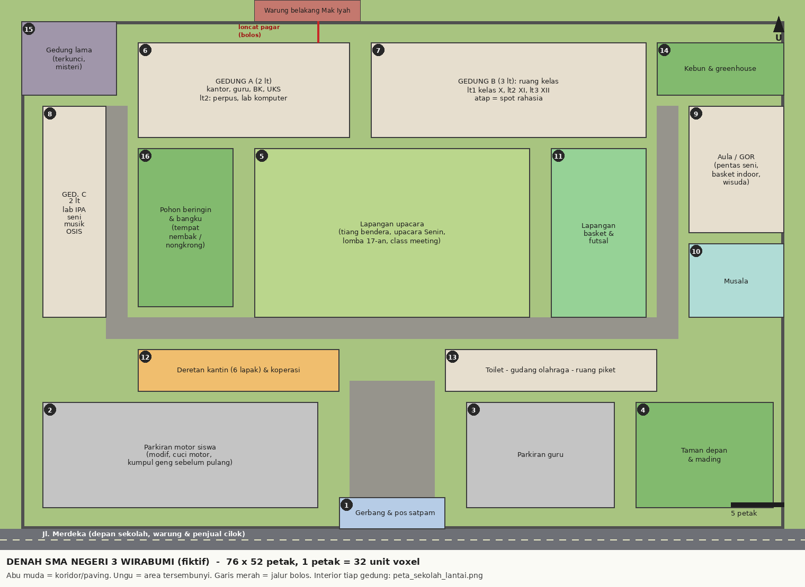

# Peta: Kota Wirabumi & SMA Negeri 3

Semua ukuran dalam **petak**. **1 petak = 32 unit voxel** (kira-kira 1 meter di dunia game). Skala ini mengikuti demo
sprite-stacking: tokoh ±36 unit, pintu 44, dinding 52, motor 34 panjang. Gambar dibuat oleh `peta/buat_peta.py`;
ubah daftar zona di skrip itu lalu jalankan ulang (`python buat_peta.py`) kalau tata letaknya berubah.

## Peta kota (220 x 150 petak)

Kota dibagi kotak-kotak blok oleh jalan raya (abu tua bergaris) dan jalan kampung/gang (abu muda). Sungai Kali Cendana di
selatan memisahkan kota dari Jalan Lingkar Selatan (sirkuit balap). Bukit di utara untuk sepeda turunan dan tempat romantis.

| No | Lokasi | Fungsi utama | Terbuka |
|---|---|---|---|
| 1 | **SMA Negeri 3 Wirabumi** | Pusat cerita, pelajaran, ekskul (peta terpisah di bawah) | Bab 1 |
| 2 | **Perumahan Gang Kenanga** | Rumah Om Darto (kamar pemain), tetangga, misi warga. Bisa memakai ulang scene gang perumahan yang sudah ada. | Bab 1 |
| 3 | **Warkop Simpang** | Properti utama, berubah bentuk sesuai level, pusat malam hari | Bab 2 |
| 4 | **Kos-kosan Bu Narti** | Properti investasi kelas XII, sumber gosip | Bab 2 (beli: kelas XII) |
| 5 | **Pasar Wirabumi & terminal angkot** | Belanja bahan warkop, kerja subuh, Laras, angkot sebagai transport cepat | Bab 1 |
| 6 | **Alun-alun** | Pasar malam Sabtu, ngamen, kencan, upacara kota 17-an | Bab 1 |
| 7 | **Masjid Agung** | Landmark, event Ramadan (ngabuburit, bukber) | Bab 1 |
| 8 | **Puskesmas & kantor polisi** | Respawn kalau pingsan (biaya), Bab 9, urusan razia | Bab 1 |
| 9 | **Ruko Pelita** | Warnet, kafe, toko buku, karaoke; lokasi Warkop level 4 | Kelas X sem. 2 |
| 10 | **Bengkel Mas Fajar** | Upgrade motor/sepeda, kerja montir, properti bengkel | Bab 3 |
| 11 | **Plaza Wirabumi** | Mal kecil & bioskop (kencan, baju) | Kelas X sem. 2 |
| 12 | **Lapangan bola kampung & GOR kota** | Futsal kampung, liga Minggu | Bab 4 |
| 13 | **STM Karya Bangsa** | Sekolah rival, wilayah Serigala Besi | Bab 3 |
| 14 | **Lahan proyek PT Graha Megantara** | Konflik utama kelas XI-XII, set piece Bab 13 | Bab 10 |
| 15 | **Gudang tua markas Lampu Kota** | Markas geng, latihan, properti markas | Bab 3 |
| 16 | **Kampung Bantaran** | Pangkalan ojek, rute kopi malam, banjir musim hujan | Bab 2 |
| 17 | **Stasiun Wirabumi** | Pembuka game, perjalanan study tour | Bab 1 |
| 18 | **Bukit Cemara** | Balap sepeda turunan | Kelas X sem. 2 |
| 19 | **Menara pemancar** | Tempat nongkrong malam rahasia, arc Tegar, romance Arga | Bab 3 |
| 20 | **Kebun teh & danau kecil** | Mancing, kencan, foto | Kelas X sem. 2 |
| 21 | **Perumahan elite Bukit Asri** | Rumah Bram, misi menyelinap Bab 13 | Bab 6 |
| 22 | **Taman kota & skatepark** | Nongkrong, misi sampingan, romance Rizal | Bab 1 |
| 23 | **Lapangan basket umum** | Basket 3x3, romance Dimas | Bab 1 |
| - | **Jalan Lingkar Selatan** | Balap resmi (Minggu) & liar (malam) | Bab 9 (liar: Bab 3) |

**Jarak kira-kira** (untuk merasakan ritme): rumah ke sekolah ±45 petak (jalan kaki ±40 detik, sepeda ±15 detik, motor
±8 detik). Ujung ke ujung kota ±220 petak (motor ±40 detik). Angkot dari terminal = pindah cepat ke halte tertentu.

## Peta sekolah (76 x 52 petak)

| No | Area | Isi & fungsi |
|---|---|---|
| 1 | **Gerbang & pos satpam** | Tutup jam 07.00. Dialog bujuk satpam kalau telat. |
| 2 | **Parkiran motor siswa** | Modif ringan, cuci motor, titik kumpul geng saat pulang. |
| 3 | **Parkiran guru** | Mobil guru, tempat menguping (misi gosip). |
| 4 | **Taman depan & mading** | Papan misi sampingan, pengumuman, hasil OSIS. |
| 5 | **Lapangan upacara** | Upacara Senin, lomba 17-an, class meeting, wisuda/lonceng di Bab 15. |
| 6 | **Gedung A** (2 lt) | Lt1: kepala sekolah, TU, ruang guru, BK, UKS. Lt2: perpustakaan, lab komputer, ruang arsip (terkunci, Bab 12). |
| 7 | **Gedung B** (3 lt) | Ruang kelas: lt1 kelas X, lt2 kelas XI, lt3 kelas XII. Atap = tempat rahasia (bolos, romance Sekar). |
| 8 | **Gedung C** (2 lt) | Lt1: lab fisika, kimia, biologi. Lt2: ruang seni, studio musik, ruang OSIS. |
| 9 | **Aula / GOR** | Pensi, basket indoor, malam perpisahan, wisuda kalau hujan. |
| 10 | **Musala** | Shalat Jumat, event Ramadan. |
| 11 | **Lapangan basket & futsal** | Ekskul, class meeting, basket 3x3. |
| 12 | **Kantin (6 lapak) & koperasi** | Makan, gosip, lapak milik pemain di kelas XI. |
| 13 | **Toilet, gudang olahraga, ruang piket** | Tempat sembunyi, ambil sapu untuk hukuman/senjata. |
| 14 | **Kebun & greenhouse** | Misi Biologi, bahan herbal. |
| 15 | **Gedung Lama** | Terkunci, misteri lonceng & akta (Bab 12). |
| 16 | **Pohon beringin & bangku** | Nongkrong, tempat nembak romance. |
| - | **Warung belakang Mak Iyah** | Di luar pagar utara. Jalur bolos lewat titik loncat pagar (garis merah). |

### Interior gedung

- Gedung C di peta sekolah berdiri memanjang utara-selatan; denah lantainya digambar diputar 90 derajat.
- **Satu ruang kelas** = 6 x 5 petak: papan tulis, meja guru, 16 meja siswa, satu pintu ke koridor. Tiap angkatan punya 3 kelas
  (X-1 sampai X-3, dst.). Pemain di X-2 (bersama Bimo, Tegar, Nadia/Rizal), Bram di XI-1, Sekar & Dimas di kelas sebelah.
- **Koridor lantai atas** jadi balkon yang menghadap lapangan upacara (bisa melihat kejadian di lapangan, tempat ngobrol).
- **Tangga** di ujung gedung. Atap Gedung B dicapai lewat tangga darurat ujung timur (pintu terkunci, butuh kunci dari Pak Ujang
  atau loncat dari balkon lt3, risiko jatuh).

### Catatan untuk renderer sprite-stacking

- Bangunan bertingkat: tiap lantai dibuat sebagai model terpisah yang ditumpuk. Saat pemain masuk, lantai di atas pemain dan
  atapnya dibuat transparan (sistem "bangunan yang menutupi pemain jadi tembus pandang" yang sudah ada).
- **Interior**: masuk pintu = pindah ke scene interior kecil (lebih ringan) atau atap dilepas di tempat. Saran: kelas, lab,
  dan warkop pakai **atap dilepas di tempat** (terasa satu dunia); Gedung Lama dan aula pakai scene terpisah (bisa lebih detail).
- Gedung B 3 lantai x 3 kelas memakai **satu model ruang kelas** yang diulang, jadi murah dibuat.
- Benda statis (meja, kursi, rak) cocok untuk cache impostor yang sudah ada.

## Urutan pembangunan peta (saran)

1. **Prototipe 1 (inti)**: Gang Kenanga + Warkop Simpang lv1-2 + jalan ke sekolah + halaman sekolah (gerbang, lapangan, kantin)
   + 1 ruang kelas. Cukup untuk loop: sekolah pagi, satu mini game pelajaran, kopi keliling sore, warkop malam.
2. **Prototipe 2**: Gedung B penuh, Gedung A lt1 (BK untuk hukuman), parkiran, pasar, alun-alun. Tambah berantem dan rapor.
3. **Prototipe 3**: Bengkel, gudang markas, Kampung Bantaran, Jalan Lingkar (balap). Tambah geng motor dan motor.
4. **Lengkap**: sisa kota (ruko, plaza, bukit, STM, lahan proyek), Gedung C, aula, Gedung Lama, peta study tour.
