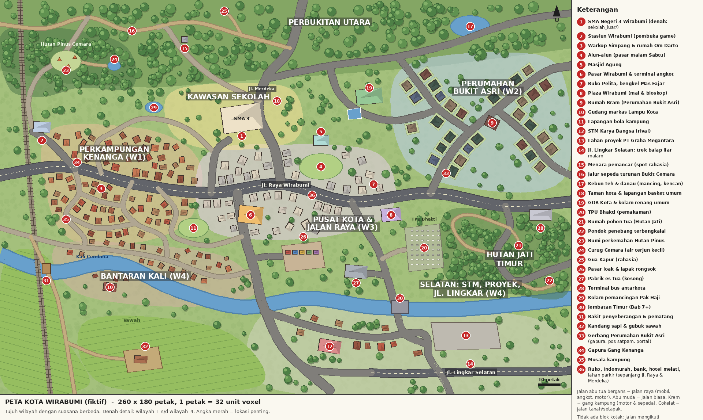
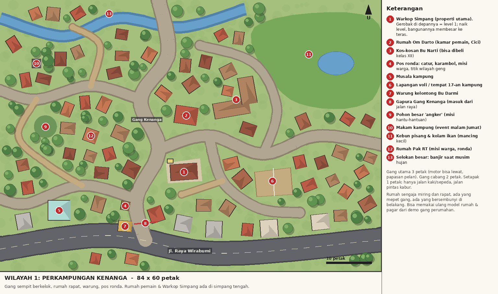
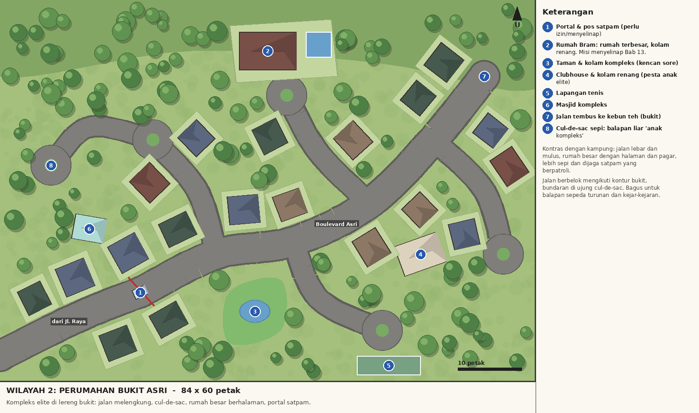
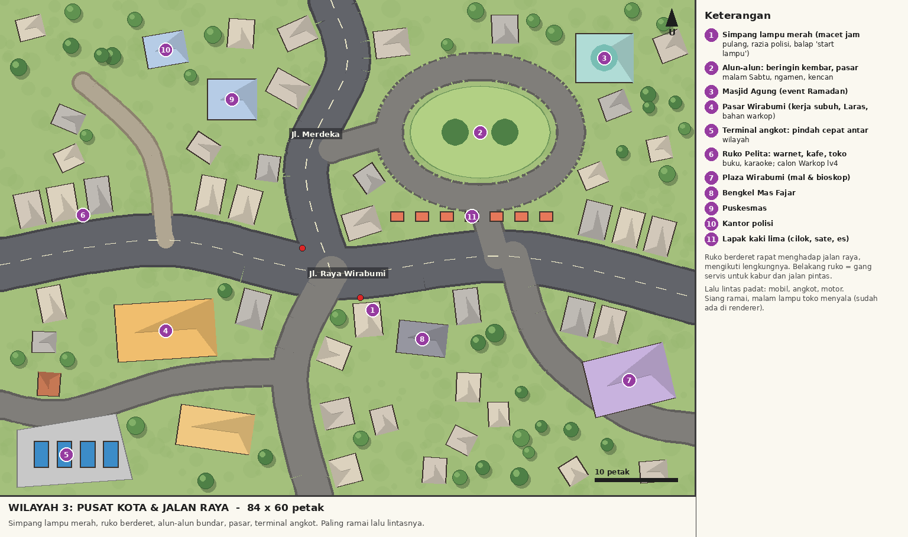
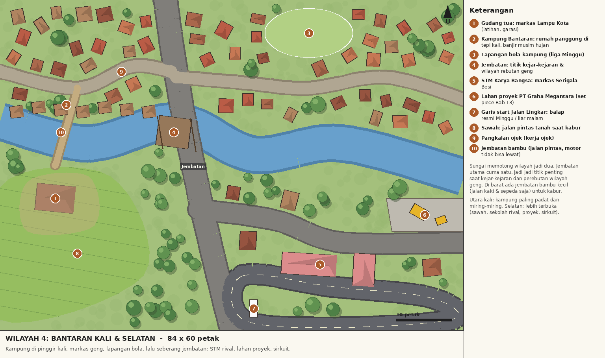
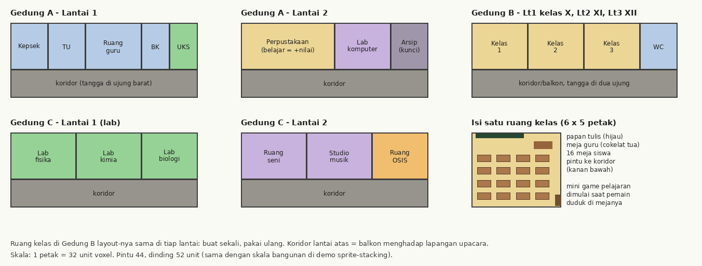

# Peta: Kota Wirabumi & SMA Negeri 3

Semua ukuran dalam **petak**. **1 petak = 32 unit voxel** (kira-kira 1 meter di dunia game). Skala ini mengikuti demo
sprite-stacking: tokoh ±36 unit, pintu 44, dinding 52, motor 34 panjang. Peta kota & wilayah dibuat oleh `peta/peta_organik.py`, peta sekolah oleh `peta/buat_peta.py`;
ubah koordinat di skrip lalu jalankan ulang kalau tata letaknya berubah.

## Peta kota (260 x 180 petak)

Kota sengaja **tidak berbentuk kotak-kotak**. Jalan mengikuti sungai, bukit, dan rel; tiap wilayah punya pola rumah sendiri,
jadi pemain langsung tahu sedang di mana hanya dari bentuk jalannya. Gambar dibuat oleh `peta/peta_organik.py`
(rumah di sepanjang gang ditempatkan otomatis dengan seed tetap).

### Tujuh wilayah

| Wilayah | Suasana | Pola jalan & bangunan | Denah detail |
|---|---|---|---|
| **Perkampungan Kenanga** | Rumah pemain, warkop, akrab, ramai anak kecil & ibu-ibu | Gang sempit berkelok dan bercabang, rumah rapat dan miring-miring, setapak tembus | [wilayah_1_perkampungan.png](peta/wilayah_1_perkampungan.png) |
| **Perumahan Bukit Asri** | Elite, sepi, dijaga satpam | Jalan lebar melengkung mengikuti lereng, cul-de-sac berbundaran, rumah besar berhalaman | [wilayah_2_perumahan.png](peta/wilayah_2_perumahan.png) |
| **Pusat Kota & Jalan Raya** | Paling ramai, macet, lampu toko malam | Jalan raya melengkung, simpang lampu merah, ruko berderet, alun-alun bundar | [wilayah_3_pusat_kota.png](peta/wilayah_3_pusat_kota.png) |
| **Bantaran Kali** | Padat, sederhana, rawan banjir, wilayah geng | Gang menyusuri kali, rumah panggung, satu jembatan utama + jembatan bambu | [wilayah_4_bantaran.png](peta/wilayah_4_bantaran.png) |
| **Selatan** (seberang kali) | Terbuka, keras, wilayah rival | STM, lahan proyek berpagar seng, sirkuit Jalan Lingkar, sawah | [wilayah_4_bantaran.png](peta/wilayah_4_bantaran.png) |
| **Kawasan Sekolah** | Seragam di mana-mana pagi & siang | Satu kompleks besar di Jl. Merdeka, taman kota & lapangan basket di sampingnya | [peta_sekolah.png](peta/peta_sekolah.png) |
| **Perbukitan Utara** | Sejuk, sepi, romantis | Jalan tanah & setapak di antara hutan, menara pemancar, kebun teh & danau | (cukup dari peta kota) |

### Denah per wilayah

### Lokasi penting (nomor di peta kota)

| No | Lokasi | Wilayah | Terbuka |
|---|---|---|---|
| 1 | SMA Negeri 3 Wirabumi | Kawasan Sekolah | Bab 1 |
| 2 | Stasiun Wirabumi | Barat, dekat rel | Bab 1 |
| 3 | Warkop Simpang & rumah Om Darto | Perkampungan | Bab 1-2 |
| 4 | Alun-alun (pasar malam Sabtu) | Pusat Kota | Bab 1 |
| 5 | Masjid Agung | Pusat Kota | Bab 1 |
| 6 | Pasar Wirabumi & terminal angkot | Pusat Kota | Bab 1 |
| 7 | Ruko Pelita & bengkel Mas Fajar | Pusat Kota | Bab 3 |
| 8 | Plaza Wirabumi (mal & bioskop) | Pusat Kota | Kelas X sem. 2 |
| 9 | Rumah Bram | Perumahan | Bab 6 |
| 10 | Gudang markas Lampu Kota | Bantaran | Bab 3 |
| 11 | Lapangan bola kampung | Perkampungan/Bantaran | Bab 4 |
| 12 | STM Karya Bangsa | Selatan | Bab 3 |
| 13 | Lahan proyek PT Graha Megantara | Selatan | Bab 10 |
| 14 | Jalan Lingkar (sirkuit) | Selatan | Bab 9 (liar: Bab 3) |
| 15 | Menara pemancar | Perbukitan | Bab 3 |
| 16 | Jalur sepeda turunan Bukit Cemara | Perbukitan | Kelas X sem. 2 |
| 17 | Kebun teh & danau | Perbukitan | Kelas X sem. 2 |
| 18 | Taman kota & lapangan basket umum | Kawasan Sekolah | Bab 1 |

**Jarak kira-kira**: rumah ke sekolah ±70 petak (jalan kaki ±60 detik, sepeda ±20 detik, motor ±10 detik). Ujung ke ujung
kota ±260 petak (motor ±45 detik). Angkot dari terminal = pindah cepat antar wilayah.

## Peta sekolah (76 x 52 petak)

| No | Area | Isi & fungsi |
|---|---|---|
| 1 | **Gerbang & pos satpam** | Tutup jam 07.00. Dialog bujuk satpam kalau telat. |
| 2 | **Parkiran motor siswa** | Modif ringan, cuci motor, titik kumpul geng saat pulang. |
| 3 | **Parkiran guru** | Mobil guru, tempat menguping (misi gosip). |
| 4 | **Taman depan & mading** | Papan misi sampingan, pengumuman, hasil OSIS. |
| 5 | **Lapangan upacara** | Upacara Senin, lomba 17-an, class meeting, wisuda/lonceng di Bab 15. |
| 6 | **Gedung A** (2 lt) | Lt1: kepala sekolah, TU, ruang guru, BK, UKS. Lt2: perpustakaan, lab komputer, ruang arsip (terkunci, Bab 12). |
| 7 | **Gedung B** (3 lt) | Ruang kelas: lt1 kelas X, lt2 kelas XI, lt3 kelas XII. Atap = tempat rahasia (bolos, romance Sekar). |
| 8 | **Gedung C** (2 lt) | Lt1: lab fisika, kimia, biologi. Lt2: ruang seni, studio musik, ruang OSIS. |
| 9 | **Aula / GOR** | Pensi, basket indoor, malam perpisahan, wisuda kalau hujan. |
| 10 | **Musala** | Shalat Jumat, event Ramadan. |
| 11 | **Lapangan basket & futsal** | Ekskul, class meeting, basket 3x3. |
| 12 | **Kantin (6 lapak) & koperasi** | Makan, gosip, lapak milik pemain di kelas XI. |
| 13 | **Toilet, gudang olahraga, ruang piket** | Tempat sembunyi, ambil sapu untuk hukuman/senjata. |
| 14 | **Kebun & greenhouse** | Misi Biologi, bahan herbal. |
| 15 | **Gedung Lama** | Terkunci, misteri lonceng & akta (Bab 12). |
| 16 | **Pohon beringin & bangku** | Nongkrong, tempat nembak romance. |
| - | **Warung belakang Mak Iyah** | Di luar pagar utara. Jalur bolos lewat titik loncat pagar (garis merah). |

### Interior gedung

- Gedung C di peta sekolah berdiri memanjang utara-selatan; denah lantainya digambar diputar 90 derajat.
- **Satu ruang kelas** = 6 x 5 petak: papan tulis, meja guru, 16 meja siswa, satu pintu ke koridor. Tiap angkatan punya 3 kelas
  (X-1 sampai X-3, dst.). Pemain di X-2 (bersama Bimo, Tegar, Nadia/Rizal), Bram di XI-1, Sekar & Dimas di kelas sebelah.
- **Koridor lantai atas** jadi balkon yang menghadap lapangan upacara (bisa melihat kejadian di lapangan, tempat ngobrol).
- **Tangga** di ujung gedung. Atap Gedung B dicapai lewat tangga darurat ujung timur (pintu terkunci, butuh kunci dari Pak Ujang
  atau loncat dari balkon lt3, risiko jatuh).

### Catatan untuk renderer sprite-stacking

- Bangunan bertingkat: tiap lantai dibuat sebagai model terpisah yang ditumpuk. Saat pemain masuk, lantai di atas pemain dan
  atapnya dibuat transparan (sistem "bangunan yang menutupi pemain jadi tembus pandang" yang sudah ada).
- **Interior**: masuk pintu = pindah ke scene interior kecil (lebih ringan) atau atap dilepas di tempat. Saran: kelas, lab,
  dan warkop pakai **atap dilepas di tempat** (terasa satu dunia); Gedung Lama dan aula pakai scene terpisah (bisa lebih detail).
- Gedung B 3 lantai x 3 kelas memakai **satu model ruang kelas** yang diulang, jadi murah dibuat.
- Benda statis (meja, kursi, rak) cocok untuk cache impostor yang sudah ada.

## Urutan pembangunan peta (saran)

1. **Prototipe 1 (inti)**: Perkampungan Kenanga + Warkop Simpang lv1-2 + jalan ke sekolah + halaman sekolah (gerbang, lapangan, kantin)
   + 1 ruang kelas. Cukup untuk loop: sekolah pagi, satu mini game pelajaran, kopi keliling sore, warkop malam.
2. **Prototipe 2**: Gedung B penuh, Gedung A lt1 (BK untuk hukuman), parkiran, pasar, alun-alun. Tambah berantem dan rapor.
3. **Prototipe 3**: Bengkel, gudang markas, Kampung Bantaran, Jalan Lingkar (balap). Tambah geng motor dan motor.
4. **Lengkap**: sisa kota (ruko, plaza, bukit, STM, lahan proyek), Gedung C, aula, Gedung Lama, peta study tour.
