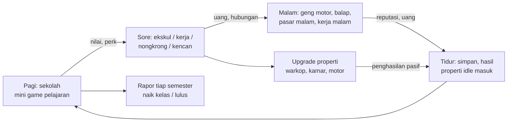

# Desain Game: "Lonceng Pulang" (judul kerja)

Game action + slice-of-life + romance tentang tiga tahun di SMA, di kota fiktif **Wirabumi**.
Dibangun di atas renderer voxel sprite-stacking yang sudah ada (tokoh 36 voxel, jurus pukul/tendang/pedang,
sapu, guling, motor/sepeda/mobil, rambut & peci/topi/helm).

> Status: dokumen desain, belum ada kode game. Semua nama, tokoh, sekolah, kota, dan geng di sini fiktif dan
> dibuat khusus untuk game ini.

## Isi dokumen

| File | Isi |
|---|---|
| [01-cerita.md](01-cerita.md) | Premis, alur kelas X sampai XII per bab, cabang cerita, dan 6 ending |
| [02-karakter.md](02-karakter.md) | Tokoh utama, 5 sahabat, 6 tokoh romance, rival, guru, geng motor |
| [03-sistem.md](03-sistem.md) | Jadwal harian, mini game pelajaran, nilai & kenaikan kelas, berantem, geng, mini game luar, kerja sampingan, properti, hal-hal yang bikin nagih |
| [04-peta.md](04-peta.md) | Peta kota 7 wilayah, 4 denah wilayah, denah sekolah, daftar lokasi, urutan pembangunan |
| [05-bangunan.md](05-bangunan.md) | Gaya, warna (kode hex), bentuk, ukuran, dan detail setiap bangunan & tipe rumah per wilayah |
| [06-event.md](06-event.md) | Event harian, mingguan, sekolah, kalender tahunan, acak, sosial, geng, usaha, rahasia, dan ulang tahun tokoh |
| [karakter/](karakter/README.md) | Kartu 34 tokoh: sprite voxel (dirender dari renderer asli), portrait, baju, gerak khas, jadwal; plus `npc_styles.js` |
| [guide/](guide/00-ringkasan.md) | **Guide desain lengkap** (30 segmen): 16 NPC utama romanceable, NPC pendukung & pengisi, sistem hati, obrolan, konsekuensi, pelajaran, upgrade, keuangan, animasi. `guide/_artifact/index.html` = semua segmen dalam satu halaman |
| [peta/](peta/) | Peta kota, 4 denah wilayah, denah sekolah & lantai (PNG) dan skrip `peta_organik.py` + `buat_peta.py` untuk menggambar ulang |

## Pitch satu paragraf

Kamu anak kampung yang pindah ke Wirabumi untuk tinggal bersama Om Darto, pemilik warkop kecil yang terlilit utang.
Siang hari kamu siswa baru di SMA Negeri 3 Wirabumi: ikut pelajaran lewat mini game, cari teman, naksir orang, dan
bertahan dari kakak kelas yang suka cari masalah. Sore dan malam kamu cari uang (kopi keliling, jaga warung, ojek, bengkel)
untuk membesarkan warkop Om, dan pelan-pelan masuk ke dunia klub motor "Lampu Kota". Dalam tiga tahun kamu harus naik kelas,
lulus, menyelamatkan sekolah dari penggusuran, dan memutuskan mau jadi orang seperti apa.

## Pilar desain

1. **Hari yang padat pilihan.** Tiap hari dibagi Pagi (sekolah), Sore, dan Malam. Waktu terbatas memaksa pilihan:
   belajar, kerja, pacaran, atau nongkrong sama geng.
2. **Sekolah itu game, bukan menu.** Pelajaran = mini game 1-2 menit. Hasilnya jadi nilai rapor dan juga membuka kemampuan
   di dunia luar (contoh: nilai Fisika tinggi = lemparan lebih jauh).
3. **Uang punya tujuan.** Uang dipakai untuk upgrade properti yang terlihat berubah di dunia (gerobak jadi warung tenda jadi
   kafe), dan properti menghasilkan uang walau pemain sedang sekolah (sisi idle game).
4. **Pilihan punya akibat.** Bolos, berantem, ikut balap liar, atau setia ke teman mengubah reputasi, hubungan, dan ending.
5. **Kota yang hidup.** NPC punya jadwal, ada hujan, pasar malam, hari besar, dan gosip yang menyebar.

## Loop utama

## Panjang permainan (target)

- 3 tahun ajaran x 2 semester = 6 semester. Satu semester = 6 minggu dalam game (30 hari sekolah + akhir pekan).
- Satu hari dalam game kira-kira 12-18 menit main. Total cerita utama sekitar 25-35 jam, lebih kalau mengejar semua romance,
  properti maksimal, dan koleksi.

## Bahasa & nada

Bahasa Indonesia sehari-hari, gaya anak SMA (gue/lu di kota, aku/kamu dengan guru dan tokoh tertentu). Nada: lucu dan hangat,
ada momen sedih, aksi dibuat seru tapi bukan sadis (lawan pingsan/kabur, tidak ada darah).
