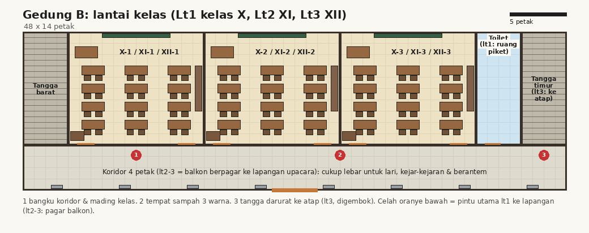
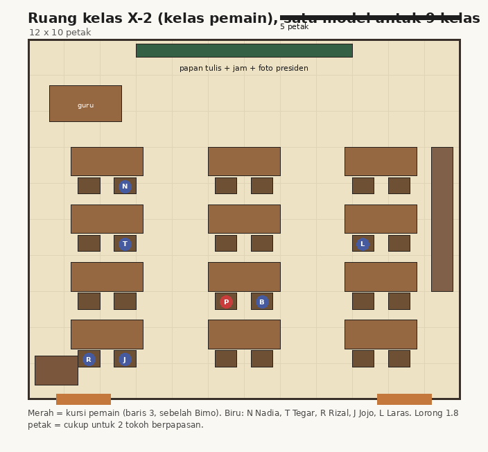
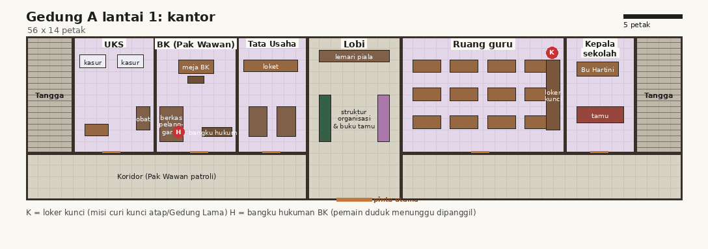
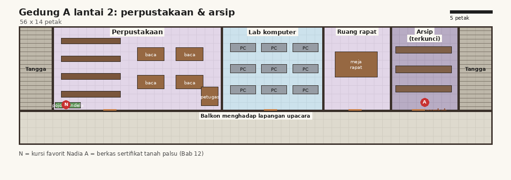
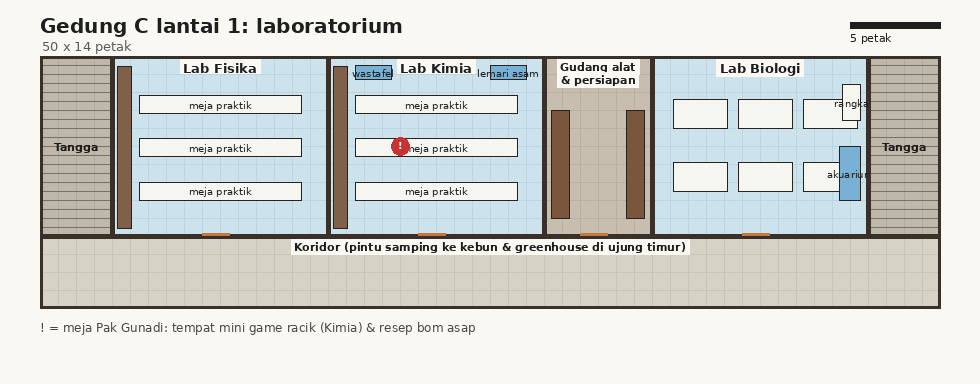
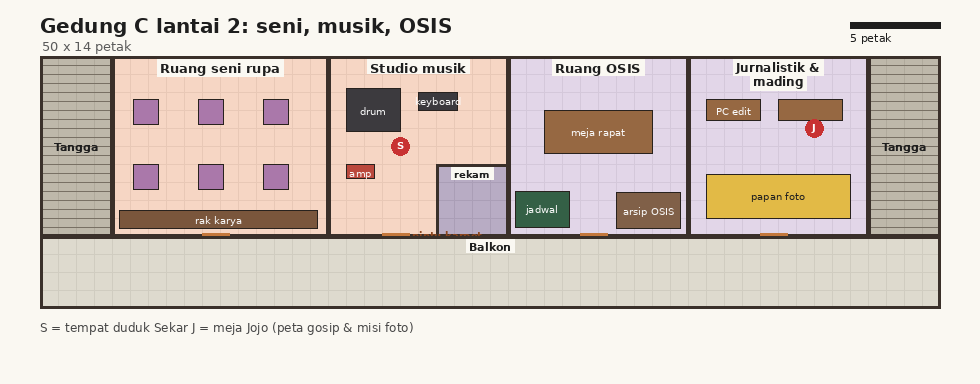
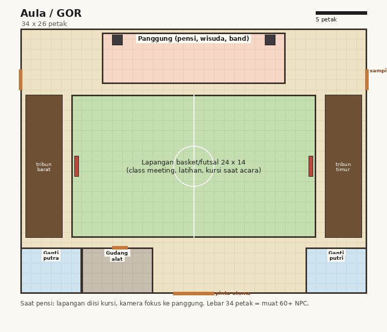
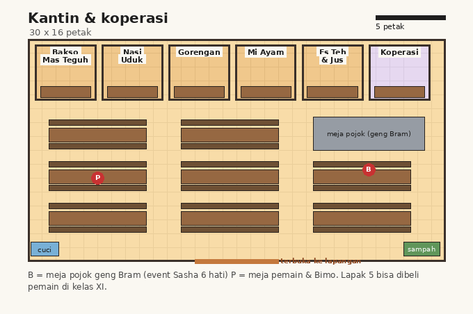
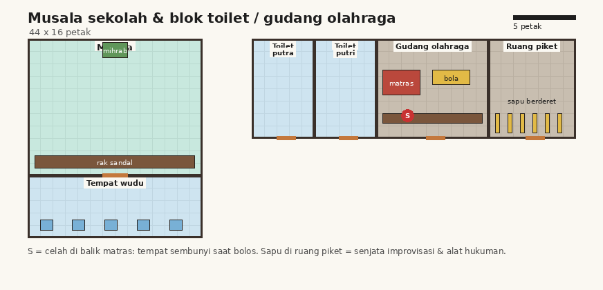
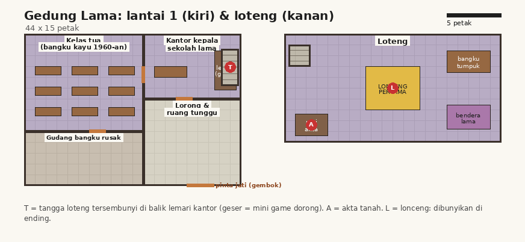

# 81. Interior Sekolah

Sekolah adalah tempat pemain menghabiskan separuh waktunya, jadi interiornya dibuat **lebih luas dari bentuk luarnya**.
Ini disengaja: luar gedung dijaga proporsional supaya kota tetap rapat, sedangkan dalam gedung diberi ruang untuk berjalan,
ngobrol, kejar-kejaran, berantem, dan sembunyi.

> Aturan ini **mengganti** saran lama di `04-peta.md` ("atap dilepas di tempat"). Semua gedung sekolah sekarang memakai
> **scene interior terpisah**: masuk pintu = layar memudar 0.3 detik, pemain muncul di pintu yang sama di scene dalam.

## Aturan ukuran untuk gameplay

| Unsur | Ukuran | Alasan gameplay |
|---|---|---|
| Tokoh | Tinggi ±1.1 petak, tapak ±0.6 petak | Dasar semua ukuran |
| Lorong antar meja | 1.6-1.8 petak | Dua tokoh bisa berpapasan, pemain bisa menyelinap saat bolos |
| Koridor gedung | **4 petak** | Lari, kejar-kejaran Pak Wawan, berantem 1 lawan 3 tanpa macet |
| Pintu ruang | 1.5 petak (pintu utama 3-4) | Satu tokoh lewat dengan nyaman; pintu utama muat rombongan |
| Ruang kelas | **12 x 10** | 24 kursi (12 meja ganda), ruang depan untuk guru & mini game di papan |
| Lab / ruang khusus | 10-12 x 10 | Meja praktik besar untuk mini game |
| Tangga | 4 x 10 di tiap ujung | Pindah lantai = pindah scene lantai (fade singkat) |
| Arena berantem minimal | 8 x 8 kosong | Keroyokan 5 lawan butuh ruang melingkar; koridor, lapangan, aula, kantin memenuhi ini |
| Kamera dalam ruang | Menampilkan ±16 x 10 petak | Ruang kelas penuh terlihat dalam satu layar |

### Ukuran luar vs dalam

| Gedung | Luar (di peta sekolah) | Dalam (scene) | Lantai |
|---|---|---|---|
| Gedung A (kantor) | 20 x 9 | 56 x 14 per lantai | 2 |
| Gedung B (kelas) | 26 x 9 | 48 x 14 per lantai | 3 + atap |
| Gedung C (lab & seni) | 6 x 20 | 50 x 14 per lantai | 2 |
| Aula / GOR | 9 x 12 | 34 x 26 | 1 |
| Kantin | 6 lapak 3 x 4 | 30 x 16 | 1 |
| Musala | 9 x 7 | 14 x 16 (dengan tempat wudu) | 1 |
| Blok toilet & gudang | 20 x 4 | 26 x 8 | 1 |
| Gedung Lama | 9 x 7 | 20 x 14 + loteng 20 x 10 | 1 + loteng |
| Pos satpam | 2 x 2 | 4 x 4 (meja, monitor CCTV, buku tamu) | 1 |

## Gedung B: ruang kelas

- Tiga lantai memakai **denah yang sama**. Lt1 = kelas X, lt2 = kelas XI, lt3 = kelas XII. Ruang kecil di ujung timur:
  lt1 ruang piket, lt2-3 toilet.
- Koridor lt2-3 adalah **balkon** yang menghadap lapangan upacara: tempat ngobrol, menguping, melihat kejadian di lapangan,
  dan melempar barang (risiko pelanggaran).
- Tangga timur lt3 punya pintu darurat ke **atap** (digembok; kunci dari Pak Ujang atau loncat dari balkon dengan risiko jatuh).
- **Atap Gedung B** (scene 48 x 12): tandon air, antena, kursi plastik bekas, tali jemuran. Tempat bolos, makan siang rahasia,
  event Sekar 4 & 8 hati. Pinggir atap ada pagar rendah (tidak bisa jatuh).

### Ruang kelas X-2 (kelas pemain)

| Bagian | Isi | Interaksi |
|---|---|---|
| Papan tulis hijau | Jam, foto presiden & wakil, jadwal piket | Mini game pelajaran memakai papan; piket menghapus papan |
| Meja guru | Absen, kapur/spidol, penggaris kayu | Mengintip nilai saat kosong (risiko), penggaris = senjata improvisasi |
| 12 meja ganda (4 baris x 3 kolom) | Tiap meja punya coretan unik | Duduk = mulai pelajaran; meja pemain bisa dicoret/dihias (kosmetik) |
| Lemari belakang (timur) | Buku paket, piala kelas | Simpan barang 5 slot |
| Rak sapu (pojok belakang) | Sapu, pengki, kemoceng | Hukuman, piket, senjata |
| Dua pintu (depan & belakang) | Pintu belakang dekat kursi belakang | Kabur diam-diam saat pelajaran (mini game mengendap) |
| Jendela utara | Pemandangan taman/kebun | Kertas/pesawat kertas bisa dilempar keluar |

Kursi tetap kelas X-2: Nadia & Tegar di depan kiri, **pemain baris 3 tengah sebelah Bimo**, Rizal & Jojo di belakang kiri,
Laras di kanan baris 2. Tiap tahun ajaran kursi diacak ulang lewat event "Tukar bangku" (pemain memilih sebelah siapa:
hati +10 per minggu dengan teman sebangku).

Kelas lain: X-1 (Uti, Sasha, Arga), X-3 (Sekar, Dimas). Variasi tiap kelas: gorden (merah/biru/hijau), poster, tanaman,
coretan papan tulis, tingkat kerapian (X-1 paling berantakan).

## Gedung A: kantor

| Ruang | Ukuran | Isi & fungsi |
|---|---|---|
| UKS | 7 x 10 | 2 kasur, lemari obat. Tempat bangun setelah pingsan; tidur siang curian (Energi +, risiko ketahuan) |
| BK (Pak Wawan) | 7 x 10 | Meja BK, lemari berkas pelanggaran, **bangku hukuman**. Dipanggil ke sini = cutscene teguran, pilihan dialog |
| Tata Usaha | 6 x 10 | Loket bayar SPP/iuran, ambil rapor, surat izin |
| Lobi | 8 x 14 | Lemari piala, struktur organisasi, buku tamu. Om Darto menunggu di sini saat dipanggil |
| Ruang guru | 14 x 10 | 12 meja guru, **loker kunci** (misi curi kunci atap/Gedung Lama), tempat menguping guru bergosip |
| Kepala sekolah | 6 x 10 | Meja Bu Hartini, sofa tamu. Event jalur legal Bab 13 |

| Ruang | Ukuran | Isi & fungsi |
|---|---|---|
| Perpustakaan | 20 x 10 | 4 deret rak, 4 meja baca, meja petugas, pojok jendela (kursi favorit Nadia). Belajar = Kecerdasan +, harus diam (bubble "Ssst") |
| Lab komputer | 12 x 10 | 9 PC. Ekskul, mengetik tugas, misi Kevin (akun palsu) |
| Ruang rapat | 8 x 10 | Rapat guru & komite; tempat menguping rencana relokasi (Bab 11) |
| Arsip | 8 x 10 | **Terkunci** sampai Bab 12. Berkas sertifikat tanah dan surat izin palsu |

## Gedung C: laboratorium, seni, OSIS

| Ruang | Ukuran | Isi & mini game |
|---|---|---|
| Lab Fisika | 12 x 10 | 3 meja praktik panjang, lemari alat, papan. "Lempar Parabola" |
| Lab Kimia | 12 x 10 | Meja praktik, lemari asam, wastafel, meja Pak Gunadi. "Racik Larutan", resep bom asap |
| Gudang alat & persiapan | 6 x 10 | Rak alat, botol. Tempat sembunyi; bahan racikan |
| Lab Biologi | 12 x 10 | 6 meja, rangka manusia, akuarium. "Bedah Daun"; pintu samping ke kebun & greenhouse |

| Ruang | Ukuran | Isi & fungsi |
|---|---|---|
| Ruang seni rupa | 12 x 10 | 6 kuda-kuda lukis, rak karya. Mini game Seni (melukis), Prakarya (Gelang Benang) |
| Studio musik | 10 x 10 | Drum, keyboard, ampli, **ruang rekam 4 x 4**. Latihan band, rhythm game, tempat duduk Sekar |
| Ruang OSIS | 10 x 10 | Meja rapat, papan jadwal, lemari arsip. Ekskul OSIS, event Nadia |
| Jurnalistik & mading | 10 x 10 | PC edit, papan foto. Meja Jojo: peta gosip, misi foto |

## Aula / GOR

- **34 x 26**: lapangan basket/futsal 24 x 14 di tengah, panggung 18 x 5 di utara, tribun kayu kiri-kanan, ruang ganti
  putra/putri, gudang alat.
- Tiga mode: **olahraga** (Penjaskes hujan, basket indoor, class meeting), **pentas** (lapangan diisi kursi, kamera fokus
  panggung: pensi, band, wisuda), **darurat** (Bab 13: warga dan siswa berkumpul, aula jadi markas aksi damai).
- Bisa jadi arena berantem besar (bos Bram fase akhir di lapangan aula saat class meeting).

## Kantin & koperasi

- **30 x 16**, terbuka ke lapangan di sisi selatan.
- 6 lapak (4.4 x 4): Bakso Mas Teguh, Nasi Uduk, Gorengan, Mi Ayam, Es Teh & Jus, Koperasi (alat tulis, benang Gelang Benang).
  Lapak ke-5 bisa dibeli pemain di kelas XI (cabang Warkop Simpang).
- 9 meja panjang bangku ganda + **meja pojok** geng Bram (meja logam, kipas angin sendiri).
- Jam istirahat: 30-40 NPC, antre di lapak (mini game antre: menyalip = reputasi Siswa -), gosip menyebar paling cepat di sini.

## Musala, toilet, gudang olahraga, ruang piket

| Ruang | Ukuran | Fungsi |
|---|---|---|
| Musala | 14 x 11 + tempat wudu 14 x 5 | Salat Zuhur & Jumat, event Ramadan, tempat tenang (Mood +) |
| Toilet putra / putri | 5 x 8 masing-masing | Tempat sembunyi bolos, ganti baju olahraga, event gosip di cermin |
| Gudang olahraga | 9 x 8 | Matras, bola, net. Celah di balik matras = sembunyi dari Pak Wawan |
| Ruang piket | 7 x 8 | Sapu berderet, pel, ember. Mulai hukuman menyapu; senjata improvisasi |

## Gedung Lama & loteng

- **Lantai 1 (20 x 14)**: kelas tua dengan bangku kayu 1960-an, kantor kepala sekolah lama, lorong & ruang tunggu, gudang
  bangku rusak. Debu, sarang laba-laba, cahaya masuk dari celah papan jendela. Musik berubah sunyi.
- **Tangga loteng tersembunyi** di balik lemari kantor lama: geser lemari (mini game dorong, butuh Kekuatan 4 atau dua orang).
- **Loteng (20 x 10)**: lonceng sekolah pertama di tengah, peti kayu berisi **akta tanah**, bangku bertumpuk, bendera lama.
  Lonceng dibunyikan di ending "Lonceng Pulang".
- Masuk sebelum Bab 12 hanya lewat event (Arga 6 hati, Pak Ujang 8 hati) atau jendela papan yang longgar (risiko pelanggaran).

## Area luar yang berfungsi seperti ruang

| Area | Ukuran | Catatan |
|---|---|---|
| Lapangan upacara | 30 x 18 | Upacara, class meeting, lomba 17-an, arena berantem terbuka |
| Lapangan basket & futsal luar | 28 x 16 | Ekskul, basket 3x3 |
| Parkiran motor | 20 x 8 | Kumpul geng saat pulang, cuci motor |
| Pohon beringin & bangku melingkar | radius 4 | Tempat nembak, nongkrong |
| Kebun & greenhouse | 12 x 8 | Misi Biologi, bahan herbal |
| Taman rahasia Arga (belakang Gedung Lama) | 6 x 5 | Bunga melati, event Arga |
| Atap Gedung B | 48 x 12 | Lihat di atas |

## Catatan teknis

- Satu **model ruang kelas** dipakai ulang 9 kali; variasi lewat warna gorden, poster, dan coretan (tekstur kecil).
- Scene interior dimuat per lantai. Pintu tangga = titik pindah scene.
- NPC punya jadwal per ruang: di luar jam, ruang kelas kosong; malam hari sekolah gelap, hanya satpam dan Pak Ujang
  yang berkeliling (misi malam: senter, mengendap).
- Benda statis (meja, kursi, rak) cocok untuk cache impostor yang sudah ada di renderer.
