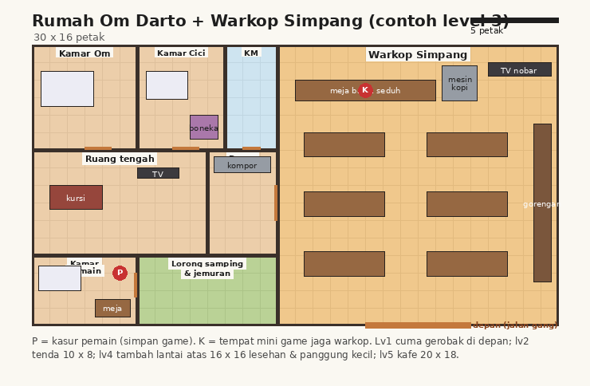
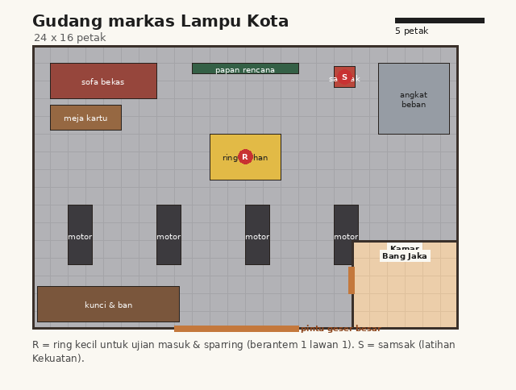
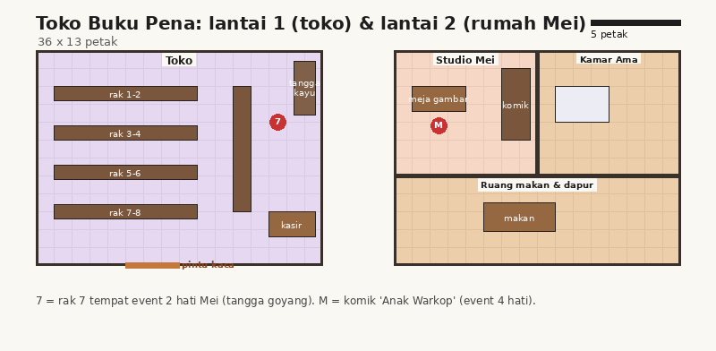
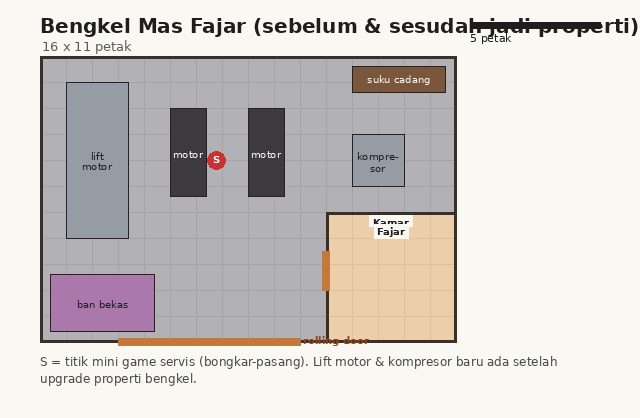

# 82. Interior Bangunan Kota

Sama seperti sekolah: interior = **scene terpisah** dan boleh lebih luas dari luarnya. Rumah NPC hanya bisa dimasuki sesuai
tahap hati (lihat `32-tempat-tinggal.md`). Bangunan yang tidak tercantum di sini cukup punya pintu dekorasi.

## Rumah Om Darto & Warkop Simpang

| Ruang | Ukuran | Fungsi |
|---|---|---|
| Kamar pemain | 6 x 4 (lv1), sampai loteng 10 x 8 (lv5) | Tidur = simpan game, belajar, buat Gelang Benang, dekorasi (lihat `60-upgrade.md`) |
| Kamar Om | 6 x 6 | Laci dengan foto Lampu Kota (event Om 4) |
| Kamar Cici | 5 x 6 | Les PR Cici, boneka, gambar keluarga |
| Ruang tengah | 10 x 6 | Telepon Ibu (video call Minggu malam), nonton TV, makan malam bersama |
| Dapur | 4 x 6 | Masak (Keterampilan), stok bahan warkop |
| Kamar mandi | 3 x 6 | Mandi = Kebersihan penuh |
| Lorong samping & jemuran | 8 x 4 | Parkir sepeda/motor, cuci motor |

**Warkop Simpang per level (bagian depan rumah):**

| Level | Ukuran dalam | Isi |
|---|---|---|
| 1 Gerobak | 4 x 3 (luar) | Gerobak, 2 kursi plastik, termos |
| 2 Warung tenda | 10 x 8 | 3 meja, bangku panjang, lampu bohlam |
| 3 Semi permanen | 16 x 16 | Meja bar & seduh, mesin kopi, TV nobar, 6 meja, rak gorengan (gambar di atas) |
| 4 Dua lantai | 16 x 16 + lantai atas 16 x 16 | Atas: lesehan, panggung kecil live music, mural Andra |
| 5 Kafe Simpang | 20 x 18 + atas | Mesin roasting, etalase kue, sudut baca, area outdoor |

## Gudang markas Lampu Kota

**24 x 16** (luar 7 x 5): sofa bekas & meja kartu, papan rencana, samsak & alat angkat beban (latihan Kekuatan), ring
latihan 4 x 2.6 (ujian masuk, sparring), deretan motor, rak kunci & ban, kamar Bang Jaka. Malam hari ramai 6-10 anggota.

## Toko Buku Pena (rumah Mei)

**Lantai 1 (16 x 12)**: 8 rak bernomor, rak tinggi, kasir, tangga kayu (event Mei 2 hati di rak 7). **Lantai 2 (16 x 12)**:
studio Mei (meja gambar, rak komik), kamar Ama, ruang makan & dapur. Lantai 2 terbuka di 4 hati Mei.

## Bengkel Mas Fajar

**16 x 11** (luar 6 x 4): titik servis, lift motor & kompresor (setelah jadi properti), rak suku cadang, tumpukan ban, kamar
Fajar. Tempat upgrade motor & sepeda.

## Bangunan lain yang bisa dimasuki

| Bangunan | Wilayah | Ukuran dalam | Isi & fungsi |
|---|---|---|---|
| Rumah Uti + garasi | Kenanga | 14 x 10 + garasi 8 x 6 | Garasi: motor Mas Danu, meja kerja, ayam Rossi di kandang belakang |
| Rumah Bimo | Kenanga | 12 x 10 | Dapur besar & gerobak bakso, kamar penuh poster masak |
| Kos Bu Narti | Kenanga | 18 x 10 (6 kamar) | Kamar kos bocor (event), teras gosip |
| Musala kampung | Kenanga | 10 x 10 | Ngaji sore, Ustaz Hasan |
| Pos ronda | Kenanga | 4 x 4 | Catur, kentongan, ronda malam |
| Rumah Sekar | Bukit Asri | 16 x 12 + loteng 10 x 8 | Loteng kamar Sekar: gitar, jendela atap (event 6 hati) |
| Rumah Sasha | Bukit Asri | 20 x 14 | Ruang tamu mewah, kamar dengan meja desain tersembunyi |
| Rumah Tegar | Bukit Asri | 18 x 12 | Kamar penuh maket & lego, ruang belajar sunyi |
| Rumah Bram | Bukit Asri | 24 x 16, 2 lantai | Ruang piano, ruang kerja Pak Haris (laci dokumen, Bab 12), gym rumah |
| Clubhouse | Bukit Asri | 18 x 12 | Pesta, kolam |
| Rumah Nadia | Pusat Kota | 14 x 10, 2 lantai | Mesin jahit ibu, kamar adik kembar, akses atap masjid lewat tangga samping |
| Kontrakan Rizal | Pusat Kota | 6 x 8 (2 petak) | Rak buku menumpuk, meja tulis, buku surat untuk ayah |
| Studio Foto Kilat | Pusat Kota | 12 x 10 + atas 12 x 10 | Studio foto (latar kain), kamar Jojo, akses atap |
| Warnet Nebula Net | Pusat Kota | 12 x 8 | 10 bilik PC, game balap Tegar, lampu neon ungu |
| Kafe modern | Pusat Kota | 12 x 10 | Saingan warkop, kencan |
| Karaoke Suara Emas | Pusat Kota | 14 x 10 (4 bilik) | Mini game ritme, kencan rame-rame |
| Pasar Wirabumi (los) | Pusat Kota | 30 x 18 | Lapak sayur, ikan, kain; lapak Laras; kios jahit Teh Lilis |
| Plaza Wirabumi | Pusat Kota | 3 lantai 30 x 20 | Lt1 toko baju & butik, lt2 food court & arkade, lt3 bioskop |
| Masjid Agung | Pusat Kota | 20 x 18 | Salat, event Ramadan, atap (event Nadia 8 hati) |
| Bank | Pusat Kota | 10 x 8 | Tabungan pelajar, ATM |
| Puskesmas / klinik | Pusat Kota | 14 x 10 | Bangun setelah kecelakaan, biaya berobat |
| Kantor polisi | Pusat Kota | 12 x 10 | Ambil motor ditahan, event Arga dijebak |
| Rumah Laras | Bantaran | 8 x 8 | Dapur nasi uduk, ibu di kasur, buku kas |
| Rumah panggung Gilang | Bantaran | 8 x 6 | Galon tabungan, gitar kentrung; banjir masuk saat event 6 hati |
| PKBM (paket C) | Bantaran | 10 x 8 | Kelas malam Gilang & Mas Fajar |
| Bengkel Wijaya Motor + rumah Kirana | Selatan | 18 x 10 + rumah 10 x 8 | Kamar Kirana: dinding puisi setelan mesin, akuarium cupang |
| Rumah nenek Andra | Selatan | 10 x 8 | Dapur jamu, kamar penuh sketsa |
| STM Karya Bangsa | Selatan | Lantai bengkel praktik 24 x 14 | Event Kirana & Andra, bentrok geng |
| Kontainer kantor proyek | Selatan | 8 x 3 | Infiltrasi Bab 12-13 (mengendap, foto dokumen) |
| Rumah dinas Pak Ujang | Kawasan Sekolah | 8 x 6 | Kunci-kunci sekolah di dinding |
| Warung Mak Iyah | Kawasan Sekolah | 8 x 6 | Tempat persembunyian bolos, gorengan "utang dulu" |

## Scene luar peta (perjalanan)

| Scene | Ukuran | Isi |
|---|---|---|
| Asrama Batalyon (Dimas) | 30 x 20 | Lapangan apel, rumah dinas, lapangan basket |
| Desa Sukamekar (Wulan) | 40 x 30 | Kebun teh berundak, rumah panggung, pendopo perguruan |
| Desa Lereng Wangi (rumah pemain) | 30 x 24 | Rumah ibu, sawah, stasiun kecil (mudik & ending) |
