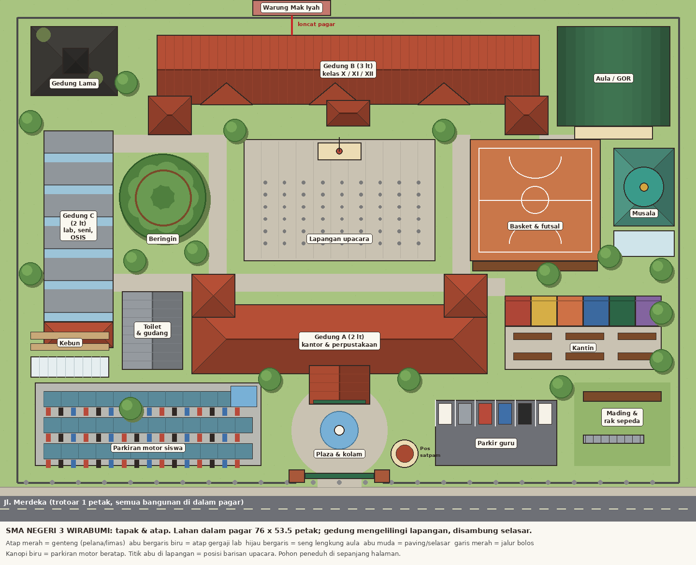
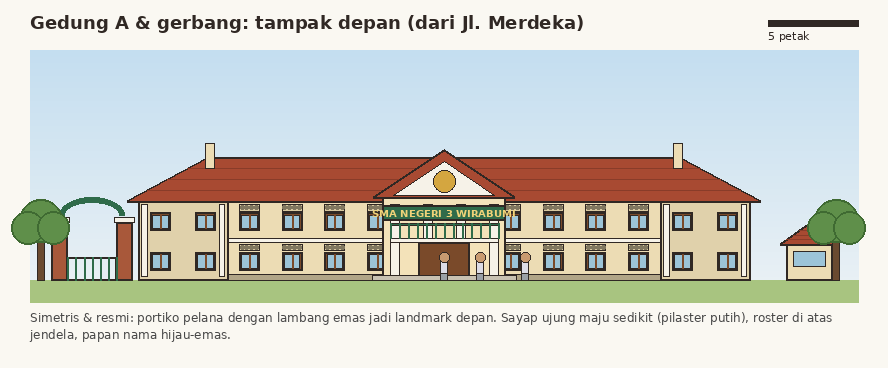
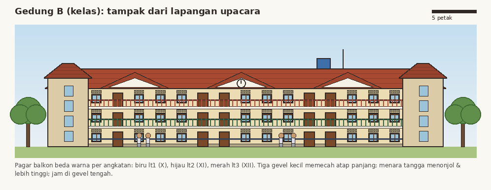
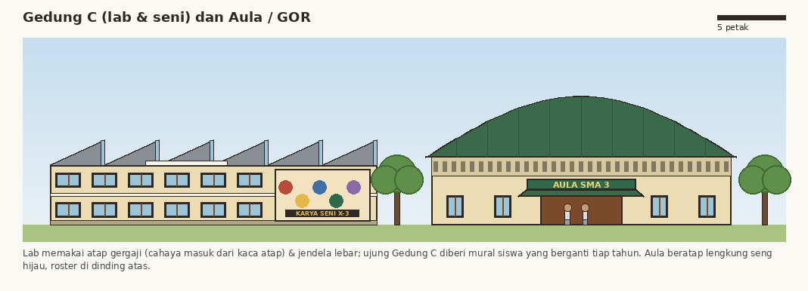
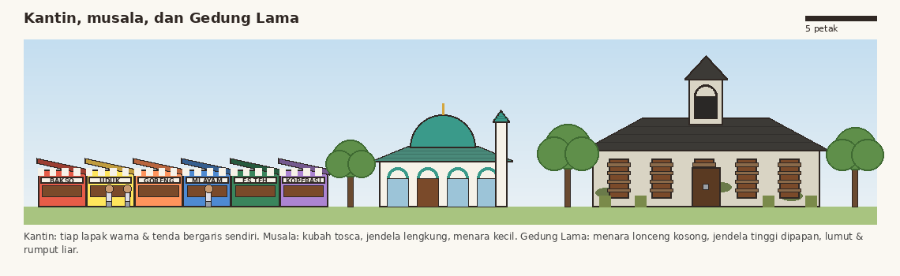

# 83. Sekolah dari Luar: Gedung, Halaman, Lapangan, Parkiran

Desain ini **mengganti** denah halaman lama (`peta_sekolah.png`, semua gedung kotak). Gedung sekarang punya bentuk dan atap
masing-masing, dan semuanya mengelilingi lapangan upacara. Jalan dan selasar tidak menembus gedung. Semua bangunan ada
**di dalam pagar**, tidak ada yang menyentuh trotoar atau Jl. Merdeka.

Gambar dibuat oleh `peta/buat_sekolah_luar.py`. Lahan di dalam pagar **76 x 53.5 petak**, ditambah trotoar 1 petak dan
Jl. Merdeka 3 petak di selatan. Tinggi 1 lantai = **2.2 petak** (70 unit voxel).

## Prinsip supaya tidak monoton

1. **Tiap gedung punya siluet atap sendiri**, jadi bisa dikenali dari jauh dan dari sudut kamera mana pun.
   - Gedung A: limas dengan portiko pelana.
   - Gedung B: limas panjang dengan 3 gevel dan menara tangga.
   - Gedung C: atap gergaji.
   - Aula: atap lengkung.
   - Musala: kubah.
   - Gedung Lama: atap gelap dengan menara lonceng.
   - Kantin: atap miring warna-warni.
2. **Denah tidak kotak**.
   - Gedung A berbentuk U.
   - Gedung B punya tonjolan menara di kedua ujung dan teras tengah.
   - Pos satpam bulat.
   - Plaza depan dan pohon beringin berbentuk lingkaran.
3. **Warna sebagai petunjuk**.
   - Pagar balkon Gedung B beda warna per angkatan.
   - Lapak kantin beda warna.
   - Pagar dan papan nama sekolah memakai hijau tua dan emas.
4. **Lapisan detail** dari jauh ke dekat:
   - Siluet atap.
   - List putih, roster, dan pilaster.
   - Jendela berkusen cokelat.
   - Benda kecil: tempat sampah, bangku, pot, sepeda.
5. **Selasar beratap** (paving abu muda, lebar 2 petak) menghubungkan semua gedung. Pemain bisa berjalan di bawah atap saat
   hujan, dan selasar membentuk "jalan" yang jelas di dalam sekolah.

## Tampak gedung

### Gedung A (kantor) & gerbang

| Unsur | Desain |
|---|---|
| Denah | Huruf U: badan 34 x 8, dua sayap 5 x 5 menjorok ke utara (memeluk lapangan), portiko 7 x 4.5 menonjol ke selatan |
| Atap | Limas genteng merah bata `#a84a32`, ventilasi kecil di kiri-kanan. Portiko pelana dengan bidang segitiga putih dan **lambang emas** |
| Fasad | Dinding krem `#ecdcb4`, list putih tiap lantai, pilaster putih di sayap, roster di atas jendela, papan nama hijau-emas di portiko, 4 tiang putih, balkon kecil hijau di lt2 portiko |
| Gerbang | Gapura dua pilar bata dengan lengkung besi hijau tua, pintu besi dorong; pilar di dalam garis pagar |
| Pos satpam | Bulat, diameter 3.2 petak, jendela kaca keliling, atap limas kecil |
| Malam | Lampu sorot ke papan nama, lampu teras portiko kuning |

### Gedung B (kelas)

| Unsur | Desain |
|---|---|
| Denah | Badan 44 x 8, **menara tangga** 5 x 4.5 di kedua ujung (menonjol ke selatan), teras tengah 5 x 3 |
| Atap | Limas panjang dipecah **3 gevel kecil** (satu per kolom kelas) menghadap lapangan; menara tangga lebih tinggi dengan atap limas sendiri; tandon air biru dan antena di atap |
| Fasad | 3 lantai, balkon menerus di lt2-3. Pagar balkon: **biru** (lt1, kelas X), **hijau** (lt2, XI), **merah** (lt3, XII), sehingga pemain langsung tahu lantai angkatan. Jam sekolah besar di gevel tengah |
| Detail | Papan nama kelas di tiap pintu, jemuran lap pel di balkon, tempat sampah 3 warna, coretan "X-2 JUARA" di dinding tangga |

### Gedung C (lab & seni) dan Aula / GOR

| Gedung | Desain |
|---|---|
| Gedung C | Memanjang 8 x 25 di barat, 2 lantai. **Atap gergaji** abu dengan kaca miring (cahaya untuk lab). Jendela lebar. Ujung selatan diberi **mural siswa** yang berganti tiap tahun ajaran (tema dipilih lewat event OSIS). Atap limas genteng kecil di ujung tangga |
| Aula / GOR | 13 x 11.5 di timur laut. **Atap lengkung** seng hijau `#3a6a4a`, roster sepanjang dinding atas, kanopi pintu hijau, papan "AULA SMA 3". Saat pensi: umbul-umbul dan lampu warna di kanopi |

### Kantin, musala, dan Gedung Lama

| Bangunan | Desain |
|---|---|
| Kantin | 6 lapak 3 x 3.5 berderet, tiap lapak beda warna (merah, kuning, oranye, biru, hijau, ungu), atap miring dan tenda bergaris putih, papan nama kecil. Di depannya pelataran paving 18 x 5 dengan meja panjang |
| Musala | 7 x 9 putih, **kubah tosca** `#3a9a8a` dengan puncak emas, menara kecil, jendela lengkung, tempat wudu 7 x 3 di selatan |
| Toilet & gudang | 7 x 9, atap pelana seng abu, pintu biru. Sengaja polos supaya tidak menarik perhatian, kecuali saat dipakai sembunyi |
| Gedung Lama | 10 x 8 di pojok barat laut. Dinding putih kusam berlumut, atap gelap `#3c3a36`, **menara lonceng** kosong, jendela tinggi ditutup papan, pintu jati bergembok, rumput liar setinggi lutut. Satu-satunya gedung tanpa lampu malam (suasana misteri) |

### Ukuran luar baru (menggantikan tabel lama di segmen 81)

| Gedung | Luar | Dalam (scene) |
|---|---|---|
| Gedung A | U 34 x 8 + sayap 5 x 5 + portiko 7 x 4.5 | 56 x 14 per lantai |
| Gedung B | 44 x 8 + menara 5 x 4.5 | 48 x 14 per lantai |
| Gedung C | 8 x 25 | 50 x 14 per lantai |
| Aula | 13 x 11.5 | 34 x 26 |
| Kantin | 18 x 8.5 | 30 x 16 |
| Musala | 7 x 9 + wudu 7 x 3 | 14 x 16 |
| Toilet & gudang | 7 x 9 | 26 x 8 |
| Gedung Lama | 10 x 8 + menara 3 x 3 | 20 x 14 + loteng |

## Halaman

| Area | Ukuran | Desain | Gameplay |
|---|---|---|---|
| **Plaza depan & kolam** | Lingkaran radius 5.5 | Paving melingkar, kolam bulat dengan air mancur kecil, dua bangku batu | Titik kumpul pagi, Om Darto menunggu, foto wisuda |
| **Jalan masuk** | 5 x 9.5 | Paving lurus dari gerbang ke portiko, pot bunga di kiri-kanan | Gerbang tutup 07.00: lari sprint dari gerbang ke kelas |
| **Selasar beratap** | Lebar 2 | Atap seng tipis bertiang besi hijau, mengelilingi lapangan dan menyambung semua gedung | Jalan saat hujan, tempat berdiri ngobrol, papan pengumuman di tiang |
| **Pohon beringin** | Radius 5 | Bangku kayu melingkar, akar gantung, coretan nama di bangku | Nongkrong, tempat nembak, bisik-bisik gosip |
| **Taman mading & rak sepeda** | 11 x 9.6 | Papan mading kaca, rak sepeda 8 slot, rumput | Misi sampingan di mading, parkir sepeda pemain |
| **Kebun & greenhouse** | 9 x 2.4 + bedeng 9 x 2.6 | Rangka besi + plastik, bedeng sayur berlabel | Misi Biologi, bahan herbal |
| **Pohon peneduh** | 16 pohon | Ketapang dan mahoni di tepi pagar dan selasar | Teduh = NPC berkumpul saat siang panas; pohon dekat pagar utara = jalur bolos |
| **Pagar** | Keliling | Tembok bata setengah + besi hijau, lampu di tiap 3 petak | Utara (belakang Gedung B) ada titik loncat ke warung Mak Iyah |

## Lapangan

| Lapangan | Ukuran | Desain | Gameplay |
|---|---|---|---|
| **Lapangan upacara** | 22 x 14 | Paving abu dengan garis sambungan, **mimbar** krem dan tiang bendera di utara (menghadap Gedung B), titik barisan 9 kolom x 6 baris | Upacara Senin (barisan per kelas), lomba 17-an, class meeting, wisuda, arena berantem terbuka yang dilihat banyak orang (reputasi berubah lebih besar) |
| **Lapangan basket & futsal** | 15 x 14 | Lantai semen cat bata `#c9774a`, garis putih, 2 ring basket + 2 gawang futsal lipat, bangku kayu panjang di selatan | Ekskul, basket 3x3, futsal saat istirahat (NPC acak bermain), event Dimas & Uti |
| **Aula (indoor)** | 24 x 14 di dalam | Lihat segmen 81 | Olahraga saat hujan, pensi |

## Parkiran

| Parkiran | Ukuran | Desain | Gameplay |
|---|---|---|---|
| **Motor siswa** | 26 x 9.6 di barat depan | 3 baris **kanopi bergelombang** biru-abu, ±48 slot motor; pojok kanan atas ada tempat cuci (keran & ember) | Parkir motor pemain (Bab 4+), modif ringan, geng berkumpul sebelum pulang, balapan "start lampu" mulai di sini, mini game cuci motor |
| **Guru** | 14 x 7.6 di timur depan | Aspal bergaris, 6 slot mobil (mobil Bu Hartini putih, Pak Hendro merah, dst.) | Menguping guru di mobil (misi gosip), Pak Wawan memeriksa motor siswa yang parkir di sini |
| **Sepeda** | Rak 8 slot di taman mading | Rak besi abu | Sepeda pemain (tahun 1) |
| **Antar-jemput** | Trotoar depan gerbang | Di luar pagar, tanpa bangunan | Pukul 06.30 dan 14.00 ramai ojek, angkot, penjual cilok |

## Siang, malam, cuaca

- **Pagi**: sinar matahari dari timur menyinari fasad Gedung A, bayangan pohon panjang, embun di rumput.
- **Siang**: NPC berkumpul di bawah pohon dan selasar. Lapangan upacara sepi kecuali ada olahraga.
- **Hujan**: semua orang berpindah ke selasar, genangan muncul di lapangan upacara (bisa terpeleset), talang meneteskan air.
- **Malam**: hanya lampu pagar, pos satpam, portiko, dan koridor yang menyala. Gedung Lama gelap. Pak Ujang berkeliling
  membawa senter.
- **Agustus**: umbul-umbul merah-putih di pagar, bendera di setiap balkon, gapura dihias bambu.
