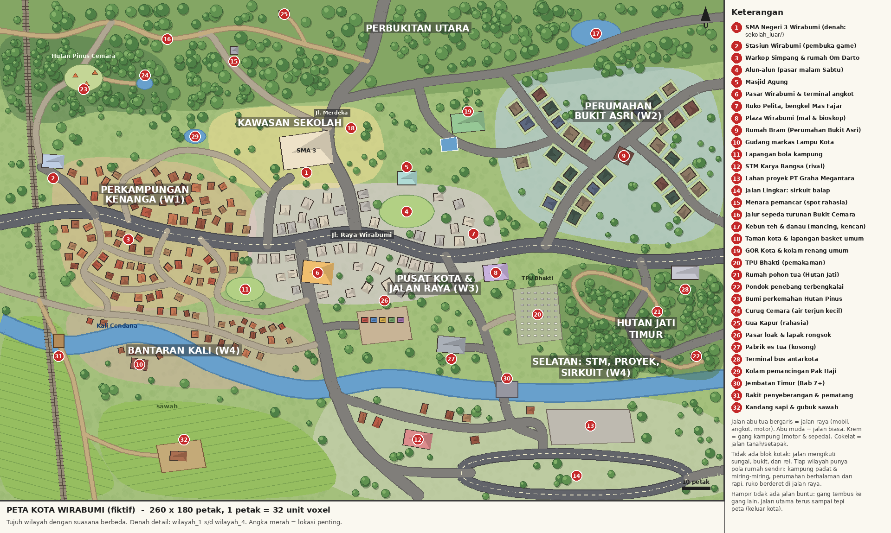

# 85. Jalan Tembus & Area Baru

Peta kota sekarang **hampir tanpa jalan buntu**. Hampir semua jalan nyambung ke jalan lain atau terus sampai ujung peta
(ujung peta = jalan keluar kota, pemain bisa fast travel ke tempat di luar peta). Lahan kosong diisi hutan, tempat
nongkrong, dan tempat yang menyimpan kait cerita. Nomor di bawah sama dengan nomor penanda di peta kota.

## Aturan jalan

| Aturan | Isi |
|---|---|
| Tidak ada jalan buntu | Setiap jalan berakhir di jalan lain, di tempat tujuan yang jelas (curug, gua, rumah pohon), atau di ujung peta |
| Ujung peta = keluar kota | Jalan yang menyentuh tepi peta memunculkan pilihan "Keluar kota" (fast travel ke Desa Sukamekar, Asrama Batalyon, kota sebelah) |
| Variasi lebar | Jalan raya 3 petak, jalan biasa 2, gang 1-1.2, setapak 0.6 (motor hanya bisa lewat setapak dengan pelan) |
| Jalan pintas | Setiap wilayah punya minimal 2 jalan tikus ke wilayah tetangga. Jalan tikus dipakai saat dikejar polisi atau geng |
| Buntu yang disengaja | Hanya cul-de-sac Perumahan Bukit Asri (memang desain kompleks elite) dan ujung setapak di depan tempat tujuan |
| Jalan yang dibuka belakangan | Jembatan Timur (30) baru dibuka Bab 7. Sebelumnya dipalang dan dijaga satpam proyek |

## Area hutan

| Area | Isi | Fungsi |
|---|---|---|
| **Hutan Jati Timur** | Pohon jati rapat, jalan tanah ke tepi timur, setapak memutar, rumah pohon, pondok penebang | Tempat kabur, balap trail, rahasia cerita. Lahan yang diincar proyek developer (Bab 11-13) |
| **Hutan Pinus Cemara** (barat laut) | Pinus jarang, bumi perkemahan, curug, gua kapur | Kemah Pramuka, kencan, misi malam, uji nyali |

Siang hari terang dan aman. Malam hari gelap: perlu senter HP, suara jangkrik dan burung hantu, kadang ada geng
Serigala Besi nongkrong. Pemain yang tersesat > 3 menit di hutan malam mendapat status `takut` (stamina turun pelan).

## Tempat baru dan kait cerita

| No | Tempat | Kegiatan bebas | Kait cerita |
|---|---|---|---|
| 19 | GOR Kota & kolam renang umum | Latihan basket, renang (stamina +), tonton turnamen, kerja paruh waktu jaga loket | Final basket antar-SMA Dimas (Bab 6). Event renang dengan Uti. Tribun GOR tempat Tegar menangis setelah ranking turun |
| 20 | TPU Bhakti | Ziarah tiap Kamis sore, bersihkan makam (karma +) | Makam ibu Laras; pemain bisa menemani (event hati Laras 4). Malam Jumat: uji nyali Jojo & Gilang |
| 21 | Rumah pohon tua (Hutan Jati) | Tempat menyendiri, simpan barang di peti | Dibangun Bram dan Arga waktu kecil, sebelum keluarga mereka berpisah jalan. Ditemukan Bab 5; kunci jalur penebusan Bram |
| 22 | Pondok penebang terbengkalai | Berteduh, tidur siang (energi +) | Di Bab 12 pemain menemukan patok dan peta proyek palsu di sini. Bukti untuk gugatan Bab 13 |
| 23 | Bumi perkemahan Hutan Pinus | Api unggun, masak, berkemah sabtu malam | Kemah Pramuka kelas X (Bab 3): jurit malam, pasangan acak, cerita hantu. Kencan api unggun 6 hati |
| 24 | Curug Cemara | Berenang, foto, memancing | Tempat Sekar menulis lagu. Mei melukis di batu besar. Spot kencan tingkat tinggi |
| 25 | Gua Kapur | Jelajah gua dengan senter, cari batu kristal (bisa dijual) | Lukisan dinding tua yang dicari Andra untuk mural besarnya. Misi opsional "Suara di dalam gua" (ternyata kelelawar dan radio rusak) |
| 26 | Pasar loak & lapak rongsok | Beli barang bekas murah, jual barang temuan, cari suku cadang | Uti mencari karburator langka. Gilang menjual papan skate rakitan. Tempat informan geng jual kabar |
| 27 | Pabrik es tua (kosong) | Markas cadangan, latihan berantem, coretan mural | Arena tanding gelap antar geng (Bab 8). Andra melukis mural pertama di dinding luarnya |
| 28 | Terminal bus antarkota | Pulang-pergi luar kota, kerja angkut barang | Kakak Kirana pulang dari perantauan (Bab 9). Ending tertentu: tokoh pergi naik bus dari sini |
| 29 | Kolam pemancingan Pak Haji | Mini game mancing, lomba mancing minggu pagi | Ayah pemain dan Pak Haji teman lama; obrolan tentang masa muda ayah |
| 30 | Jembatan Timur (Bab 7+) | Jalan pintas ke ruko & STM | Dibangun developer ayah Bram. Diresmikan Bab 7; retak di Bab 12 jadi bukti proyek asal-asalan |
| 31 | Rakit penyeberangan & pematang | Naik rakit (bayar 2 ribu), jalan pematang sawah | Jalur kabur rahasia Kampung Bantaran ke selatan. Laras jualan pagi lewat sini |
| 32 | Kandang sapi & gubuk sawah | Kerja angon sapi, istirahat di gubuk | Nenek Andra punya 3 sapi. Event Idul Adha. Gubuk tempat Andra & pemain ngobrol soal masa depan |

## Kejadian acak di area baru

| Tempat | Kejadian | Peluang |
|---|---|---|
| Hutan Jati | Truk kayu ilegal lewat malam hari; pemain bisa memotret (bukti +1) | 15% malam |
| Hutan Pinus | Rombongan pendaki tanya jalan; antar mereka = uang tip | 20% sabtu-minggu |
| TPU | Penjaga makam cerita legenda kota | 10% |
| Pasar loak | Barang langka muncul (kaset band lama, kamera analog) | 5% per kunjungan |
| Terminal | Copet; kejar = event berantem kecil | 10% |
| Curug | NPC acak berenang; bisa bertemu tokoh utama yang sedang libur | 25% minggu |

## Prioritas pembuatan

1. Jalan tembus dan ujung peta (wajib sebelum uji jalan-jalan bebas).
2. Hutan Jati Timur, rumah pohon, pondok (terikat cerita utama).
3. TPU, GOR, bumi perkemahan, curug (event hati).
4. Sisanya (pasar loak, pabrik es, terminal, kolam, kandang) sebagai isi kota bebas.
