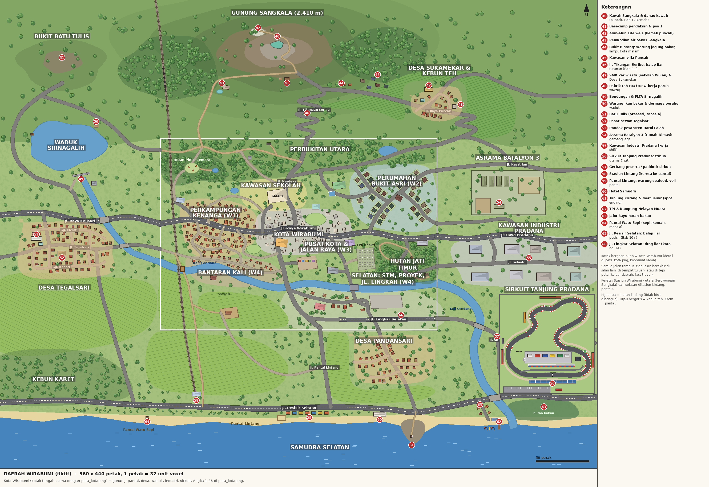

# 86. Peta Daerah Wirabumi (peta besar)

Peta sekarang bukan cuma kota. Kota Wirabumi (260 x 180 petak) jadi bagian tengah dari **daerah 560 x 440 petak**:
gunung di utara, pantai di selatan, waduk dan desa di barat, asrama batalyon, kawasan industri dan sirkuit resmi di timur.
Tempat yang dulu "luar peta" (Desa Sukamekar rumah Wulan, Asrama Batalyon rumah Dimas) sekarang bisa didatangi langsung.

## Aturan koordinat (penting untuk game)

| Aturan | Isi |
|---|---|
| Koordinat kota tidak berubah | Kota tetap di x 0..260, y 0..180. Semua bangunan kota di game tidak perlu digeser |
| Daerah baru | x -150..410, y -130..310. Utara & barat memakai koordinat negatif |
| Batas kota | Garis putih di peta. Di game tidak ada tembok: jalan kota langsung nyambung ke jalan luar |
| Skala | 1 petak = 32 unit voxel (sama). Jarak & tinggi gunung dipadatkan (skala game, bukan skala nyata). Peta besar digambar 4 px/petak, peta kota 6 px/petak |
| Sumber | `peta/peta_dunia.py` memanggil isi kota yang sama dengan `peta_kota()` (seed sama), lalu menambah daerah luar |
| Jalan buntu | Tetap aturan segmen 85: semua jalan tembus ke jalan lain, ke tujuan, atau ke tepi peta (keluar daerah = fast travel) |

## Wilayah baru

| Wilayah | Letak | Suasana | Isi utama |
|---|---|---|---|
| **Gunung Sangkala** (2.410 m) | Utara, x 0..230, y -130..-30 | Dingin, kabut, sepi | Kawah & danau kawah (40), basecamp pendakian (41), Alun-alun Edelweis (42), hutan lindung |
| **Jl. Tikungan Seribu & Bukit Bintang** | Lereng selatan gunung | Jalan serpentin, lampu kota di bawah | Warung jagung bakar (44), villa (45), rute balap liar turunan (46) |
| **Desa Sukamekar & kebun teh** | Timur laut, x 150..330, y -60..0 | Hijau, pagi berkabut | SMK Pariwisata & rumah Wulan (47), pabrik teh tua (48), kebun teh luas |
| **Bukit Batu Tulis** | Barat laut | Batu besar, misterius | Prasasti (51, rahasia), jalan tanah keliling |
| **Waduk Sirnagalih** | Barat, x -125..-50, y -15..30 | Danau besar, angin | Bendungan & PLTA (49), dermaga perahu & warung ikan bakar (50). Sungainya jadi hulu Kali Cendana |
| **Desa Tegalsari** | Barat, x -128..-45, y 79..128 | Kampung padat bergang | Pasar hewan (52), pesantren (53), Gg. Melati (utara) & Gg. Kenari (selatan) + 5 gang penghubung, sawah luas di selatannya, kebun karet lebih jauh |
| **Asrama Batalyon 3** | Timur, x 292..362, y 30..72 | Rapi, disiplin | Rumah Dimas, barak, lapangan apel, lapangan tembak, gerbang jaga (54) |
| **Kawasan Industri Pradana** | Timur, x 282..404, y 96..138 | Pabrik, truk, shift malam | Kerja shift (55), jalan lebar sepi malam |
| **Sirkuit Tanjung Pradana** | Tenggara, x 318..408, y 146..240 | Ramai saat event | Sirkuit resmi lengkap (56-57), lihat segmen 87 |
| **Desa Pandansari** | Selatan kota, x 182..258, y 186..230 | Rumah desa, sawah di barat & selatan | Jalan desa ke pantai + 3 gang |
| **Pantai selatan** | Seluruh tepi selatan, y 250..290 | Ombak, angin, warung | Stasiun Lintang (58), Pantai Lintang (59), Hotel Samudra (60), Tanjung Karang & mercusuar (61), TPI & kampung nelayan (62), hutan bakau (63), Pantai Watu Sepi (64) |

Nomor dalam kurung = penanda di peta daerah. Nomor 1-36 ada di peta kota.

## Akses: cara ke mana-mana

| Cara | Rute | Buka |
|---|---|---|
| Jalan kaki / sepeda | Semua jalan & setapak. Gunung hanya lewat setapak pendakian | Bab 1 (kota), Bab 2 (luar kota) |
| Motor | Semua jalan kecuali setapak pendakian & jalur kayu bakau | Setelah punya motor (Bab 3) |
| Angkot biru (Terminal Pasar) | Kota ke Pantai Lintang lewat Jl. Pantai Lintang; kota ke Kawasan Industri & sirkuit (hari event) | Bab 2, Rp 4.000 |
| Bus antarkota (Terminal Timur, no. 28) | Ke Desa Sukamekar (Jl. Raya Puncak), ke Kalisari (barat), ke Pradana (timur) | Bab 2, Rp 10.000, tiap 2 jam |
| Kereta | Stasiun Wirabumi ke Stasiun Lintang (pantai), dan ke utara lewat terowongan (keluar daerah: mudik ke Desa Lereng Wangi) | Bab 2, Rp 5.000 |
| Perahu | Dermaga waduk (keliling waduk), dermaga TPI (ikut nelayan subuh) | Bab 4 |
| Fast travel | Jalan yang menyentuh tepi peta daerah = keluar daerah (Kalisari, Pradana, Lereng Wangi) | Kapan saja, pakai waktu 1-3 jam game |

### Batas akses tempat tertentu

| Tempat | Syarat masuk |
|---|---|
| Puncak & kawah | Daftar di basecamp (Rp 15.000), tidak boleh naik sesudah 15.00. Kemah puncak hanya event (Bab 12) atau Sabtu malam dengan 1 teman |
| Asrama Batalyon | Gerbang jaga: masuk hanya bersama Dimas (hati 4+) atau event (lari subuh, 8 hati). Masuk paksa = ditangkap, reputasi turun |
| Kawasan Industri | Kerja shift umur 16+, Bab 4. Malam hari jalan industri sepi: tempat geng nongkrong |
| Hutan lindung | Bebas siang. Malam: status `takut`, bisa tersesat. Tidak bisa membangun/menebang |
| Pantai | Bebas. Dilarang berenang lewat tanda merah (ombak besar): pemain terseret, pingsan, bangun di pos SAR |
| Sirkuit | Lihat segmen 87 |

## Bangunan in-game yang sekarang ada di peta

Peta kota disesuaikan dengan yang sudah dibangun di game 3D:

| No | Di game | Di peta |
|---|---|---|
| 33 | Gerbang Perumahan Bukit Asri: gapura, pos satpam, portal naik-turun | Mulut jalan perumahan dari Jl. Raya |
| 34 | Gapura Gang Kenanga | Mulut gang utama kampung dari Jl. Raya |
| 35 | Musala kampung | Tengah Perkampungan Kenanga |
| 36 | Ruko 2-3 lantai, Indomurah + parkiran, bank kaca + ATM, hotel melati/kos, lahan parkir, parkir liar & tukang parkir | Sepanjang Jl. Raya & Jl. Merdeka di pusat kota |
| 6 | Terminal angkot + halte di depan pasar | Sudah di penanda pasar |
| 11, 18 | Lapangan bola kampung (main bola) & lapangan basket umum (basket 3x3) | Sudah ada |
| 19 | GOR + kolam renang | Detail baru di segmen 89 |
| 14 | Sirkuit lingkaran dihapus | Diganti Jl. Lingkar Selatan lurus (balap liar) + sirkuit resmi di timur (segmen 87) |

## Catatan untuk game 3D

- Jalan, sungai, rel, area, bangunan, dan pohon daerah luar dicatat dengan cara yang sama seperti kota, jadi
  `tools/export_kota.py` bisa diperluas untuk menjalankan `peta_dunia()` (atau fungsi isinya) dan menambah data luar kota.
- Jalan lingkaran tertutup (sirkuit lama) sudah tidak ada di `peta_kota()`. Kode yang mencari `roads.find(r => r.closed)`
  tidak akan menemukan apa-apa; sirkuit baru punya titik lintasan sendiri (`TRACK` dan `PIT` di `peta_dunia.py`).
- Gunung digambar sebagai kontur bertingkat: di game bisa jadi tanah naik bertahap (tiap kontur +2..4 petak).

## Tata ruang luar kota (revisi): bangunan, air, desa, tanjakan

Aturan segmen 90 (jarak dari jalan, menghadap jalan, akses, parkir di dalam kavling) berlaku juga di luar kota.

### Rumah desa

- Rumah desa **tidak lagi ditebar acak**. Semua rumah ditaruh di sepanjang jalan atau gang. Sisi panjang rumah sejajar jalan
  dan pintunya menghadap jalan terdekat.
- Jarak dari tepi aspal: 1-1,3 petak di gang kampung dan 1,4-2,4 petak di jalan desa. Antar rumah 0-0,5 petak di gang
  (kampung padat) dan 0,6-1,6 petak di jalan desa.
- Sawah, kebun teh, dan sungai tidak ditimpa rumah. Kebun teh Sukamekar sekarang berbentuk U yang mengelilingi desa,
  dan sawah Pandansari ada di barat dan selatan desa.
- **Tegalsari** (kampung paling padat di luar kota) punya 6 jalur:
  - Jl. Tegalsari (jalan utama)
  - Gg. Melati, sejajar di utaranya
  - Gg. Kenari, sejajar di selatannya
  - 5 gang pendek yang menyambungkan ketiganya

  Pesantren pindah ke (-116, 94) dan masjidnya ke (-112, 99), keduanya menghadap Jl. Tegalsari.
- Kampung nelayan berjajar di dua sisi jalan TPI. TPI dan dermaga pindah ke barat muara.

### Jalan vs sungai dan danau

| Kasus | Aturan | Contoh di peta |
|---|---|---|
| Jalan menyeberang sungai | Wajib jembatan (`m.jembatan`). Panjang dek = lebar sungai + 4 petak, lebar dek = lebar jalan + 1,2 petak, pagar di dua sisi | Jl. Raya Kalisari & Jl. Tegalsari (sungai bendungan), Jl. Sirkuit & Jl. Pesisir Selatan (Kali Cendana) |
| Jalan di tepi danau | Badan jalan minimal 4 petak dari garis air, tidak boleh memotong danau | Jalan keliling Waduk Sirnagalih lewat sisi barat. Jalan waduk utara digeser ke utara |
| Setapak ke kolam / danau kawah | Berhenti atau memutar di tepi, tidak menembus air | Setapak air panas, jalur pendakian memutar danau kawah |
| Bangunan dekat air | Tidak boleh di atas air, kecuali dermaga, bendungan, dan mercusuar | Dermaga waduk, dermaga TPI |

Semua jembatan dicatat di `m.bridges` (x, y, sudut, panjang, lebar, nama jalan). `peta_dunia()` mengembalikan `m`, jadi
skrip ekspor game cukup menyalin `m.bridges`. Persilangan jalan dan sungai dicari otomatis, jadi kalau jalan atau sungai
digeser, jembatannya ikut pindah.

### Tanjakan jalan pegunungan

Kontur gunung memberi tinggi dasar. Di jalan pegunungan, tanjakan dibuat lebih terasa dengan target tinggi berikut
(tinggi relatif terhadap jalan kota, dalam petak):

| Titik | Tinggi |
|---|---|
| Kaki Jl. Tikungan Seribu (138, 0) | 0 |
| Tikungan ke-4 (128, -23) | +10 |
| Bukit Bintang / ujung serpentin (152, -46) | +22 |
| Basecamp (128, -62) | +26 |
| Pertigaan Jl. Raya Puncak (250, -28) dan Desa Sukamekar | +16 (Jl. Raya Puncak dari batas kota diberi 3 kelokan di x 272..296, panjangnya ~120 petak supaya tanjakan 18% cukup) |
| Alun-alun Edelweis dan kawah | +40 (setapak saja) |

- Kemiringan maksimum:
  - jalan pegunungan (Tikungan Seribu, Raya Puncak, jalan desa ke timur) 18%
  - setapak pendakian 35%
  - jalan lain tetap 10%
- Di tikungan tajam serpentin, buat bagian datar kira-kira 3 petak supaya motor bisa berbelok.
- Pinggir jalan pegunungan diberi tebing di sisi atas dan pagar atau batu di sisi jurang.

### Rumput dan tanah

Rumput dibuat bertingkat supaya tidak datar:

- tekstur dasar dengan variasi warna
- rumpun rumput pendek (tinggi 0,2-0,4 petak) yang rapat di tepi jalan, pagar, dan kaki bangunan
- ilalang tinggi (0,6-1 petak) di lereng, tepi sungai, dan lahan kosong
- bunga liar sesekali

Rumput dibuat lebih rapat di lereng gunung. Di jalan tanah, setapak, dan halaman yang sering diinjak, rumputnya menipis.
