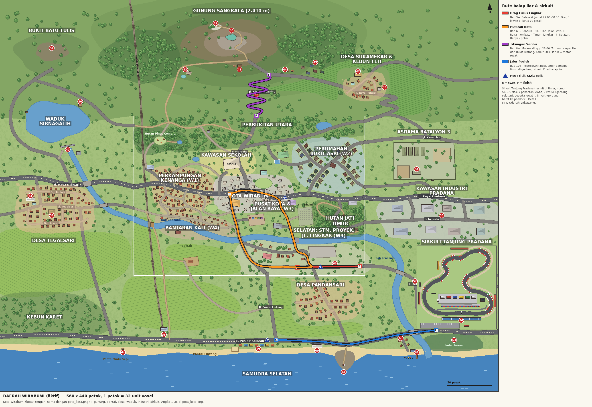
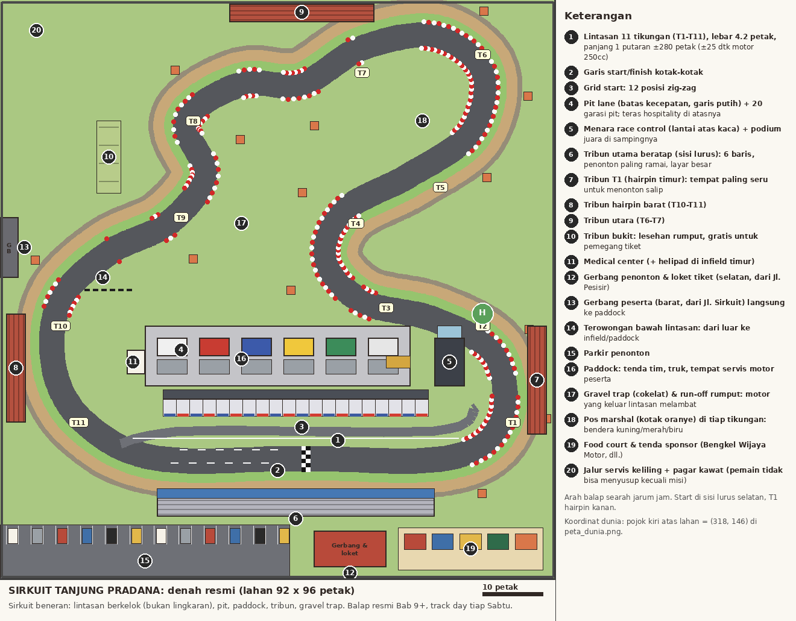

# 87. Sirkuit Resmi & Balap Liar

Sirkuit lingkaran di Jalan Lingkar dihapus. Sekarang ada dua dunia balap yang terpisah:

- **Sirkuit Tanjung Pradana**: sirkuit beneran di timur daerah, lengkap dengan lintasan berkelok, pit, paddock, dan tribun.
  Balap resmi, aman, ada hadiah dan sponsor.
- **Balap liar**: tetap di jalan umum, malam hari, taruhan, razia polisi. Empat rute dengan tingkat kesulitan naik.

## Sirkuit Tanjung Pradana

| Bagian | Isi | Gameplay |
|---|---|---|
| Lintasan | 11 tikungan, lebar 4.2 petak, ±280 petak per putaran, searah jarum jam | Balap 3-5 lap. Garis balap ideal ditandai kerb merah-putih |
| Start/finish & grid | Lurus selatan, 12 posisi grid zig-zag | Posisi start dari hasil kualifikasi (1 lap waktu terbaik) |
| Pit lane & 20 garasi | Sejajar lurus utama, batas kecepatan | Masuk pit = ganti ban / isi bensin di balap 5 lap. Ngebut di pit = penalti 5 detik |
| Paddock | Tenda tim, truk, area servis | Upgrade & setel motor sebelum balap; ngobrol dengan pembalap lain (Kirana, Uti, Kobar) |
| Menara race control & podium | Pojok timur paddock | Cutscene podium juara 1-3, foto Jojo masuk mading |
| Tribun utama (beratap, 6 baris) | Sisi lurus selatan | NPC penonton paling ramai, layar besar, teman pemain duduk di sini |
| Tribun T1, hairpin barat, utara | Di tikungan tajam | Spot nonton salip; event kencan "nonton balap" |
| Tribun bukit (lesehan rumput) | Infield barat | Gratis dengan tiket; geng nongkrong |
| Gravel trap & run-off | Luar tiap tikungan | Keluar lintasan = melambat; terlalu cepat di tikungan = jatuh |
| Pos marshal | Tiap tikungan | Bendera kuning (hati-hati), merah (balap dihentikan), biru (beri jalan) |
| Medical center & helipad | Ujung barat paddock & infield timur | Jatuh berat = scene perawatan, bukan game over |
| Food court & tenda sponsor | Dekat gerbang selatan | Beli makan, merchandise, ketemu sponsor (Bengkel Wijaya Motor) |

### Akses sirkuit

| Akses | Lewat | Syarat | Jam |
|---|---|---|---|
| **Penonton** | Gerbang selatan + loket, dari Jl. Pesisir Selatan; parkir penonton | Tiket Rp 25.000 (event), tribun utama Rp 50.000 | Minggu event 08.00-16.00 |
| **Peserta** | Gerbang barat langsung ke paddock, dari Jl. Sirkuit (lanjutan Jl. Lingkar Selatan) | Terdaftar di tim/klub | Hari balap 06.00 |
| **Track day** (latihan bebas) | Gerbang barat | Rp 75.000, motor minimal level 2, helm full-face + jaket | Sabtu 07.00-11.00, Bab 5+ |
| **Liga resmi** | Gerbang barat | Masuk tim Bengkel Wijaya Motor (ayah Kirana) setelah event Bab 9; SIM C | Seri tiap 2 minggu, Bab 9+ |
| **Infield** | Terowongan bawah lintasan | Gelang peserta / panitia | Saat event |
| **Menyusup** | Jalur servis + pagar kawat | Hanya misi (mis. ambil bukti, kejar orang) | Malam |

Transport: motor sendiri; angkot "Kota - Sirkuit" hanya hari event dari Terminal Pasar; bus tim untuk liga resmi.

## Balap liar (jalan umum)

| Rute | Jalan | Format | Buka | Jadwal |
|---|---|---|---|---|
| **Drag Lurus Lingkar** (merah) | Jl. Lingkar Selatan, lurus ±70 petak | Drag 1 lawan 1, start dari lampu senter | Bab 3 | Selasa & Jumat 22.00-00.30 (jadwal Kirana) |
| **Putaran Kota** (oranye) | Jl. Raya - Jembatan Timur - Jl. Lingkar - Jl. Selatan, kembali ke Jl. Raya | 3 lap lawan 3 pembalap, lalu lintas sepi tapi ada | Bab 6 (Jembatan Timur buka Bab 7; sebelumnya lewat Jl. Selatan bolak-balik) | Sabtu 01.00 |
| **Tikungan Seribu** (ungu) | Jl. Tikungan Seribu, turun dari Bukit Bintang ke ujung Jl. Merdeka | Sprint turunan 1 lawan 1, tikungan tajam, kabut 30% | Bab 8 | Malam Minggu 23.00 |
| **Jalur Pesisir** (biru) | Jl. Pesisir Selatan, Pantai Lintang ke gerbang sirkuit | Sprint kecepatan tinggi, angin samping | Bab 10 | Final balap liar, sekali per bab |

### Aturan balap liar

| Aturan | Isi |
|---|---|
| Cara ikut | Datang ke titik kumpul jam tersebut (warung nasi goreng Jl. Lingkar, Bukit Bintang, atau warung Pantai Lintang), ngobrol dengan "joki" |
| Taruhan | Rp 50.000-500.000 (segmen 61). Menang = uang + Nyali +, kalah = uang hilang |
| Razia | Peluang 25% (segmen 41). Pos polisi tetap di Jl. Raya, razia acak di lingkar, razia pantai malam Minggu (segitiga biru di peta). Kena = motor ditahan 3 hari, denda Rp 100.000, Om marah |
| Kabur | Jalan tikus (gang kampung, setapak hutan jati, pematang) bisa dipakai lolos dari polisi |
| Jatuh | Motor rusak (biaya bengkel), luka = istirahat 1 hari. Di Tikungan Seribu jatuh ke jurang = scene khusus, bukan mati |
| Hubungan | Kirana, Kobar, Uti suka; Nadia, Tegar tidak suka (hati turun kalau ketahuan). Om Darto melarang (kenangan kecelakaan) |
| Jalan cerita | Balap liar membuka jalan ke balap resmi: Kirana menantang di Bab 4 (drag), Uti ikut balap resmi Bab 9, final pesisir Bab 10 |

### Mini game balap motor (pengganti baris di segmen 50)

| Mode | Tempat | Isi |
|---|---|---|
| Drag | Jl. Lingkar Selatan | Timing gas & ganti gigi (bar hijau), 1 lawan 1 |
| Balap jalan | Putaran Kota, Tikungan Seribu, Jalur Pesisir | Belok, drift, nitro sederhana, hindari mobil & polisi |
| Balap sirkuit | Sirkuit Tanjung Pradana | Kualifikasi, 3-5 lap, pit stop, penalti keluar lintasan |
