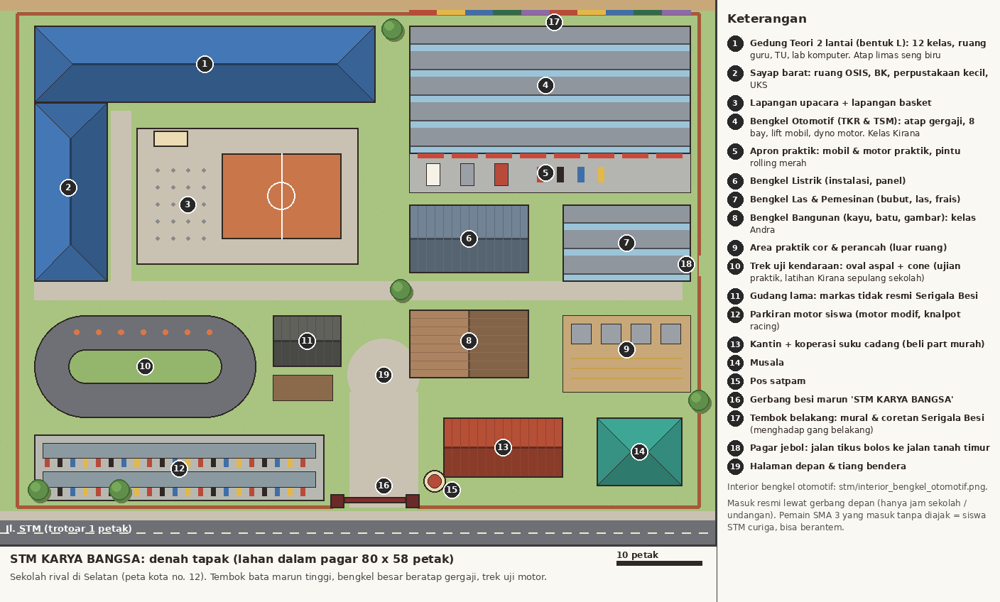
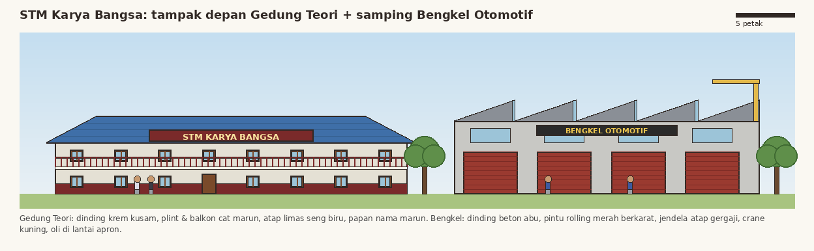
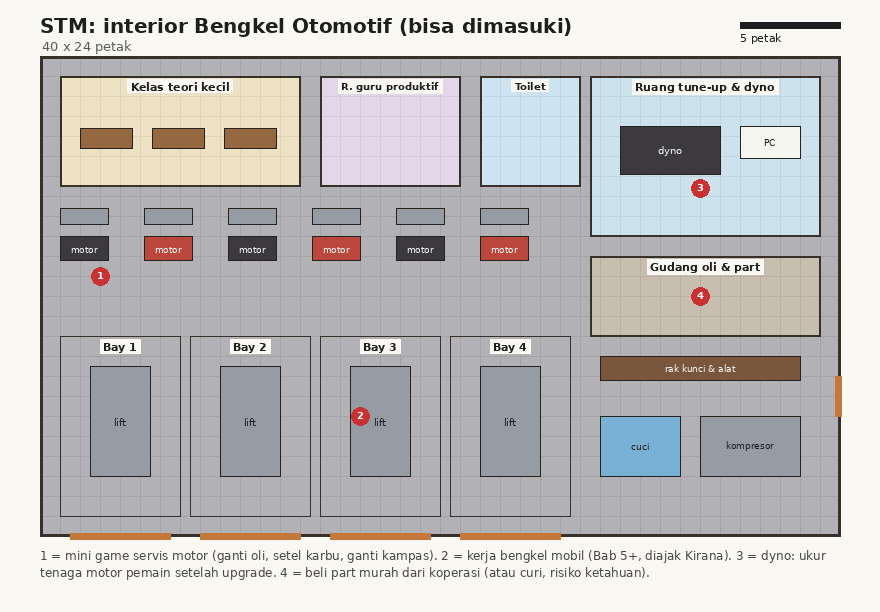

# 88. STM Karya Bangsa (sekolah rival)

STM Karya Bangsa di Selatan (peta kota no. 12) adalah sekolah Kirana dan Andra, sekaligus wilayah geng Serigala Besi
yang diketuai Kobar. Kesannya harus beda jauh dari SMA 3: lebih kasar, lebih "bengkel", tembok tinggi, oli, suara mesin.

## Gaya bangunan

| Bagian | SMA 3 | STM Karya Bangsa |
|---|---|---|
| Pagar | Bata rendah + besi, lampu | Tembok bata tinggi cat marun, gerbang besi geser |
| Gedung utama | Krem, genteng merah, portiko | Krem kusam, plint & balkon marun, atap limas seng biru |
| Gedung praktik | Lab atap gergaji kecil | Bengkel besar atap gergaji, pintu rolling merah, crane kuning |
| Halaman | Plaza, air mancur, taman | Halaman paving + tiang bendera, apron beton bernoda oli |
| Hiasan | Mading, taman | Mural & coretan Serigala Besi, knalpot bekas jadi pot bunga |

## Bagian sekolah

| No | Bagian | Isi | Gameplay |
|---|---|---|---|
| 1-2 | Gedung Teori (L, 2 lantai) | 12 kelas, ruang guru, TU, lab komputer, OSIS, BK, perpustakaan kecil, UKS | Jarang dimasuki pemain; event Bab 13 rapat gabungan SMA 3 & STM |
| 3 | Lapangan upacara + basket | Barisan upacara Senin | Pertandingan persahabatan basket (Dimas vs STM) |
| 4-5 | Bengkel Otomotif + apron | 4 bay mobil, 6 stand motor, ruang dyno | Mini game servis motor, ukur tenaga motor, kerja bengkel |
| 6 | Bengkel Listrik | Panel, instalasi | Misi: perbaiki lampu jalan kampung (Bab 6) |
| 7 | Bengkel Las & Pemesinan | Bubut, las, frais | Pesan part custom (knalpot, footstep) untuk upgrade motor |
| 8-9 | Bengkel Bangunan + area cor | Kayu, batu, gambar, perancah | Kelas Andra; Andra meminjam cat dan perancah untuk mural |
| 10 | Trek uji kendaraan | Oval aspal + cone | Latihan Kirana sepulang sekolah; tantangan slalom (unlock drag Bab 3) |
| 11 | Gudang lama | Markas tidak resmi Serigala Besi: sofa bekas, drum, papan target | Tempat negosiasi / berantem dengan geng; kunci jalur damai Lampu Kota vs Serigala Besi |
| 12 | Parkiran motor | Motor modif, knalpot racing | Lihat motor rival, tantang balap |
| 13 | Kantin + koperasi suku cadang | Nasi goreng, kopi, part murah | Beli part 20% lebih murah dari bengkel kota |
| 14-16 | Musala, pos satpam, gerbang | Satpam Pak Bonar (galak) | Masuk tanpa diajak = ditanya satpam |
| 17 | Tembok mural belakang | Mural Andra + coretan geng | Event mural Andra; coretan berubah sesuai hubungan geng |
| 18 | Pagar jebol timur | Jalan tikus | Kabur saat dikejar, masuk diam-diam malam |

## Akses

| Cara masuk | Syarat | Akibat |
|---|---|---|
| Gerbang depan, jam sekolah | Diajak Kirana (hati 3+) atau Andra (hati 3+) | Aman, NPC STM menyapa |
| Gerbang depan, tanpa diajak | Bebas tapi dicurigai | 30% dihadang anak STM: ngobrol (Karisma) atau berantem |
| Pagar jebol timur | Malam / bolos | Kalau ketahuan Serigala Besi: berantem 3 lawan 1 |
| Acara terbuka | Pensi STM, lomba otomotif (Bab 8), bazar | Bebas masuk, banyak NPC dari sekolah lain |

## Jadwal NPC

| Jam | Di mana | Siapa |
|---|---|---|
| 06.30-07.00 | Gerbang, parkiran | Motor berdatangan, knalpot keras, satpam marah-marah |
| 07.00-12.00 | Bengkel & kelas | Praktik bergiliran; suara gerinda dan kompresor |
| 12.00-13.00 | Kantin, gudang lama | Serigala Besi nongkrong di gudang |
| 14.00-16.00 | Trek uji, bengkel | Kirana latihan di trek; Andra di tembok mural |
| 16.00-18.00 | Gerbang, parkiran | Geng keluar bareng ke Jl. Lingkar |
