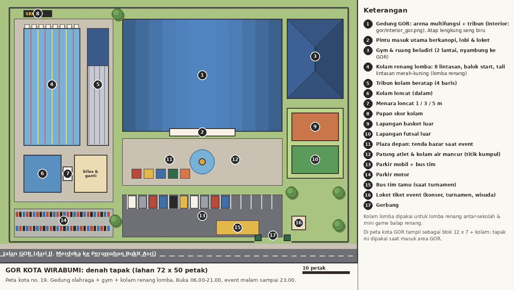
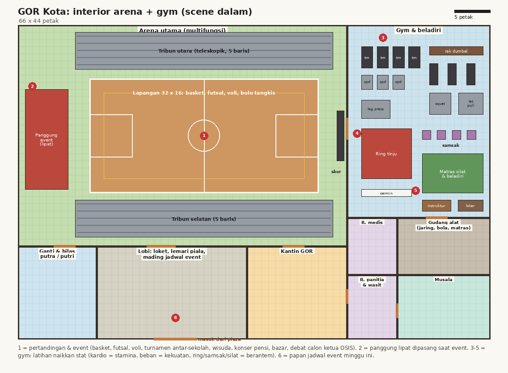

# 89. GOR Kota Wirabumi

GOR (peta kota no. 19) sekarang jadi kompleks olahraga yang bisa dimasuki: arena untuk event, kolam renang lomba,
dan gym untuk upgrade diri. Di peta kota tampil sebagai gedung beratap lengkung biru + kolam; saat pemain masuk
gerbang GOR, scene memakai denah tapak dan interior di bawah (lebih luas dari tampak luar, aturan segmen 81).

## Arena utama (event)

Lapangan 32 x 16 petak dengan garis basket, futsal, voli, dan bulu tangkis. Tribun teleskopik di utara dan selatan
(5 baris), panggung lipat di sisi barat, papan skor di sisi timur.

| Event | Kapan | Isi | Tokoh |
|---|---|---|---|
| Liga basket antar-SMA | Bab 4-6, final Bab 6 | Mini game basket 3x3 / 5x5, tribun penuh suporter sekolah | Dimas (kapten), event 6 hati Dimas Bab 9 |
| Turnamen futsal | Bab 3, Bab 8 | Mini game futsal | Uti |
| Turnamen silat | Sesekali (tiap 2 minggu) | Mini game berantem versi aturan (poin, tanpa senjata) | Wulan, event 6 hati Wulan Bab 9 |
| Debat calon ketua OSIS | Bab 4-5 | Panggung + kursi penonton | Nadia, Tegar, Rizal |
| Konser pensi gabungan | Bab 8 | Panggung, lampu, tribun berdiri | Sekar (konser amal Bab 13) |
| Bazar & pameran | Akhir bulan | Lapak di lapangan & plaza | Laras jualan, Mei jual ilustrasi |
| Wisuda / perpisahan | Akhir game | Kursi berjajar, panggung | Semua (ending) |
| Badminton bebas | Tiap sore tanpa event | Sewa lapangan Rp 20.000/jam | NPC pengisi |

Papan jadwal event di lobi menampilkan event minggu ini.

## Kolam renang lomba

| Bagian | Isi | Gameplay |
|---|---|---|
| Kolam lomba | 8 lintasan, tali merah-kuning, balok start | **Balap renang**: 2-8 perenang, 2 atau 4 panjang kolam. Tekan tombol berirama (kanan-kiri) + napas (tahan tombol). Salah ritme = melambat |
| Tribun kolam beratap | 4 baris | Teman menonton & bersorak |
| Kolam loncat + menara 1/3/5 m | Kolam dalam | Mini game loncat indah (timing putaran). Menara 5 m = uji nyali (Nyali +) |
| Papan skor | Utara kolam | Waktu & peringkat |
| Bilas & ganti | Di antara kolam dan GOR | Ganti baju renang otomatis |

Event kolam: lomba renang antar-sekolah (Bab 5), lomba 17 Agustus (balap renang gaya bebas, hadiah uang), latihan pagi bebas.
Tiket berenang bebas Rp 10.000, 06.00-17.00.

## Gym & ruang beladiri (upgrade diri)

| Zona | Alat | Stat yang naik | Biaya energi |
|---|---|---|---|
| Kardio | 4 treadmill, 3 sepeda statis | Stamina | 15 |
| Beban bebas | Rak dumbel, 3 bench, squat rack | Kekuatan | 20 |
| Mesin | Lat pulldown, leg press | Kekuatan, sedikit Stamina | 15 |
| Ring tinju & samsak | Ring 7 x 7, 4 samsak | Berantem (combo, tenaga pukul) | 20 |
| Matras silat & beladiri | 8.5 x 5.5 | Kelincahan, jurus spesial (bersama Wulan) | 20 |

| Aturan | Isi |
|---|---|
| Biaya | Harian Rp 15.000, bulanan Rp 150.000 (upgrade segmen 60) |
| Batas | Maksimal 2 sesi per hari; lebih dari itu = cedera ringan 1 hari |
| Hasil | Stat naik +1 per sesi (lambat setelah level 5). Tubuh voxel pemain sedikit lebih kekar di level 8+ |
| Instruktur | Coach Herman (mantan atlet): kasih latihan mingguan, bonus +1 kalau selesai |
| Teman latihan | Dimas (beban, Senin & Kamis), Wulan (silat, Selasa & Kamis 16.00), Uti (samsak, kadang) |

## Akses GOR

| Hal | Isi |
|---|---|
| Letak | Jalan GOR (dari Jl. Merdeka ke Perumahan Bukit Asri), utara pusat kota |
| Jam | 06.00-21.00; event malam sampai 23.00 |
| Masuk | Gerbang depan bebas; arena saat event pakai tiket (Rp 10.000-50.000) |
| Transport | Jalan kaki 3 menit dari sekolah, parkir motor di depan, angkot jurusan Merdeka |
