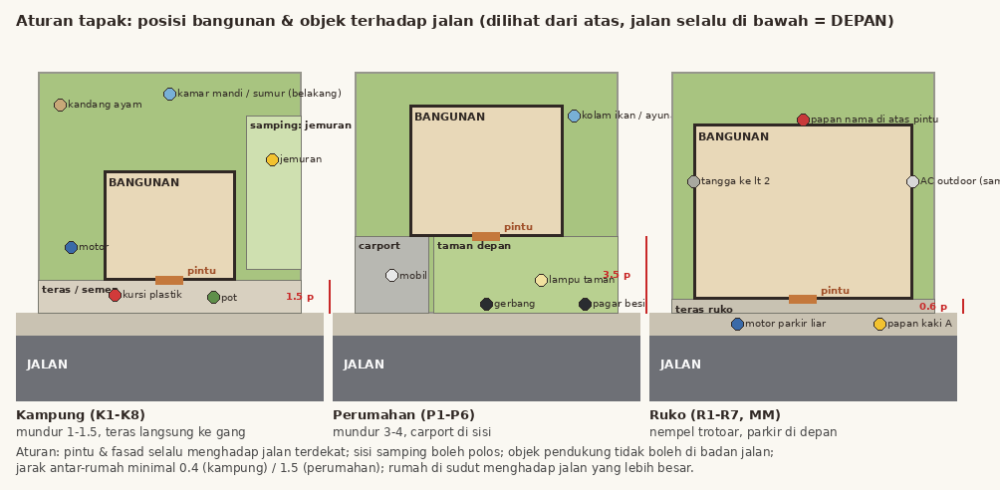
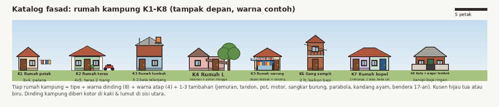
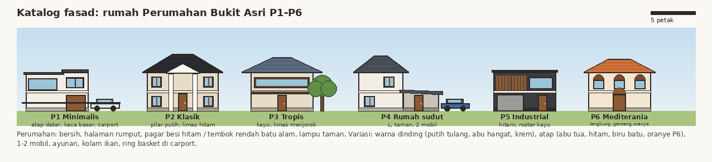
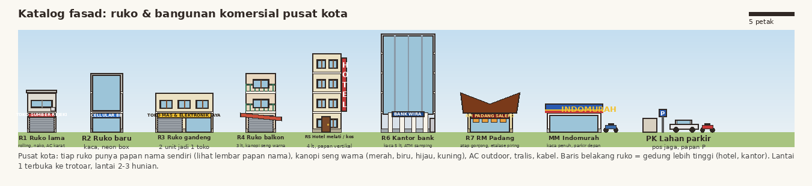
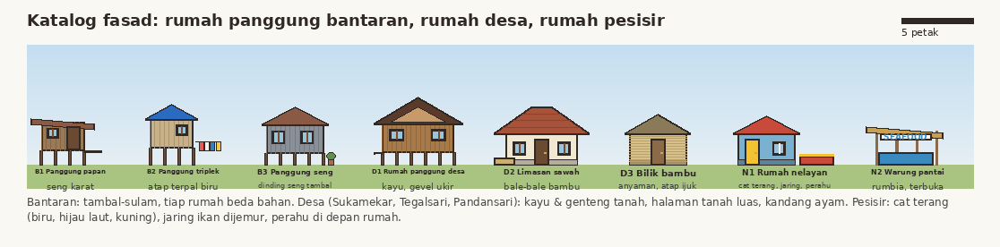

# 90. Katalog Tipe Bangunan (supaya kota tidak monoton)

Segmen ini mengatur **bangunan umum** yang diulang di seluruh peta (rumah kampung, perumahan, ruko, rumah panggung, rumah desa
dan pesisir): bentuk, ukuran, warna, kelebihan dan kekurangan tiap tipe, objek pendukung, serta posisi objek terhadap jalan.
Bangunan bernama (sekolah, pasar, GOR, dll.) ada di segmen 91, isi dalamnya di segmen 92.
Menggantikan dan memperluas `05-bangunan.md` yang lama.

## Aturan anti-monoton

| Aturan | Isi |
|---|---|
| Rumus variasi | **Tipe + warna dinding + warna atap + 1-3 tambahan + tingkat kusam**. Kampung: 8 tipe x 8 dinding x 4 atap x 12 tambahan, jadi praktis tidak ada yang kembar |
| Tetangga beda | Dua rumah berdampingan tidak boleh punya tipe **dan** warna dinding yang sama. Kalau sama, ganti warna |
| Pengulangan | Tipe yang sama paling banyak 3 rumah berturut-turut di satu sisi jalan |
| Ritme jalan | Tiap 6-10 rumah ada "pemecah": warung, musala, pos ronda, lahan kosong ber-pohon, atau gang kecil |
| Umur bangunan | 3 tingkat: baru (warna penuh), biasa (sedikit pudar), tua (pudar + noda rembes + lumut di sisi utara + retak). Kampung & bantaran lebih banyak yang tua; perumahan hampir semua baru |
| Tinggi | Atap tidak boleh rata satu jalan: campur 1, 1.5, dan 2 lantai |
| Sudut jalan | Rumah di sudut menghadap jalan yang lebih besar; sudut sering jadi warung (K5) atau ruko |
| Event & musim | Agustus: bendera & umbul-umbul; Ramadan: lampu kelap-kelip; hujan: genangan & ember di teras |
| Malam | Tiap rumah 1-3 jendela menyala acak (kuning hangat), ruko lampu neon putih, warung lampu bohlam |

## Aturan posisi (tapak)

| Wilayah | Mundur dari jalan | Pintu | Objek di depan (z +) | Objek di samping | Objek di belakang (z -) |
|---|---|---|---|---|---|
| Kampung | 1-1.5 petak | Selalu menghadap gang/jalan terdekat | Teras semen, kursi plastik, pot, sandal, motor | Jemuran, tandon, tumpukan kayu | Kamar mandi/sumur, kandang ayam, pohon pisang |
| Perumahan | 3-4 petak | Menghadap jalan kompleks | Taman, lampu taman, pagar + gerbang, carport | Mobil di carport, AC outdoor | Halaman belakang, kolam ikan, ayunan |
| Ruko | 0-0.6 (nempel trotoar) | Rolling door/kaca ke trotoar | Motor parkir liar, papan kaki A, gerobak, tukang parkir | Tangga lantai 2, AC outdoor | Pintu belakang, tumpukan kardus, baris gedung belakang |
| Bantaran | 0.5-1 dari gang, tangga ke kali | Menghadap gang | Tangga kayu, sandal, ember | Jemuran di atas air | Teras panggung ke kali |
| Desa | 3-6 (halaman tanah luas) | Menghadap jalan desa | Halaman tanah, bale-bale, ayam lepas | Lumbung, tumpukan jerami | Kebun, kandang |
| Pesisir | 2-3 | Menghadap jalan pesisir | Jaring dijemur, perahu, keranjang ikan | Bak garam, jemuran ikan asin | Arah laut |

**Wajib**: fasad dan pintu menghadap jalan terdekat; sisi samping dan belakang boleh polos tapi tetap punya 1 jendela.
Tidak ada objek di badan jalan. Jarak antar-rumah minimal 0.4 (kampung), 1.5 (perumahan).

## Rumah kampung K1-K8

| Tipe | Ukuran | Bentuk | Kelebihan | Kekurangan | Objek pendukung khas |
|---|---|---|---|---|---|
| **K1 Rumah petak** | 3 x 4, 1 lt | Kotak, atap pelana | Murah, cocok mengisi gang sempit | Paling polos, jangan dipakai berderet | Jemuran tali, sandal, ember |
| **K2 Rumah teras** | 4 x 5, 1 lt | Teras beratap 2 tiang | Tempat NPC duduk ngobrol (bubble chat) | Butuh lahan lebih lebar | Kursi plastik, sangkar burung, motor di teras |
| **K3 Rumah tumbuh** | 4 x 4, 1.5 lt | Lantai 2 bata telanjang, besi cor mencuat | Memberi variasi tinggi, terasa "kampung beneran" | Terlihat belum jadi: jangan di jalan raya | Tandon oranye, tangga besi luar |
| **K4 Rumah L** | 5 x 5, 1 lt | Bentuk L mengapit halaman | Halaman bisa dipakai event (arisan, hajatan) | Makan tempat | Pohon mangga, bale-bale bambu, kandang ayam |
| **K5 Rumah warung** | 4 x 4, 1 lt | Depan etalase + kanopi seng | Bisa dimasuki: beli jajan, ngutang, gosip (segmen 92) | Ramai, motor parkir di depan | Renceng sachet, termos es, spanduk kecil |
| **K6 Gang sempit** | 2.5 x 5, 2 lt | Tinggi ramping, balkon besi | Mengisi celah, memberi kesan padat | Gelap, kabel semrawut | Parabola, pot gantung, kabel |
| **K7 Rumah kopel** | 6 x 5, 1 lt | 2 rumah 1 atap, cat beda tiap separuh | Variasi warna dalam 1 bangunan | Sering cekcok tetangga (event kecil) | 2 pintu beda warna, 2 motor |
| **K8 Bata + pagar tembok** | 4.5 x 5, 1 lt | Bata ekspos, atap limas, pagar tembok + kanopi baja ringan | Rumah kampung "mapan", memecah warna cerah | Pagar menutupi halaman | Kanopi, pagar besi kecil, mobil tua |

Warna dinding kampung: krem `#e8d8b8`, mint `#b8d8b0`, biru muda `#a8c8d8`, merah muda `#e8b8b0`, kuning `#f0d890`,
bata `#b06a4a`, lila `#d8c8e8`, hijau pucat `#c8e0d0`. Atap: genteng `#b4583e`, seng karat `#8a6a5a`, asbes `#a8a8a0`,
genteng tua `#a8523a`. Kusen: hijau tua `#2f6a4a` atau biru `#2a5a8a`.

Tambahan acak (pilih 1-3): jemuran, tandon air, parabola, pot berderet, motor, sepeda, sangkar burung, kandang ayam,
gerobak dagangan, bendera 17-an, kursi plastik, tumpukan galon.

## Perumahan Bukit Asri P1-P6

| Tipe | Ukuran | Bentuk | Kelebihan | Kekurangan | Objek pendukung |
|---|---|---|---|---|---|
| **P1 Minimalis** | 6 x 7, 2 lt | Kotak bertumpuk, atap datar, kaca besar | Modern, terlihat jelas dari jauh | Dingin, polos | Carport, pagar besi horizontal, 1 mobil |
| **P2 Klasik** | 7 x 7, 2 lt | Pilar putih, atap limas hitam | Kesan kaya (keluarga Megantara) | Kaku | Air mancur kecil, lampu taman bulat |
| **P3 Tropis** | 7 x 6, 2 lt | Limas lebar menjorok, kayu | Hangat, cocok rumah Sekar | Butuh banyak tanaman | Teras kayu, kolam ikan, kamboja |
| **P4 Rumah sudut** | 8 x 8, 2 lt | Bentuk L di pojok cul-de-sac | Halaman luas: event pesta | Hanya di sudut | 2 mobil, taman luas, ayunan |
| **P5 Industrial** | 7 x 6, 2 lt | Dinding hitam, roster kayu vertikal | Pemecah warna putih | Terlalu gelap kalau banyak | Lampu dinding, motor besar |
| **P6 Mediterania** | 7 x 7, 2 lt | Jendela lengkung, genteng oranye | Warna hangat, beda dari P1-P5 | Kesan "pamer" | Pot terakota, pagar tembok putih |

Warna dinding: putih tulang `#f2eee6`, abu hangat `#c8c2b8`, krem `#e6dcc8`, hitam `#3a3c40` (P5), pasir `#f2e6d0` (P6).
Atap: abu tua `#4a5058`, hitam `#2a2c30`, biru batu `#5a6a80`, oranye `#d0703a`. Semua bersih (tingkat kusam rendah).

## Ruko & komersial

| Tipe | Ukuran | Bentuk | Kelebihan | Kekurangan | Papan & objek |
|---|---|---|---|---|---|
| **R1 Ruko lama** | 3 x 5, 2 lt | Rolling door, jendela nako | Paling khas kota Indonesia | Kusam, mudah terlihat sama: wajib beda papan | Papan luntur, AC karat, tralis |
| **R2 Ruko baru** | 3.5 x 6, 3 lt | Fasad kaca + panel | Toko HP, apotek, bimbel | Terlihat steril | Neon box, kanopi kaca |
| **R3 Ruko gandeng** | 6 x 5, 2 lt | 2 unit jadi 1 toko | Toko besar (emas, elektronik, bangunan) | Makan 2 kavling | Papan panjang, tangga samping |
| **R4 Ruko balkon** | 3.4 x 6, 3 lt | Balkon besi berwarna tiap lantai | Variasi tinggi & warna | - | Kanopi seng warna, jemuran di balkon |
| **R5 Hotel melati / kos** | 3.2 x 6, 4 lt | Ramping, papan vertikal menonjol | Landmark kecil di baris belakang | Bukan untuk jalan utama depan | Papan vertikal neon |
| **R6 Kantor bank** | 6 x 7, 5 lt | Kaca tinggi, lobi bertiang | Gedung tertinggi pusat kota | Hanya 1-2 di kota | ATM samping, logo di atap |
| **R7 RM Padang** | 5 x 6, 1 lt | Atap gonjong, etalase piring bertumpuk | Siluet unik | Hanya 1-2 | Etalase piring, papan merah-emas |
| **MM Indomurah** | 6 x 7, 1 lt | Kaca penuh, pita biru-kuning-merah | Buka 24 jam (segmen 92) | Kalau terlalu banyak terasa kota besar: maks 3 | Parkiran depan, ATM, galon, es krim box |
| **PK Lahan parkir** | 8 x 8 | Lahan aspal + pos jaga | Napas di antara ruko, NPC tukang parkir | - | Papan P, pos jaga, motor & mobil berjajar |

Papan nama ruko diambil dari daftar usaha: fotokopi, service HP, apotek, laundry kiloan, RM Padang, bimbel, toko emas,
toko bangunan, konter pulsa, salon, optik, toko kue, bakso, pecel lele. **Tidak boleh ada dua papan sama dalam satu blok.**
Warna papan: merah `#c83a3a`, biru `#2a6ac0`, kuning `#f2c230`, hijau `#2f8a5a`, ungu `#8a3ab0`.
Kanopi: merah, biru, hijau, kuning, abu.

## Bantaran, desa, pesisir

| Tipe | Wilayah | Bentuk | Kelebihan | Kekurangan | Objek |
|---|---|---|---|---|---|
| **B1 Panggung papan** | Bantaran | Papan kayu, atap seng karat miring | Siluet panggung khas | Rapuh (banjir) | Tangga ke kali, ember |
| **B2 Panggung triplek** | Bantaran | Triplek, atap terpal biru | Warna biru memecah coklat | Kumuh | Jemuran di atas air |
| **B3 Panggung seng** | Bantaran | Dinding seng tambal | Tekstur logam beda | Panas | Pot, kaleng bekas |
| **D1 Panggung desa** | Sukamekar | Kayu, gevel ukir | Indah, rumah Wulan | Butuh lahan | Bale-bale, tangga kayu |
| **D2 Limasan sawah** | Tegalsari, Pandansari | Atap limas tinggi, halaman luas | Kesan desa Jawa | - | Bale-bale, lumbung, ayam |
| **D3 Bilik bambu** | Desa, kaki gunung | Anyaman bambu, atap ijuk | Paling murah, tekstur unik | Gelap | Tungku, kayu bakar |
| **N1 Rumah nelayan** | Muara | Cat terang, kusen kuning | Warna cerah pantai | Bau amis | Jaring, perahu, keranjang ikan |
| **N2 Warung pantai** | Pantai Lintang | Terbuka, atap rumbia | Tempat kencan | Tutup saat badai | Spanduk seafood, tikar, gazebo |

## Daftar periksa tiap model baru

1. Tipe & ukuran petak, jumlah lantai, dua lapis (badan + atap) supaya tokoh bisa masuk ke bawah teras.
2. Warna dari palet wilayah + 1 warna pembeda.
3. Minimal 3 objek pendukung di posisi sesuai tabel tapak.
4. Pintu menghadap jalan (cek di game: rumah yang membelakangi jalan = bug).
5. Versi malam (lampu) & versi event.
6. Kalau bisa dimasuki: denah di segmen 92 + titik interaksi.
