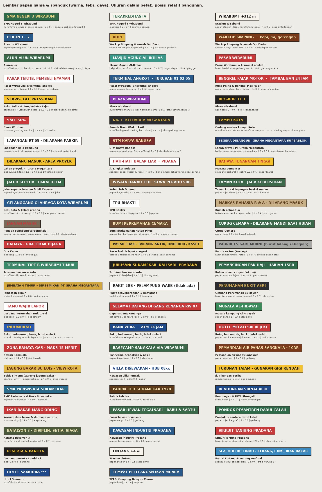

# 91. Detail Tiap Bangunan di Peta

Semua bangunan bernama di peta kota (1-36) dan peta daerah (40-64): bentuk, warna, papan nama, objek pendukung beserta
posisinya, kelebihan & kekurangan untuk pemain, jam buka, dan interiornya (kalau bisa dimasuki). Tipe rumah umum ada di segmen 90.

**Posisi objek** ditulis (x, z) dalam petak dari tengah fasad depan: x ke kanan dilihat dari jalan, z positif = ke arah jalan,
z negatif = ke belakang. Sama dengan bingkai lokal game (depan = +z).

## 1. SMA Negeri 3 Wirabumi

| | |
|---|---|
| Wilayah | Kawasan Sekolah |
| Bentuk | Kompleks 76 x 53.5 (segmen 83): Gedung A bentuk U, Gedung B 3 lantai, Gedung C atap gergaji, aula lengkung |
| Warna | krem #ecdcb4, list putih #f6f4ec, genteng #a84a32, papan hijau #2f6a4a |
| Jam | 06.00-17.30 |
| Kelebihan | Pusat cerita: hampir semua NPC lewat sini; Banyak tempat sembunyi (gedung lama, atap, belakang kantin) |
| Kekurangan | Telat > 07.00 = dihukum; Guru BK patroli, susah bolos siang |
| Interior | segmen 81 |

| Papan nama | Warna | Gaya | Ukuran | Letak |
|---|---|---|---|---|
| **SMA NEGERI 3 WIRABUMI** | latar `#2f6a4a`, huruf `#f0d27a` | huruf timbul emas di balok gapura | 8 x 0.7 | gapura gerbang, tinggi 2.4 |
| **TERAKREDITASI A** | latar `#f6f4ec`, huruf `#2f6a4a` | plat kecil | 2 x 0.4 | pilar kiri gapura |

Objek pendukung: Pos satpam bulat `(6.5, -2)`; Tiang bendera `(0, -9)`; Rak sepeda `(24, -4)`; Gerobak cilok (14.00) `(-6, 1.5)`.

## 2. Stasiun Wirabumi

| | |
|---|---|
| Wilayah | Barat (rel) |
| Bentuk | Bangunan kolonial memanjang 8 x 5, atap limas tinggi, peron beratap 20 petak, jam bulat di fasad |
| Warna | krem tua #e6d6b0, list hijau #3a6a4a, atap seng merah #a8523a, peron abu #9a9a96 |
| Jam | 04.30-22.00 |
| Kelebihan | Pembuka game; fast travel kereta ke pantai & luar daerah |
| Kekurangan | Ramai: copet acak 5%; Kereta hanya tiap 2 jam |
| Interior | 92: stasiun |

| Papan nama | Warna | Gaya | Ukuran | Letak |
|---|---|---|---|---|
| **WIRABUMI  +312 m** | latar `#f6f4ec`, huruf `#1e1e1e` | papan stasiun klasik, huruf hitam tegak | 4 x 0.6 | atas pintu tengah |
| **PERON 1 - 2** | latar `#2a5a8a`, huruf `#ffffff` | papan gantung biru | 1.6 x 0.4 | tergantung di kanopi peron |

Objek pendukung: Loket kaca `(-2, -1)`; Bangku besi hijau (3) `(2, 0.6)`; Jam bulat `(0, 0.1)`; Pangkalan ojek `(5, 3)`; Penjual asongan `(-4, 2)`.

## 3. Warkop Simpang & rumah Om Darto

| | |
|---|---|
| Wilayah | Perkampungan Kenanga |
| Bentuk | Rumah K2 + gerobak kopi (level 1) yang tumbuh jadi warkop beratap (level 5) |
| Warna | dinding hijau mint #b8d8b0, genteng #b4583e, gerobak kuning #e2b84a, kusen hijau tua #2f6a4a |
| Jam | Warkop 16.00-24.00 |
| Kelebihan | Rumah pemain: tidur, simpan barang, kerja warkop; Gratis makan sekali sehari |
| Kekurangan | Kecil, kamar sempit sampai upgrade; Om marah kalau pulang > 23.00 |
| Interior | segmen 82 |

| Papan nama | Warna | Gaya | Ukuran | Letak |
|---|---|---|---|---|
| **KOPI** | latar `#e2b84a`, huruf `#7a3a1a` | tulisan cat tangan di gerobak | 1 x 0.4 | sisi depan gerobak |
| **WARKOP SIMPANG  -  kopi, mi, gorengan** | latar `#7a3a1a`, huruf `#f2e2b0` | spanduk vinyl (level 2+) | 4 x 0.6 | tiang depan warkop |

Objek pendukung: Gerobak kopi `(2.8, 0.8)`; Bangku panjang kayu `(1.5, 2)`; Termos & renceng kopi sachet `(2.8, 0.6)`; Jemuran `(-2, -2.5)`; Motor Om Darto `(-1.6, 1)`.

## 4. Alun-alun

| | |
|---|---|
| Wilayah | Pusat Kota |
| Bentuk | Lapangan rumput lonjong 17 x 11, jalan melingkar, dua beringin kembar, panggung kecil |
| Warna | rumput #b2d084, pagar besi rendah hijau #3a6a4a, conblock #bcb6a8 |
| Jam | 24 jam |
| Kelebihan | Pasar malam Sabtu: mini game & kencan; Gratis, ramai sepanjang hari |
| Kekurangan | Sabtu malam penuh, sulit parkir; Preman parkir minta jatah |

| Papan nama | Warna | Gaya | Ukuran | Letak |
|---|---|---|---|---|
| **ALUN-ALUN WIRABUMI** | latar `#3a6a4a`, huruf `#ffffff` | huruf beton putih berdiri di taman | 6 x 0.8 | sisi selatan menghadap Jl. Raya |

Objek pendukung: Beringin kembar `(-3, -5)`; Panggung kecil `(0, -9)`; Lampu taman bulat (12); Bianglala (Sabtu malam) `(6, -6)`; Tenda pasar malam `(-6, -2)`.

## 5. Masjid Agung Al-Ikhlas

| | |
|---|---|
| Wilayah | Pusat Kota |
| Bentuk | Masjid 7 x 6 + serambi, kubah besar + 4 kubah kecil, menara 12 petak (landmark) |
| Warna | putih #f2f0e8, kubah tosca #3a9a8a, puncak emas #d4a640, keramik pelataran #e2dcd0 |
| Jam | 04.00-21.30 |
| Kelebihan | Karma +, event Ramadan; Atap: event Nadia 8 hati |
| Kekurangan | Tidak boleh lari/berantem di pelataran (karma -) |
| Interior | 92: masjid_agung |

| Papan nama | Warna | Gaya | Ukuran | Letak |
|---|---|---|---|---|
| **MASJID AGUNG AL-IKHLAS** | latar `#3a9a8a`, huruf `#ffffff` | kaligrafi + huruf latin di batu marmer | 5 x 0.7 | pagar depan, di samping gerbang |

Objek pendukung: Beduk besar `(3, -1)`; Tempat wudu `(-4.5, -2)`; Rak sandal `(0, 0.8)`; Kotak amal `(1.2, 0.5)`; Pedagang kurma (Ramadan) `(-5, 3)`.

## 6. Pasar Wirabumi & terminal angkot

| | |
|---|---|
| Wilayah | Pusat Kota |
| Bentuk | Los besar 12 x 7 atap seng berundak + los terbuka 9 x 5, pelataran terminal 14 x 8 |
| Warna | seng #9aa0a6, tiang beton #bcbab4, terpal biru #2a6ac0 / oranye #e07a3a, angkot biru muda #3a8ac0 |
| Jam | 03.00-17.00 |
| Kelebihan | Harga bahan paling murah (-20%); Lapak Laras, pemasok warkop |
| Kekurangan | Becek, kotor (penampilan -1 kalau lama); Ramai copet pagi |
| Interior | 92: pasar |

| Papan nama | Warna | Gaya | Ukuran | Letak |
|---|---|---|---|---|
| **PASAR WIRABUMI** | latar `#c83a3a`, huruf `#ffffff` | huruf besi di atas gerbang los | 6 x 0.8 | gerbang utama |
| **PASAR TERTIB, PEMBELI NYAMAN** | latar `#ffffff`, huruf `#c83a3a` | spanduk vinyl kusam | 4 x 0.5 | tiang los terbuka |
| **TERMINAL ANGKOT  -  JURUSAN 01 02 05** | latar `#2a5a8a`, huruf `#ffffff` | papan jurusan bertiang | 3 x 0.6 | ujung halte |

Objek pendukung: Halte panjang `(0, 6)`; Angkot berjajar (4) `(0, 8)`; Gerobak dorong sayur `(-4, 1)`; Lapak ikan (basah) `(3, -3)`; Timbangan & keranjang `(-2, -1)`.

## 7. Ruko Pelita & Bengkel Mas Fajar

| | |
|---|---|
| Wilayah | Pusat Kota |
| Bentuk | Deretan ruko R1-R3; bengkel 6 x 4 setengah terbuka, rolling door |
| Warna | abu kusam #a8a8a4, lantai hitam oli #3a3a3a, rolling door abu #8a9098, papan merah #c83a3a |
| Jam | 07.00-22.00 (tambal ban 24 jam) |
| Kelebihan | Kerja paruh waktu, upgrade motor, servis murah |
| Kekurangan | Antre lama sore hari |
| Interior | segmen 82 |

| Papan nama | Warna | Gaya | Ukuran | Letak |
|---|---|---|---|---|
| **BENGKEL FAJAR MOTOR  -  TAMBAL BAN 24 JAM** | latar `#c83a3a`, huruf `#ffffff` | papan seng dicat, huruf kotak | 4 x 0.6 | atas rolling door |
| **SERVIS  OLI  PRESS BAN** | latar `#f2c230`, huruf `#1e1e1e` | papan kaki A (sandwich board) | 0.8 x 1 | trotoar depan, kiri pintu |

Objek pendukung: Ban bekas bertumpuk `(-2.4, 0.4)`; Kompresor `(2.4, -0.5)`; Bak tambal ban `(1.6, 0.6)`; Motor antre (3) `(0, 2)`.

## 8. Plaza Wirabumi

| | |
|---|---|
| Wilayah | Pusat Kota |
| Bentuk | Kotak besar 10 x 7, 3 lantai, fasad panel + kaca biru, atrium kaca di depan |
| Warna | panel ungu muda #c8b8e0, kaca biru #7ab0d8, rangka aluminium #d8d8dc |
| Jam | 10.00-22.00 |
| Kelebihan | AC, bioskop, arkade, food court: kencan terbaik; Buka sampai malam |
| Kekurangan | Mahal (+30%); Satpam usir kalau pakai seragam saat jam sekolah |
| Interior | 92: plaza |

| Papan nama | Warna | Gaya | Ukuran | Letak |
|---|---|---|---|---|
| **PLAZA WIRABUMI** | latar `#8a3ab0`, huruf `#ffffff` | huruf timbul menyala (neon putih malam) | 8 x 1 | atas atrium, lantai 3 |
| **BIOSKOP  LT 3** | latar `#1e1e1e`, huruf `#f2c230` | neon box | 2 x 0.6 | pojok kanan fasad |
| **SALE 50%** | latar `#c83a3a`, huruf `#ffffff` | spanduk gantung vertikal | 0.8 x 3 | kiri atrium |

Objek pendukung: Pintu kaca putar `(0, 0.2)`; Parkir motor penuh `(-6, 3)`; Poster film (3) `(3, 0.1)`; Satpam `(1.5, 1)`; Tukang parkir `(-4, 4)`.

## 9. Rumah Bram (Bukit Asri)

| | |
|---|---|
| Wilayah | Perumahan Bukit Asri |
| Bentuk | P2 diperbesar 9 x 6, 2 lantai, pilar besar, atap limas tinggi hitam, kolam renang samping |
| Warna | putih #f2eee6, atap hitam #2a2c30, pilar putih #faf8f2, kolam #78b0d6 |
| Kelebihan | Event Bram & Sasha, misi dokumen Bab 12 |
| Kekurangan | Satpam pribadi: masuk tanpa diundang = ditangkap |
| Interior | 92: rumah_bram |

| Papan nama | Warna | Gaya | Ukuran | Letak |
|---|---|---|---|---|
| **No. 1  KELUARGA MEGANTARA** | latar `#2a2c30`, huruf `#d4a640` | huruf kuningan di dinding batu alam | 2 x 0.4 | pilar gerbang kanan |

Objek pendukung: Gerbang besi otomatis `(0, 4)`; CCTV (2) `(4, 0.2)`; 3 mobil `(-4, 2.5)`; Kolam renang `(6.5, -2)`; Lampu taman `(2, 3)`.

## 10. Gudang markas Lampu Kota

| | |
|---|---|
| Wilayah | Bantaran Kali |
| Bentuk | Gudang 7 x 5, atap pelengkung seng, pintu geser besar |
| Warna | bata cat hitam #2a2a2a, mural bohlam kuning #f2c230, seng #9aa0a6 |
| Jam | 24 jam |
| Kelebihan | Markas pemain: misi geng, simpan motor, latihan samsak |
| Kekurangan | Target serangan geng rival |
| Interior | segmen 82 |

| Papan nama | Warna | Gaya | Ukuran | Letak |
|---|---|---|---|---|
| **LAMPU KOTA** | latar `#2a2a2a`, huruf `#f2c230` | mural bohlam raksasa + huruf cat semprot | 5 x 2 | dinding depan di atas pintu geser |

Objek pendukung: Lampu bohlam berderet `(0, 0.3)`; Motor anggota (4) `(-3, 2)`; Drum api (malam) `(3, 2)`; Sofa bekas di luar `(2.5, 0.8)`.

## 11. Lapangan bola kampung

| | |
|---|---|
| Wilayah | Bantaran Kali |
| Bentuk | Lapangan tanah-rumput 11 x 6.4, gawang berjaring, bendera sudut |
| Warna | rumput botak #b8c088, tanah #c8a878, gawang putih #f2f2f2 |
| Jam | 06.00-18.00 |
| Kelebihan | Main bola gratis sore (Dodi & Didi); Stat kelincahan + |
| Kekurangan | Kalau hujan becek: licin, jatuh |

| Papan nama | Warna | Gaya | Ukuran | Letak |
|---|---|---|---|---|
| **LAPANGAN RT 05 - DILARANG PARKIR** | latar `#ffffff`, huruf `#2a2a2a` | papan seng dicat tangan, miring | 2 x 0.5 | pohon di sudut barat |

Objek pendukung: Gawang (2); Bangku bambu penonton `(0, 4)`; Warung es di pinggir `(6.5, 3)`; Pohon peneduh `(-6.5, 2.5)`.

## 12. STM Karya Bangsa

| | |
|---|---|
| Wilayah | Selatan |
| Bentuk | Lihat segmen 88 |
| Warna | krem kusam, marun #7a2a2a, seng biru #3f6fa8 |
| Jam | 06.30-16.00 |
| Kelebihan | Part murah, trek uji |
| Kekurangan | Wilayah Serigala Besi |
| Interior | segmen 88 |

| Papan nama | Warna | Gaya | Ukuran | Letak |
|---|---|---|---|---|
| **STM KARYA BANGSA** | latar `#7a2a2a`, huruf `#fae6a0` | papan marun di atap Gedung Teori | 7 x 1 | atas balkon lantai 2 |

Objek pendukung: Lihat denah tapak STM.

## 13. Lahan proyek PT Graha Megantara

| | |
|---|---|
| Wilayah | Selatan |
| Bentuk | Area 30 x 13 berpagar seng biru, ekskavator, pipa, kontainer kantor, lampu sorot |
| Warna | seng biru #3a6aa8, ekskavator kuning #f2c230, kontainer merah #c8503a |
| Jam | Satpam 24 jam |
| Kelebihan | Set piece Bab 12-13: infiltrasi & bukti |
| Kekurangan | Satpam proyek + anjing malam |
| Interior | 92: kontainer_proyek |

| Papan nama | Warna | Gaya | Ukuran | Letak |
|---|---|---|---|---|
| **SEGERA DIBANGUN: GRAHA MEGANTARA SUPERBLOK** | latar `#1e3a6a`, huruf `#ffffff` | baliho besar bergambar gedung kaca | 8 x 2.5 | pojok depan, tiang besi |
| **DILARANG MASUK - AREA PROYEK** | latar `#f2c230`, huruf `#1e1e1e` | plat kuning-hitam | 1.5 x 0.6 | tiap 10 petak di pagar |

Objek pendukung: Ekskavator `(-8, -2)`; Kontainer kantor `(8, -4)`; Tumpukan pipa `(0, -3)`; Lampu sorot (2) `(12, -1)`.

## 14. Jl. Lingkar Selatan

| | |
|---|---|
| Wilayah | Selatan |
| Bentuk | Jalan raya lurus 70 petak (balap liar, segmen 87) |
| Warna | aspal #55575c, marka putih |
| Jam | Malam |
| Kelebihan | Balap liar Selasa & Jumat |
| Kekurangan | Razia 25% |

| Papan nama | Warna | Gaya | Ukuran | Letak |
|---|---|---|---|---|
| **HATI-HATI  BALAP LIAR = PIDANA** | latar `#ffffff`, huruf `#c83a3a` | spanduk polisi, kusam & robek | 4 x 0.6 | tiang lampu dekat warung nasi goreng |

Objek pendukung: Warung nasi goreng (titik kumpul) `(-14, 3)`; Tiang lampu (tiap 8 petak) `(0, 3)`.

## 15. Menara pemancar

| | |
|---|---|
| Wilayah | Perbukitan Utara |
| Bentuk | Rangka besi segitiga 10 petak, platform pertama 4 petak di atas tanah, rumah genset |
| Warna | besi merah-putih #c83a3a/#f2f2f2, genset abu #8a9098 |
| Jam | 24 jam |
| Kelebihan | Spot rahasia lihat lampu kota (event kencan) |
| Kekurangan | Jatuh dari tangga = pingsan |

| Papan nama | Warna | Gaya | Ukuran | Letak |
|---|---|---|---|---|
| **BAHAYA TEGANGAN TINGGI** | latar `#f2c230`, huruf `#c83a3a` | plat seng berkarat + petir | 0.8 x 0.6 | pagar kawat |

Objek pendukung: Pagar kawat bolong `(1.5, 1.5)`; Rumah genset `(-2.5, -1)`; Tangga ke platform.

## 16. Jalur sepeda turunan Bukit Cemara

| | |
|---|---|
| Wilayah | Perbukitan Utara |
| Bentuk | Setapak tanah turunan + gundukan lompat |
| Warna | tanah #c4a87a |
| Jam | Siang |
| Kelebihan | Mini game sepeda turunan |
| Kekurangan | Jatuh = sepeda rusak |

| Papan nama | Warna | Gaya | Ukuran | Letak |
|---|---|---|---|---|
| **JALUR SEPEDA - PAKAI HELM** | latar `#3a6a4a`, huruf `#ffffff` | papan kayu taman nasional | 1.6 x 0.5 | awal jalur |

Objek pendukung: Gundukan lompat (3); Pagar bambu di tikungan.

## 17. Kebun teh & danau

| | |
|---|---|
| Wilayah | Perbukitan Utara |
| Bentuk | Kebun berundak + danau 18 x 10 + pondok kayu 3 x 3 |
| Warna | teh #78aa5a, danau #68a0cc, pondok kayu #8a6a48 |
| Jam | 06.00-18.00 |
| Kelebihan | Mancing & kencan sepi |
| Kekurangan | Jauh dari kota |

| Papan nama | Warna | Gaya | Ukuran | Letak |
|---|---|---|---|---|
| **WISATA DANAU TEH - SEWA PERAHU 5RB** | latar `#8a6a48`, huruf `#ffffff` | papan kayu ukir | 2.4 x 0.6 | dermaga pondok |

Objek pendukung: Perahu kecil (2) `(2, 3)`; Pondok teras danau; Bangku kayu `(-3, 1.5)`.

## 18. Taman kota & lapangan basket umum

| | |
|---|---|
| Wilayah | Kawasan Sekolah |
| Bentuk | Taman + lapangan basket 7.4 x 6, ring besi |
| Warna | lapangan hijau #4a8a5a, garis putih |
| Jam | 05.00-22.00 |
| Kelebihan | Basket 3x3 gratis, Liga Minggu |
| Kekurangan | Sore penuh anak SMP |

| Papan nama | Warna | Gaya | Ukuran | Letak |
|---|---|---|---|---|
| **TAMAN KOTA - JAGA KEBERSIHAN** | latar `#3a6a4a`, huruf `#ffffff` | papan hijau dinas | 2 x 0.5 | pintu masuk taman |

Objek pendukung: Ring basket (2); Bangku taman `(-5, 3)`; Penjual es `(5, 3)`.

## 19. GOR Kota & kolam renang

| | |
|---|---|
| Wilayah | Kawasan Sekolah |
| Bentuk | Lihat segmen 89 |
| Warna | seng biru #4a7ab0, putih |
| Jam | 06.00-21.00 |
| Kelebihan | Gym, event, renang |
| Kekurangan | Bayar tiap masuk |
| Interior | segmen 89 |

| Papan nama | Warna | Gaya | Ukuran | Letak |
|---|---|---|---|---|
| **GELANGGANG OLAHRAGA KOTA WIRABUMI** | latar `#2a5a8a`, huruf `#ffffff` | huruf besi biru di kanopi | 10 x 0.8 | atas pintu masuk |

Objek pendukung: Lihat denah tapak GOR.

## 20. TPU Bhakti

| | |
|---|---|
| Wilayah | Pusat Kota timur |
| Bentuk | Makam berjajar, tembok rendah, gapura, cungkup |
| Warna | tembok putih kusam #e6e2d6, kamboja |
| Jam | 24 jam |
| Kelebihan | Ziarah: karma + |
| Kekurangan | Malam: takut |

| Papan nama | Warna | Gaya | Ukuran | Letak |
|---|---|---|---|---|
| **TPU BHAKTI** | latar `#ffffff`, huruf `#2a2a2a` | huruf cat hitam di gapura | 3 x 0.5 | gapura |

Objek pendukung: Cungkup peneduh `(3, -2)`; Kamboja (6); Keran air & ember `(-2, -1)`.

## 21. Rumah pohon tua

| | |
|---|---|
| Wilayah | Hutan Jati Timur |
| Bentuk | Gubuk papan di dahan, tinggi 2.4, tangga kayu, ayunan |
| Warna | kayu #8a6a48, seng #8a9098 |
| Kelebihan | Rahasia Bram-Arga |
| Kekurangan | Lapuk: lantai bisa jebol |
| Interior | 92: rumah_pohon |

| Papan nama | Warna | Gaya | Ukuran | Letak |
|---|---|---|---|---|
| **MARKAS RAHASIA B & A - DILARANG MASUK** | latar `#c8b088`, huruf `#5a3a1a` | tulisan anak kecil, crayon pudar | 1 x 0.4 | pintu gubuk |

Objek pendukung: Tangga kayu `(0, 1.5)`; Ayunan tali `(2, 1)`; Peti harta `(0, -0.5)`.

## 22. Pondok penebang terbengkalai

| | |
|---|---|
| Wilayah | Hutan Jati Timur |
| Bentuk | Gubuk 3.2 x 2.6 papan, atap seng miring |
| Warna | kayu lapuk #7a6a58 |
| Kelebihan | Bukti proyek Bab 12 |
| Kekurangan | Gelap, ular acak |
| Interior | 92: rumah_pohon |

| Papan nama | Warna | Gaya | Ukuran | Letak |
|---|---|---|---|---|
| **JANGAN MASUK** | latar `#7a6a58`, huruf `#c83a3a` | coretan cat semprot, tanpa papan resmi | 1 x 0.4 | dinding depan |

Objek pendukung: Tumpukan kayu `(-2, 0.5)`; Kapak tertancap `(1.5, 1)`.

## 23. Bumi perkemahan Hutan Pinus

| | |
|---|---|
| Wilayah | Hutan Pinus |
| Bentuk | Lapangan kemah, tenda, api unggun, gapura bambu |
| Warna | rumput #c4d696, tenda oranye #d6784a |
| Jam | 24 jam |
| Kelebihan | Kemah Pramuka, kencan api unggun |
| Kekurangan | Dingin malam: stamina - |

| Papan nama | Warna | Gaya | Ukuran | Letak |
|---|---|---|---|---|
| **BUMI PERKEMAHAN CEMARA** | latar `#6a4a30`, huruf `#f2e2b0` | gapura bambu, huruf ukir di papan | 4 x 0.6 | gapura masuk |

Objek pendukung: Api unggun `(0, -4)`; Tenda (3) `(0, -6)`; Tiang bendera `(-4, -2)`.

## 24. Curug Cemara

| | |
|---|---|
| Wilayah | Hutan Pinus |
| Bentuk | Tebing batu berlumut + air terjun + kolam kecil |
| Warna | batu #8a8478, lumut #6a7a4a |
| Jam | Siang |
| Kelebihan | Spot kencan, lagu Sekar |
| Kekurangan | Licin |

| Papan nama | Warna | Gaya | Ukuran | Letak |
|---|---|---|---|---|
| **CURUG CEMARA - DILARANG MANDI SAAT HUJAN** | latar `#3a6a4a`, huruf `#ffffff` | papan kayu | 2 x 0.5 | awal setapak |

Objek pendukung: Batu besar (duduk) `(-3, 2)`; Kolam.

## 25. Gua Kapur

| | |
|---|---|
| Wilayah | Perbukitan Utara |
| Bentuk | Bukit batu kapur + mulut gua |
| Warna | kapur #d8d4c4 |
| Jam | 24 jam |
| Kelebihan | Kristal (dijual); Lukisan dinding (Andra) |
| Kekurangan | Butuh senter, kelelawar |

| Papan nama | Warna | Gaya | Ukuran | Letak |
|---|---|---|---|---|
| **BAHAYA - GUA TIDAK DIJAGA** | latar `#c83a3a`, huruf `#ffffff` | plat seng | 1 x 0.4 | mulut gua |

Objek pendukung: Mulut gua; Batu (3) `(2, 1.5)`.

## 26. Pasar loak & lapak rongsok

| | |
|---|---|
| Wilayah | Pusat Kota selatan |
| Bentuk | Lapak terpal di lahan tanah, 5 lapak |
| Warna | terpal warna-warni |
| Jam | 08.00-15.00 |
| Kelebihan | Barang langka murah; Jual barang temuan |
| Kekurangan | Barang bisa palsu (10%) |

| Papan nama | Warna | Gaya | Ukuran | Letak |
|---|---|---|---|---|
| **PASAR LOAK - BARANG ANTIK, ONDERDIL, KASET** | latar `#e2b84a`, huruf `#2a2a2a` | kardus & triplek cat tangan | 3 x 0.5 | tiang lapak pertama |

Objek pendukung: Lapak (5); Tumpukan rongsok `(5, -2)`.

## 27. Pabrik es tua (kosong)

| | |
|---|---|
| Wilayah | Selatan |
| Bentuk | Beton kusam 10 x 6, atap gergaji berkarat, cerobong |
| Warna | beton #a8a8a4, karat #8a5a44, mural Andra |
| Jam | 24 jam |
| Kelebihan | Arena tanding gelap, markas cadangan |
| Kekurangan | Tidak ada lampu |

| Papan nama | Warna | Gaya | Ukuran | Letak |
|---|---|---|---|---|
| **PABRIK ES SARI MURNI (huruf hilang sebagian)** | latar `#a8a8a4`, huruf `#4a4a4a` | huruf semen timbul, retak | 6 x 0.7 | dinding depan atas |

Objek pendukung: Cerobong `(3, -3)`; Mural Andra `(-5, 0)`; Drum & ban bekas `(0, 1.5)`.

## 28. Terminal bus antarkota

| | |
|---|---|
| Wilayah | Timur |
| Bentuk | Kanopi panjang 10 x 5, loket, peron, bus parkir |
| Warna | kanopi hijau #3a8a6a, lantai abu |
| Jam | 04.00-21.00 |
| Kelebihan | Ke desa & kota lain |
| Kekurangan | Calo & copet |

| Papan nama | Warna | Gaya | Ukuran | Letak |
|---|---|---|---|---|
| **TERMINAL TIPE B WIRABUMI TIMUR** | latar `#3a8a6a`, huruf `#ffffff` | huruf besi di kanopi | 8 x 0.7 | atas peron |
| **JURUSAN: SUKAMEKAR  KALISARI  PRADANA** | latar `#1e1e1e`, huruf `#f2c230` | papan LED berjalan | 3 x 0.5 | dinding loket |

Objek pendukung: Loket (3) `(-3, -1)`; Bus parkir `(0, 4)`; Warung kopi terminal `(5, -1)`.

## 29. Kolam pemancingan Pak Haji

| | |
|---|---|
| Wilayah | Perkampungan utara |
| Bentuk | Kolam + dermaga kayu + saung lesehan |
| Warna | air hijau #6a9a7a, saung bambu |
| Jam | 06.00-17.00 |
| Kelebihan | Mini game mancing, cerita ayah |
| Kekurangan | Bayar per hari |

| Papan nama | Warna | Gaya | Ukuran | Letak |
|---|---|---|---|---|
| **PEMANCINGAN PAK HAJI - HARIAN 15RB** | latar `#2f6b4a`, huruf `#ffffff` | papan kayu cat hijau | 2.4 x 0.5 | pintu masuk |

Objek pendukung: Dermaga (4 titik mancing); Saung lesehan `(3, -2)`.

## 30. Jembatan Timur

| | |
|---|---|
| Wilayah | Selatan |
| Bentuk | Jembatan rangka baja melengkung |
| Warna | baja biru #3a5a8a |
| Jam | Bab 7+ |
| Kelebihan | Jalan pintas Bab 7+ |
| Kekurangan | Retak Bab 12 |

| Papan nama | Warna | Gaya | Ukuran | Letak |
|---|---|---|---|---|
| **JEMBATAN TIMUR - DIRESMIKAN PT GRAHA MEGANTARA** | latar `#d4a640`, huruf `#2a2a2a` | plakat kuningan | 1 x 0.6 | kedua ujung |

Objek pendukung: Plakat peresmian.

## 31. Rakit penyeberangan & pematang

| | |
|---|---|
| Wilayah | Bantaran |
| Bentuk | Rakit bambu + tali + dermaga kecil |
| Warna | bambu #c8b070 |
| Jam | 05.00-18.00 |
| Kelebihan | Jalan pintas & kabur |
| Kekurangan | Bisa jatuh ke kali |

| Papan nama | Warna | Gaya | Ukuran | Letak |
|---|---|---|---|---|
| **RAKIT 2RB - PELAMPUNG WAJIB (tidak ada)** | latar `#ffffff`, huruf `#2a2a2a` | triplek cat tangan | 1 x 0.4 | dermaga |

Objek pendukung: Rakit; Tali.

## 32. Kandang sapi & gubuk sawah

| | |
|---|---|
| Wilayah | Selatan |
| Bentuk | Kandang kayu beratap seng + gubuk panggung bambu |
| Warna | kayu #8a6a48, seng |
| Jam | Siang |
| Kelebihan | Kerja angon sapi |
| Kekurangan | Bau: penampilan - |

Objek pendukung: Kandang (3 sapi); Gubuk `(6, 2)`; Orang-orangan `(8, 4)`.

## 33. Gerbang Perumahan Bukit Asri

| | |
|---|---|
| Wilayah | Perumahan |
| Bentuk | Gapura 2 pilar bata + balok papan, pos satpam kaca, portal |
| Warna | bata #a8583a, putih |
| Jam | 24 jam |
| Kelebihan | Aman |
| Kekurangan | Pejalan kaki ditanya satpam malam |

| Papan nama | Warna | Gaya | Ukuran | Letak |
|---|---|---|---|---|
| **PERUMAHAN BUKIT ASRI** | latar `#2a2c30`, huruf `#d4a640` | huruf kuningan di balok gapura | 6 x 0.7 | atas jalan |
| **TAMU WAJIB LAPOR** | latar `#ffffff`, huruf `#c83a3a` | plat kecil | 1.2 x 0.4 | pos satpam |

Objek pendukung: Pos satpam `(-3.5, 0)`; Portal `(0, 1)`.

## 34. Gapura Gang Kenanga

| | |
|---|---|
| Wilayah | Perkampungan |
| Bentuk | Gapura beton cat warna, atap genteng mini |
| Warna | merah-putih, hijau |
| Jam | 24 jam |
| Kelebihan | Penanda masuk kampung |
| Kekurangan | - |

| Papan nama | Warna | Gaya | Ukuran | Letak |
|---|---|---|---|---|
| **SELAMAT DATANG DI GANG KENANGA RW 07** | latar `#c83a3a`, huruf `#ffffff` | cat tembok, bendera kecil | 3 x 0.5 | balok gapura |

Objek pendukung: Pos ronda di samping `(2.5, -1)`.

## 35. Musala kampung Al-Hidayah

| | |
|---|---|
| Wilayah | Perkampungan |
| Bentuk | Bangunan 4 x 4, kubah kecil seng hijau |
| Warna | putih, kubah hijau #3a8a5a |
| Jam | 04.00-20.00 |
| Kelebihan | Ngaji sore: karma + |
| Kekurangan | - |

| Papan nama | Warna | Gaya | Ukuran | Letak |
|---|---|---|---|---|
| **MUSALA AL-HIDAYAH** | latar `#3a8a5a`, huruf `#ffffff` | papan seng | 2 x 0.4 | atas pintu |

Objek pendukung: Tempat wudu `(2, -1)`; Kentongan `(-2, 0.5)`.

## 36. Ruko, Indomurah, bank, hotel melati

| | |
|---|---|
| Wilayah | Pusat Kota |
| Bentuk | Lihat katalog tipe R1-R7, MM, PK (segmen 90) |
| Warna | lihat palet ruko |
| Jam | 24 jam / 08.00-15.00 bank |
| Kelebihan | Indomurah 24 jam |
| Kekurangan | Mahal 10% |
| Interior | 92: indomurah |

| Papan nama | Warna | Gaya | Ukuran | Letak |
|---|---|---|---|---|
| **INDOMURAH** | latar `#2a5ab0`, huruf `#f2c230` | pita biru-kuning-merah, logo bulat | 4 x 0.7 | atas kaca depan |
| **BANK WIRA  -  ATM 24 JAM** | latar `#1e4a8a`, huruf `#ffffff` | huruf timbul + logo di atap | 3 x 0.6 | atas lobi |
| **HOTEL MELATI SRI REJEKI** | latar `#c83a3a`, huruf `#ffffff` | papan vertikal menonjol, neon | 0.6 x 3 | sudut depan |

Objek pendukung: Parkiran Indomurah `(0, 3)`; ATM `(2.5, 0.2)`; Galon & es krim box `(-2, 0.5)`.

## 40. Kawah Sangkala

| | |
|---|---|
| Wilayah | Gunung |
| Bentuk | Danau kawah tosca, tebing belerang |
| Warna | tosca #6abeaa, belerang #e2d26a |
| Jam | 06.00-15.00 |
| Kelebihan | Pemandangan, ending tertentu |
| Kekurangan | Gas: stamina turun |

| Papan nama | Warna | Gaya | Ukuran | Letak |
|---|---|---|---|---|
| **ZONA BAHAYA GAS - MAKS 15 MENIT** | latar `#c83a3a`, huruf `#ffffff` | plat besi | 1.4 x 0.6 | bibir kawah |

Objek pendukung: Pagar kayu.

## 41. Basecamp pendakian & pos 1

| | |
|---|---|
| Wilayah | Gunung |
| Bentuk | Rumah kayu 5 x 3 + warung, papan peta jalur |
| Warna | kayu #96704a |
| Jam | 05.00-15.00 |
| Kelebihan | Daftar naik, sewa tenda |
| Kekurangan | Wajib bayar 15rb |
| Interior | basecamp |

| Papan nama | Warna | Gaya | Ukuran | Letak |
|---|---|---|---|---|
| **BASECAMP SANGKALA VIA WIRABUMI** | latar `#3a6a4a`, huruf `#ffffff` | papan kayu besar | 4 x 0.7 | atap teras |

Objek pendukung: Papan peta jalur `(-2, 1)`; Timbangan carrier `(2, 0.5)`.

## 42. Alun-alun Edelweis

| | |
|---|---|
| Wilayah | Gunung |
| Bentuk | Padang edelweis datar |
| Warna | putih krem, rumput kering |
| Jam | Event |
| Kelebihan | Kemah puncak |
| Kekurangan | Dingin ekstrem |

Objek pendukung: Tenda (event).

## 43. Pemandian air panas Sangkala

| | |
|---|---|
| Wilayah | Gunung |
| Bentuk | Kolam batu 2 + bangunan bilas 6 x 4 |
| Warna | batu #8a8478, air hijau susu |
| Jam | 07.00-21.00 |
| Kelebihan | Pulihkan stamina penuh |
| Kekurangan | Bayar |

| Papan nama | Warna | Gaya | Ukuran | Letak |
|---|---|---|---|---|
| **PEMANDIAN AIR PANAS SANGKALA - 10RB** | latar `#7a3a1a`, huruf `#f2e2b0` | papan kayu ukir | 3 x 0.6 | gerbang |

Objek pendukung: Kolam (2) `(0, 2)`; Loket `(-3, 0)`.

## 44. Bukit Bintang (warung jagung bakar)

| | |
|---|---|
| Wilayah | Lereng |
| Bentuk | Warung bambu berderet di tepi jurang |
| Warna | bambu, lampu kuning |
| Jam | 16.00-01.00 |
| Kelebihan | Kencan malam terbaik |
| Kekurangan | Start balap liar: berisik |

| Papan nama | Warna | Gaya | Ukuran | Letak |
|---|---|---|---|---|
| **JAGUNG BAKAR BU EUIS - VIEW KOTA** | latar `#e2b84a`, huruf `#5a2a1a` | spanduk vinyl + lampu bohlam | 2.4 x 0.5 | atap warung |

Objek pendukung: Bangku tepi jurang `(0, 2)`; Pagar bambu `(0, 3)`.

## 45. Kawasan villa Puncak

| | |
|---|---|
| Wilayah | Lereng |
| Bentuk | 5 villa P1/P3, kolam pribadi |
| Warna | putih, kayu |
| Kelebihan | Sewa villa (study tour, pesta) |
| Kekurangan | Mahal |

| Papan nama | Warna | Gaya | Ukuran | Letak |
|---|---|---|---|---|
| **VILLA DISEWAKAN - HUB 08xx** | latar `#ffffff`, huruf `#1e4a8a` | spanduk kecil | 1.2 x 0.4 | pagar |

## 46. Jl. Tikungan Seribu

| | |
|---|---|
| Wilayah | Lereng |
| Bentuk | Jalan serpentin |
| Warna | aspal |
| Kelebihan | Balap liar Bab 8 |
| Kekurangan | Kabut, jurang |

| Papan nama | Warna | Gaya | Ukuran | Letak |
|---|---|---|---|---|
| **TURUNAN TAJAM - GUNAKAN GIGI RENDAH** | latar `#f2c230`, huruf `#1e1e1e` | rambu kuning | 1 x 1 | tiap tikungan |

Objek pendukung: Pagar pengaman.

## 47. SMK Pariwisata & Desa Sukamekar

| | |
|---|---|
| Wilayah | Desa |
| Bentuk | Sekolah 8 x 4 + rumah panggung kayu + masjid desa |
| Warna | kayu, hijau teh |
| Kelebihan | Rumah Wulan, tur kebun teh |
| Kekurangan | Bus jarang |
| Interior | rumah_wulan |

| Papan nama | Warna | Gaya | Ukuran | Letak |
|---|---|---|---|---|
| **SMK PARIWISATA SUKAMEKAR** | latar `#2a6a8a`, huruf `#ffffff` | papan biru di pagar | 4 x 0.6 | gerbang |

Objek pendukung: Pendopo perguruan silat `(6, -2)`.

## 48. Pabrik teh tua

| | |
|---|---|
| Wilayah | Desa |
| Bentuk | Pabrik kayu-bata 4 lantai, jendela banyak |
| Warna | bata #a8583a, kayu |
| Jam | 07.00-16.00 |
| Kelebihan | Tur & kerja paruh waktu |
| Kekurangan | Kerja berat |

| Papan nama | Warna | Gaya | Ukuran | Letak |
|---|---|---|---|---|
| **PABRIK TEH SUKAMEKAR 1928** | latar `#5a3a1a`, huruf `#f2e2b0` | huruf besi berkarat | 5 x 0.6 | fasad atas |

Objek pendukung: Truk teh `(3, 3)`.

## 49. Bendungan & PLTA Sirnagalih

| | |
|---|---|
| Wilayah | Waduk |
| Bentuk | Bendungan beton 16 petak + gedung PLTA |
| Warna | beton #b8b8b4 |
| Kelebihan | Jalan pintas, pemandangan |
| Kekurangan | Dilarang turun ke pintu air |

| Papan nama | Warna | Gaya | Ukuran | Letak |
|---|---|---|---|---|
| **BENDUNGAN SIRNAGALIH** | latar `#1e4a8a`, huruf `#ffffff` | huruf beton | 6 x 0.7 | tubuh bendungan |

Objek pendukung: Pintu air.

## 50. Warung ikan bakar & dermaga perahu

| | |
|---|---|
| Wilayah | Waduk |
| Bentuk | Saung panggung di atas air |
| Warna | bambu, terpal |
| Jam | 10.00-21.00 |
| Kelebihan | Makan murah, sewa perahu |
| Kekurangan | Jauh |

| Papan nama | Warna | Gaya | Ukuran | Letak |
|---|---|---|---|---|
| **IKAN BAKAR MANG ODING** | latar `#c83a3a`, huruf `#ffffff` | spanduk vinyl | 2.4 x 0.5 | atap saung |

Objek pendukung: Perahu sewa (3) `(2, 3)`.

## 51. Batu Tulis

| | |
|---|---|
| Wilayah | Bukit |
| Bentuk | Batu besar berprasasti + cungkup kecil |
| Warna | batu #8a8478 |
| Kelebihan | Rahasia cerita (legenda kota) |
| Kekurangan | Sulit ditemukan |

Objek pendukung: Cungkup `(2, 0)`.

## 52. Pasar hewan Tegalsari

| | |
|---|---|
| Wilayah | Desa |
| Bentuk | Los kayu terbuka, kandang kambing/sapi |
| Warna | kayu, seng |
| Jam | Rabu & Sabtu 05.00-12.00 |
| Kelebihan | Beli ayam/kambing (Idul Adha) |
| Kekurangan | Bau |

| Papan nama | Warna | Gaya | Ukuran | Letak |
|---|---|---|---|---|
| **PASAR HEWAN TEGALSARI - RABU & SABTU** | latar `#3a6a4a`, huruf `#ffffff` | papan seng | 3 x 0.5 | gerbang |

Objek pendukung: Kandang (8).

## 53. Pondok pesantren Darul Falah

| | |
|---|---|
| Wilayah | Desa |
| Bentuk | Asrama 2 lantai + masjid |
| Warna | putih, hijau |
| Kelebihan | Event Ramadan |
| Kekurangan | Aturan ketat |

| Papan nama | Warna | Gaya | Ukuran | Letak |
|---|---|---|---|---|
| **PONDOK PESANTREN DARUL FALAH** | latar `#2f6b4a`, huruf `#ffffff` | papan hijau kaligrafi | 5 x 0.6 | gerbang |

## 54. Asrama Batalyon 3

| | |
|---|---|
| Wilayah | Timur |
| Bentuk | Barak berderet, lapangan apel, gerbang jaga |
| Warna | hijau tentara #7a8a5a, putih |
| Kelebihan | Rumah Dimas |
| Kekurangan | Masuk harus diajak |
| Interior | rumah_dimas |

| Papan nama | Warna | Gaya | Ukuran | Letak |
|---|---|---|---|---|
| **BATALYON 3 - DISIPLIN, SETIA, SIAGA** | latar `#4a5a3a`, huruf `#f2e2b0` | huruf timbul di tembok gerbang | 6 x 0.7 | gerbang |

Objek pendukung: Pos jaga `(3, 1)`; Portal `(0, 2)`.

## 55. Kawasan Industri Pradana

| | |
|---|---|
| Wilayah | Timur |
| Bentuk | 8 pabrik panel seng, cerobong |
| Warna | abu #c8c8cc, biru |
| Jam | 24 jam |
| Kelebihan | Kerja shift (gaji tinggi) |
| Kekurangan | Capek: energi -30 |

| Papan nama | Warna | Gaya | Ukuran | Letak |
|---|---|---|---|---|
| **KAWASAN INDUSTRI PRADANA** | latar `#2a5a8a`, huruf `#ffffff` | gapura beton modern | 8 x 0.8 | pintu masuk |

Objek pendukung: Truk kontainer `(0, 3)`.

## 56. Sirkuit Tanjung Pradana

| | |
|---|---|
| Wilayah | Timur |
| Bentuk | Lihat segmen 87 |
| Warna | merah-putih kerb |
| Jam | Event |
| Kelebihan | Balap resmi |
| Kekurangan | Tiket/biaya |

| Papan nama | Warna | Gaya | Ukuran | Letak |
|---|---|---|---|---|
| **SIRKUIT TANJUNG PRADANA** | latar `#c83a3a`, huruf `#ffffff` | huruf besar di atap tribun utama | 20 x 1.5 | atap tribun utama |

## 57. Gerbang peserta / paddock

| | |
|---|---|
| Wilayah | Timur |
| Bentuk | Gerbang besi + pos |
| Warna | abu |

| Papan nama | Warna | Gaya | Ukuran | Letak |
|---|---|---|---|---|
| **PESERTA & PANITIA** | latar `#1e1e1e`, huruf `#f2c230` | plat | 2 x 0.4 | gerbang |

## 58. Stasiun Lintang

| | |
|---|---|
| Wilayah | Pantai |
| Bentuk | Stasiun kecil 8 x 4, atap pelana |
| Warna | putih biru |
| Jam | 05.00-21.00 |
| Kelebihan | Kereta ke kota |
| Kekurangan | Kecil |
| Interior | stasiun |

| Papan nama | Warna | Gaya | Ukuran | Letak |
|---|---|---|---|---|
| **LINTANG +4 m** | latar `#f6f4ec`, huruf `#1e1e1e` | papan stasiun | 3 x 0.5 | atas pintu |

## 59. Pantai Lintang & warung seafood

| | |
|---|---|
| Wilayah | Pantai |
| Bentuk | 7 warung berderet + voli pantai |
| Warna | warna-warni, pasir #e8d6a0 |
| Jam | 08.00-22.00 |
| Kelebihan | Kencan, voli, renang |
| Kekurangan | Bendera merah: ombak |
| Interior | warung_seafood |

| Papan nama | Warna | Gaya | Ukuran | Letak |
|---|---|---|---|---|
| **SEAFOOD BU TINAH - KERANG, CUMI, IKAN BAKAR** | latar `#3a8ac0`, huruf `#ffffff` | spanduk vinyl gambar ikan | 3 x 0.6 | atap warung 1 |

Objek pendukung: Gazebo (4) `(0, 3)`; Net voli `(-8, 2)`.

## 60. Hotel Samudra

| | |
|---|---|
| Wilayah | Pantai |
| Bentuk | Hotel 4 lantai menghadap laut |
| Warna | putih, kaca biru |
| Jam | 24 jam |
| Kelebihan | Pesta perpisahan |
| Kekurangan | Mahal |

| Papan nama | Warna | Gaya | Ukuran | Letak |
|---|---|---|---|---|
| **HOTEL SAMUDRA ***** | latar `#1e4a8a`, huruf `#ffffff` | huruf timbul di atap | 6 x 0.8 | atap |

Objek pendukung: Kolam `(0, -3)`.

## 61. Tanjung Karang & mercusuar

| | |
|---|---|
| Wilayah | Pantai |
| Bentuk | Mercusuar putih-merah di batu karang |
| Warna | putih, merah |
| Jam | 24 jam |
| Kelebihan | Spot ending |
| Kekurangan | Angin kencang |

Objek pendukung: Tangga spiral.

## 62. TPI & Kampung Nelayan Muara

| | |
|---|---|
| Wilayah | Pantai |
| Bentuk | Gedung lelang + dermaga + perahu warna-warni |
| Warna | biru, perahu merah/kuning |
| Jam | 03.00-10.00 |
| Kelebihan | Ikan segar, ikut melaut |
| Kekurangan | Bau amis |

| Papan nama | Warna | Gaya | Ukuran | Letak |
|---|---|---|---|---|
| **TEMPAT PELELANGAN IKAN MUARA** | latar `#2a5a8a`, huruf `#ffffff` | papan biru | 5 x 0.6 | atap TPI |

Objek pendukung: Perahu (5) `(0, 4)`.

## 63. Jalur kayu hutan bakau

| | |
|---|---|
| Wilayah | Pantai |
| Bentuk | Jembatan kayu berliku di atas bakau |
| Warna | kayu |
| Jam | Siang |
| Kelebihan | Foto, tenang |
| Kekurangan | Nyamuk |

## 64. Pantai Watu Sepi

| | |
|---|---|
| Wilayah | Pantai |
| Bentuk | Pantai kecil berbatu + gubuk |
| Warna | batu hitam, pasir |
| Jam | 24 jam |
| Kelebihan | Rahasia, kemah |
| Kekurangan | Sepi, rawan |

Objek pendukung: Gubuk `(0, -2)`.
