# 92. Interior Detail (isi & posisi objek)

Denah dalam bangunan yang bisa dimasuki, lengkap dengan posisi tiap objek. Melengkapi segmen 81 (sekolah) dan 82 (rumah Om Darto,
markas, Toko Buku Pena, Bengkel Mas Fajar). Koordinat (x, y) dalam petak dari pojok kiri atas denah; pintu masuk utama di sisi bawah
(= sisi jalan) kecuali disebut lain. Grid tipis = 1 petak. Interior = scene terpisah, boleh lebih luas dari tampak luar.

Aturan umum: jalur jalan di dalam minimal 1.6 petak; objek interaksi diberi lampu sorot kecil / ikon; tiap interior punya
minimal 1 objek hidup (NPC, kipas berputar, TV menyala, kucing) dan 1 suara khas.

## Indomurah (minimarket parodi)

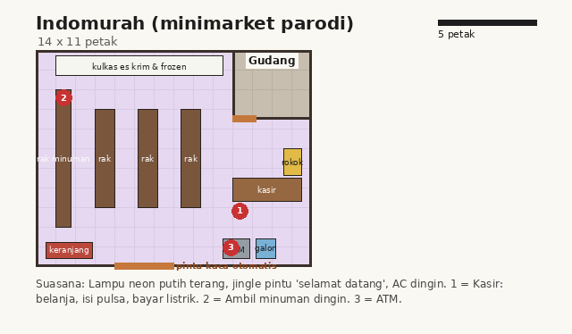

Ukuran 14 x 11 petak. Suasana: Lampu neon putih terang, jingle pintu 'selamat datang', AC dingin.  
Kelebihan: Buka 24 jam, AC (pulih panas); Harga tetap, ada ATM. Kekurangan: 10% lebih mahal dari warung; Tidak bisa ngutang.

| Objek | Posisi (x, y) | Ukuran | Fungsi |
|---|---|---|---|
| rak minuman | (1, 2) | 0.8 x 7 | Kulkas kaca: minuman dingin |
| rak | (3, 3) | 1 x 5 | Mi instan, snack |
| rak | (5.2, 3) | 1 x 5 | Sabun, sampo, alat tulis |
| rak | (7.4, 3) | 1 x 5 | Roti, susu, kopi sachet |
| kulkas es krim & frozen | (1, 0.3) | 8.5 x 1 | Es krim (cooldown panas) |
| kasir | (10, 6.5) | 3.5 x 1.2 | Bayar; kasir NPC Mbak Rina |
| rokok | (12.6, 5) | 0.9 x 1.4 | Rak rokok di belakang kasir (dijual 18+) |
| ATM | (9.5, 9.6) | 1.4 x 1 | Tarik/setor tabungan |
| galon | (11.2, 9.6) | 1 x 1 | Isi ulang galon |
| keranjang | (0.5, 9.8) | 2.4 x 0.8 | Ambil keranjang |

Titik interaksi: **1** (10.4, 8.2) Kasir: belanja, isi pulsa, bayar listrik; **2** (1.5, 5.5) Ambil minuman dingin; **3** (10.2, 10.6) ATM.

## Warung kelontong (tipe K5, mis. Warung Bu Sum)

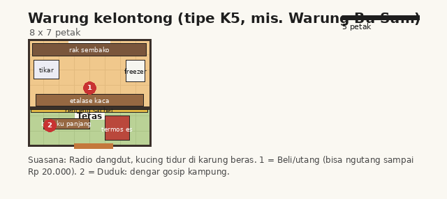

Ukuran 8 x 7 petak. Suasana: Radio dangdut, kucing tidur di karung beras.  
Kelebihan: Paling murah, bisa ngutang; Gosip: info misi. Kekurangan: Barang terbatas; Tutup 21.00.

| Objek | Posisi (x, y) | Ukuran | Fungsi |
|---|---|---|---|
| etalase kaca | (0.5, 3.6) | 7 x 0.8 | Gorengan, rokok ketengan, permen |
| rak sembako | (0.3, 0.3) | 7.4 x 0.8 | Beras, minyak, gula |
| freezer | (6.4, 1.4) | 1.2 x 1.4 | Es batu, es mambo |
| tikar | (0.4, 1.4) | 1.6 x 1.2 | Tempat bu warung duduk |
| bangku panjang | (1, 5.2) | 3 x 0.7 | Duduk ngopi, gosip |
| termos es | (5, 5) | 1.6 x 1.6 | Es teh |
| renceng sachet | (0.2, 4.6) | 7.6 x 0.2 | Renceng kopi & sampo digantung |

Titik interaksi: **1** (4, 3.2) Beli/utang (bisa ngutang sampai Rp 20.000); **2** (2.5, 5.6) Duduk: dengar gosip kampung.

## Warnet Nebula Net

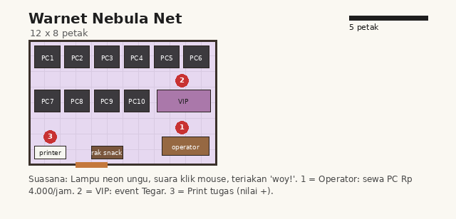

Ukuran 12 x 8 petak. Suasana: Lampu neon ungu, suara klik mouse, teriakan 'woy!'.  
Kelebihan: Mini game online, print tugas; Buka sampai 02.00. Kekurangan: Pengap, asap rokok; Razia jam sekolah.

| Objek | Posisi (x, y) | Ukuran | Fungsi |
|---|---|---|---|
| PC1 | (0.4, 0.4) | 1.6 x 1.4 | Bilik PC |
| PC2 | (2.3, 0.4) | 1.6 x 1.4 | Bilik PC |
| PC3 | (4.2, 0.4) | 1.6 x 1.4 | Bilik PC |
| PC4 | (6.1, 0.4) | 1.6 x 1.4 | Bilik PC |
| PC5 | (8, 0.4) | 1.6 x 1.4 | Bilik PC |
| PC6 | (9.9, 0.4) | 1.6 x 1.4 | Bilik PC |
| PC7 | (0.4, 3.2) | 1.6 x 1.4 | Bilik PC |
| PC8 | (2.3, 3.2) | 1.6 x 1.4 | Bilik PC |
| PC9 | (4.2, 3.2) | 1.6 x 1.4 | Bilik PC |
| PC10 | (6.1, 3.2) | 1.6 x 1.4 | Bilik PC |
| VIP | (8.2, 3.2) | 3.4 x 1.4 | Bilik VIP sofa (game balap Tegar) |
| operator | (8.5, 6.2) | 3 x 1.2 | Bayar per jam, beli mi |
| printer | (0.4, 6.8) | 2 x 0.8 | Print tugas |
| rak snack | (4, 6.8) | 2 x 0.8 | - |

Titik interaksi: **1** (9.8, 5.6) Operator: sewa PC Rp 4.000/jam; **2** (9.8, 2.6) VIP: event Tegar; **3** (1.4, 6.2) Print tugas (nilai +).

## Kafe Senja (saingan warkop)

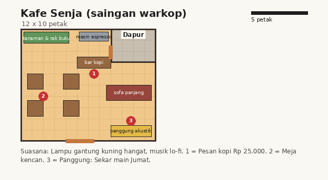

Ukuran 12 x 10 petak. Suasana: Lampu gantung kuning hangat, musik lo-fi.  
Kelebihan: Kencan rapi, wifi, AC. Kekurangan: Mahal 3x warkop; Pemain berbaju lusuh dilirik (karisma -).

| Objek | Posisi (x, y) | Ukuran | Fungsi |
|---|---|---|---|
| bar kopi | (5, 2.5) | 3 x 1 | Barista Kak Dion |
| mesin espresso | (5.2, 0.3) | 2.6 x 0.8 | - |
| sofa panjang | (7.6, 5) | 4 x 1.4 | Duduk rame-rame |
| tanaman & rak buku | (0.3, 0.3) | 4 x 1 | - |
| panggung akustik | (8, 8.6) | 3.6 x 1 | Live akustik Jumat (Sekar) |

Titik interaksi: **1** (6.5, 4) Pesan kopi Rp 25.000; **2** (2, 6) Meja kencan; **3** (9.8, 8.2) Panggung: Sekar main Jumat.

## Karaoke Suara Emas

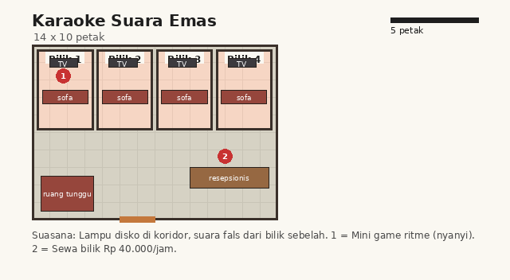

Ukuran 14 x 10 petak. Suasana: Lampu disko di koridor, suara fals dari bilik sebelah.  
Kelebihan: Kencan rame-rame, karisma +. Kekurangan: Mahal, malam ramai preman.

| Objek | Posisi (x, y) | Ukuran | Fungsi |
|---|---|---|---|
| sofa | (0.6, 2.6) | 2.6 x 0.8 | - |
| sofa | (4, 2.6) | 2.6 x 0.8 | - |
| sofa | (7.4, 2.6) | 2.6 x 0.8 | - |
| sofa | (10.8, 2.6) | 2.6 x 0.8 | - |
| TV | (1, 0.8) | 1.6 x 0.5 | - |
| TV | (4.4, 0.8) | 1.6 x 0.5 | - |
| TV | (7.8, 0.8) | 1.6 x 0.5 | - |
| TV | (11.2, 0.8) | 1.6 x 0.5 | - |
| resepsionis | (9, 7) | 4.5 x 1.2 | Sewa bilik per jam |
| ruang tunggu | (0.5, 7.5) | 3 x 2 | - |

Titik interaksi: **1** (1.8, 1.8) Mini game ritme (nyanyi); **2** (11, 6.4) Sewa bilik Rp 40.000/jam.

## Pasar Wirabumi (los dalam)

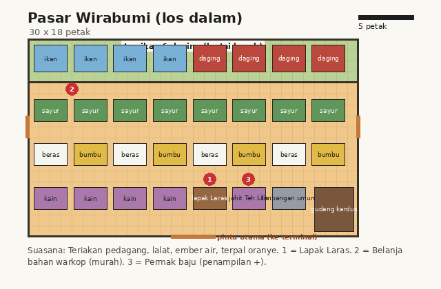

Ukuran 30 x 18 petak. Suasana: Teriakan pedagang, lalat, ember air, terpal oranye.  
Kelebihan: Bahan paling murah; Banyak NPC & gosip. Kekurangan: Becek, copet pagi; Tutup sore.

| Objek | Posisi (x, y) | Ukuran | Fungsi |
|---|---|---|---|
| ikan | (0.6, 0.6) | 3 x 2.4 | - |
| ikan | (4.2, 0.6) | 3 x 2.4 | - |
| ikan | (7.8, 0.6) | 3 x 2.4 | - |
| ikan | (11.4, 0.6) | 3 x 2.4 | - |
| daging | (15, 0.6) | 3 x 2.4 | - |
| daging | (18.6, 0.6) | 3 x 2.4 | - |
| daging | (22.2, 0.6) | 3 x 2.4 | - |
| daging | (25.8, 0.6) | 3 x 2.4 | - |
| sayur | (0.6, 5.5) | 3 x 2 | - |
| sayur | (4.2, 5.5) | 3 x 2 | - |
| sayur | (7.8, 5.5) | 3 x 2 | - |
| sayur | (11.4, 5.5) | 3 x 2 | - |
| sayur | (15, 5.5) | 3 x 2 | - |
| sayur | (18.6, 5.5) | 3 x 2 | - |
| sayur | (22.2, 5.5) | 3 x 2 | - |
| sayur | (25.8, 5.5) | 3 x 2 | - |
| beras | (0.6, 9.5) | 3 x 2 | - |
| bumbu | (4.2, 9.5) | 3 x 2 | - |
| beras | (7.8, 9.5) | 3 x 2 | - |
| bumbu | (11.4, 9.5) | 3 x 2 | - |
| beras | (15, 9.5) | 3 x 2 | - |
| bumbu | (18.6, 9.5) | 3 x 2 | - |
| beras | (22.2, 9.5) | 3 x 2 | - |
| bumbu | (25.8, 9.5) | 3 x 2 | - |
| kain | (0.6, 13.5) | 3 x 2 | - |
| kain | (4.2, 13.5) | 3 x 2 | - |
| kain | (7.8, 13.5) | 3 x 2 | - |
| kain | (11.4, 13.5) | 3 x 2 | - |
| lapak Laras | (15, 13.5) | 3 x 2 | Nasi uduk pagi (event Laras) |
| jahit Teh Lilis | (18.6, 13.5) | 3 x 2 | Permak baju |
| timbangan umum | (22.2, 13.5) | 3 x 2 | - |
| gudang kardus | (26, 13.5) | 3.6 x 4 | - |

Titik interaksi: **1** (16.5, 12.8) Lapak Laras; **2** (4, 4.6) Belanja bahan warkop (murah); **3** (20, 12.8) Permak baju (penampilan +).

## Plaza Wirabumi (3 lantai, berdampingan)

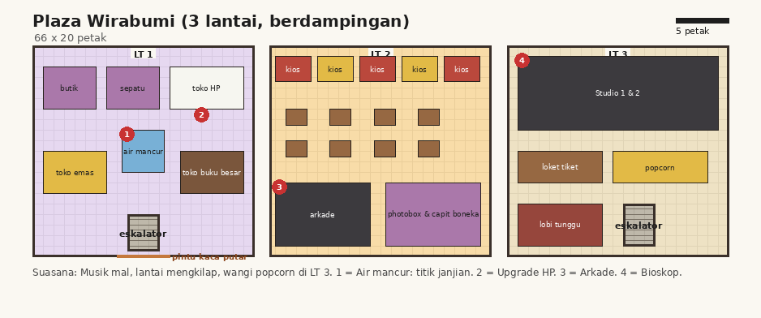

Ukuran 66 x 20 petak. Suasana: Musik mal, lantai mengkilap, wangi popcorn di LT 3.  
Kelebihan: AC, kencan terlengkap, belanja outfit. Kekurangan: Mahal 30%; Seragam jam sekolah diusir satpam.

| Objek | Posisi (x, y) | Ukuran | Fungsi |
|---|---|---|---|
| butik | (1, 2) | 5 x 4 | Baju (outfit) |
| sepatu | (7, 2) | 5 x 4 | - |
| toko HP | (13, 2) | 7 x 4 | Upgrade HP |
| toko emas | (1, 10) | 6 x 4 | - |
| toko buku besar | (14, 10) | 6 x 4 | - |
| air mancur | (8.5, 8) | 4 x 4 | Titik ketemu |
| eskalator | (9, 16) | 3 x 3.5 | pindah lantai |
| kios | (23, 1) | 3.4 x 2.4 | Food court |
| kios | (27, 1) | 3.4 x 2.4 | Food court |
| kios | (31, 1) | 3.4 x 2.4 | Food court |
| kios | (35, 1) | 3.4 x 2.4 | Food court |
| kios | (39, 1) | 3.4 x 2.4 | Food court |
| arkade | (23, 13) | 9 x 6 | Mini game arkade, dance machine |
| photobox & capit boneka | (33.5, 13) | 9 x 6 | Kencan |
| Studio 1 & 2 | (46, 1) | 19 x 7 | Nonton film (kencan) |
| loket tiket | (46, 10) | 8 x 3 | - |
| popcorn | (55, 10) | 9 x 3 | - |
| lobi tunggu | (46, 15) | 8 x 4 | - |
| eskalator | (56, 15) | 3 x 4 | pindah lantai |

Titik interaksi: **1** (10.5, 10) Air mancur: titik janjian; **2** (16, 6.6) Upgrade HP; **3** (27.5, 16) Arkade; **4** (55, 4.5) Bioskop.

## Masjid Agung Al-Ikhlas

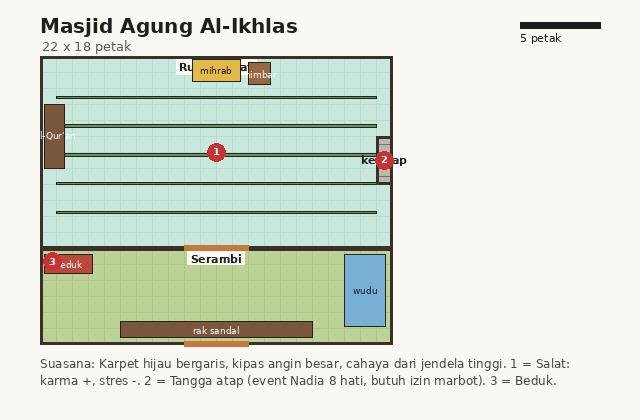

Ukuran 22 x 18 petak. Suasana: Karpet hijau bergaris, kipas angin besar, cahaya dari jendela tinggi.  
Kelebihan: Tenang: stres turun; Event Ramadan, buka puasa gratis. Kekurangan: Jangan lari/berisik.

| Objek | Posisi (x, y) | Ukuran | Fungsi |
|---|---|---|---|
| mihrab | (9.5, 0.2) | 3 x 1.4 | - |
| mimbar | (13, 0.4) | 1.4 x 1.4 | Khotbah Jumat |
| beduk | (0.3, 12.4) | 3 x 1.2 | Pukul beduk (Ramadan) |
| wudu | (19, 12.4) | 2.6 x 4.5 | - |
| rak sandal | (5, 16.6) | 12 x 1 | - |
| Al-Qur'an | (0.3, 3) | 1.2 x 4 | Ngaji (karma +) |
| ke atap | (21, 5) | 1 x 3 | pindah lantai |

Titik interaksi: **1** (11, 6) Salat: karma +, stres -; **2** (21.5, 6.5) Tangga atap (event Nadia 8 hati, butuh izin marbot); **3** (1.8, 13) Beduk.

## Bank Wira

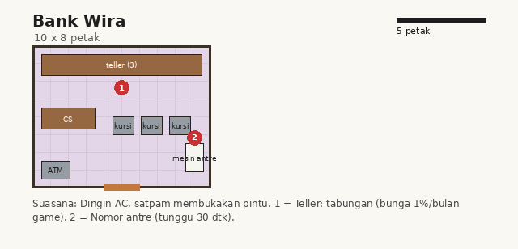

Ukuran 10 x 8 petak. Suasana: Dingin AC, satpam membukakan pintu.  
Kelebihan: Uang aman dari copet & razia; Bunga tabungan. Kekurangan: Antre, tutup 15.00.

| Objek | Posisi (x, y) | Ukuran | Fungsi |
|---|---|---|---|
| teller (3) | (0.5, 0.5) | 9 x 1.2 | Setor/tarik |
| CS | (0.5, 3.5) | 3 x 1.2 | Buka tabungan pelajar |
| kursi | (4.5, 4) | 1.2 x 1 | Antre |
| kursi | (6.1, 4) | 1.2 x 1 | Antre |
| kursi | (7.7, 4) | 1.2 x 1 | Antre |
| mesin antre | (8.6, 5.5) | 1 x 1.6 | Ambil nomor |
| ATM | (0.5, 6.5) | 1.6 x 1 | - |

Titik interaksi: **1** (5, 2.4) Teller: tabungan (bunga 1%/bulan game); **2** (9.1, 5.2) Nomor antre (tunggu 30 dtk).

## Puskesmas Wirabumi

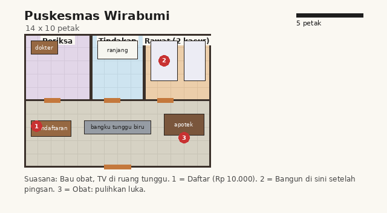

Ukuran 14 x 10 petak. Suasana: Bau obat, TV di ruang tunggu.  
Kelebihan: Murah, pulihkan luka. Kekurangan: Antre lama.

| Objek | Posisi (x, y) | Ukuran | Fungsi |
|---|---|---|---|
| dokter | (0.5, 0.5) | 2 x 1 | - |
| ranjang | (5.5, 0.5) | 3 x 1.4 | Jahit luka |
| pendaftaran | (0.5, 6.5) | 3 x 1.2 | - |
| bangku tunggu biru | (4.5, 6.5) | 5 x 1 | - |
| apotek | (10.5, 6) | 3 x 1.6 | Beli obat |

Titik interaksi: **1** (2, 7.6) Daftar (Rp 10.000); **2** (10.5, 2) Bangun di sini setelah pingsan; **3** (12, 7.8) Obat: pulihkan luka.

## Polsek Wirabumi

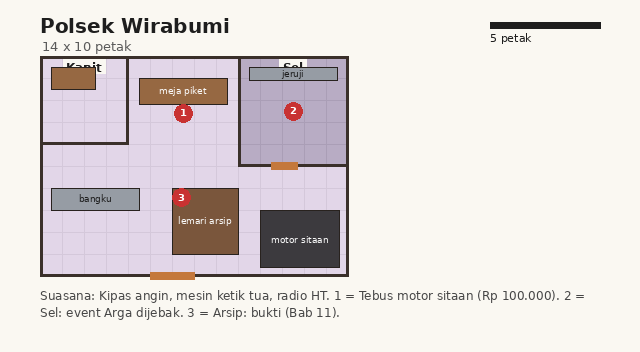

Ukuran 14 x 10 petak. Suasana: Kipas angin, mesin ketik tua, radio HT.  
Kelebihan: Ambil motor, lapor kejahatan. Kekurangan: Datang dengan reputasi buruk = ditanyai.

| Objek | Posisi (x, y) | Ukuran | Fungsi |
|---|---|---|---|
| meja piket | (4.5, 1) | 4 x 1.2 | Lapor, ambil motor |
| jeruji | (9.5, 0.5) | 4 x 0.6 | - |
| bangku | (0.5, 6) | 4 x 1 | - |
| lemari arsip | (6, 6) | 3 x 3 | Arsip (misi Arga) |
| motor sitaan | (10, 7) | 3.6 x 2.6 | - |

Titik interaksi: **1** (6.5, 2.6) Tebus motor sitaan (Rp 100.000); **2** (11.5, 2.5) Sel: event Arga dijebak; **3** (7.5, 7.5) Arsip: bukti (Bab 11).

## Studio Foto Kilat + kamar Jojo

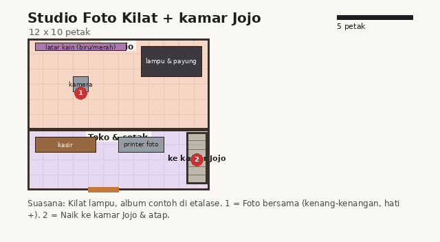

Ukuran 12 x 10 petak. Suasana: Kilat lampu, album contoh di etalase.  
Kelebihan: Foto kenangan event; Akses atap. Kekurangan: Bayar Rp 30.000.

| Objek | Posisi (x, y) | Ukuran | Fungsi |
|---|---|---|---|
| latar kain (biru/merah) | (0.5, 0.3) | 6 x 0.5 | Foto ijazah, foto pacaran |
| kamera | (3, 2.5) | 1 x 1 | - |
| lampu & payung | (7.5, 0.5) | 4 x 2 | - |
| kasir | (0.5, 6.5) | 4 x 1 | - |
| printer foto | (6, 6.5) | 3 x 1 | - |
| ke kamar Jojo | (10.5, 6.2) | 1.4 x 3.4 | pindah lantai |

Titik interaksi: **1** (3.5, 3.6) Foto bersama (kenang-kenangan, hati +); **2** (11.2, 8) Naik ke kamar Jojo & atap.

## Rumah Laras (bantaran)

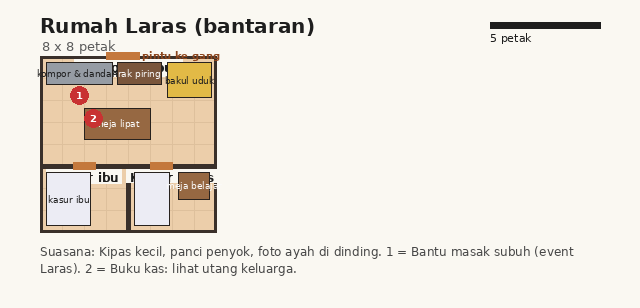

Ukuran 8 x 8 petak. Suasana: Kipas kecil, panci penyok, foto ayah di dinding.  
Kelebihan: Kehangatan keluarga, event. Kekurangan: Sempit, bocor saat hujan.

| Objek | Posisi (x, y) | Ukuran | Fungsi |
|---|---|---|---|
| kompor & dandang | (0.3, 0.3) | 3 x 1 | Masak nasi uduk subuh |
| rak piring | (3.5, 0.3) | 2 x 1 | - |
| bakul uduk | (5.8, 0.3) | 2 x 1.6 | - |
| meja lipat | (2, 2.4) | 3 x 1.4 | Buku kas |
| kasur ibu | (0.3, 5.3) | 2 x 2.4 | - |
| meja belajar | (6.3, 5.3) | 1.4 x 1.2 | - |

Titik interaksi: **1** (1.8, 1.8) Bantu masak subuh (event Laras); **2** (3.5, 3.2) Buku kas: lihat utang keluarga.

## Rumah panggung Gilang

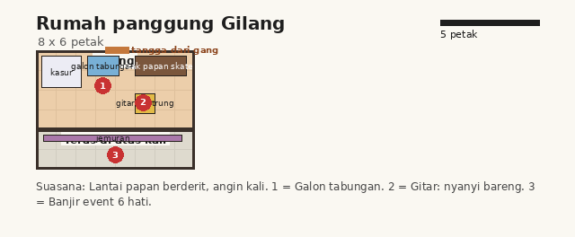

Ukuran 8 x 6 petak. Suasana: Lantai papan berderit, angin kali.  
Kelebihan: Santai, pemandangan kali. Kekurangan: Banjir.

| Objek | Posisi (x, y) | Ukuran | Fungsi |
|---|---|---|---|
| kasur | (0.3, 0.3) | 2 x 1.6 | - |
| galon tabungan | (2.6, 0.3) | 1.6 x 1 | Tabungan (event) |
| rak papan skate | (5, 0.3) | 2.6 x 1 | - |
| gitar kentrung | (5, 2.2) | 1 x 1 | Main musik |
| jemuran | (0.4, 4.3) | 7 x 0.3 | - |

Titik interaksi: **1** (3.4, 1.8) Galon tabungan; **2** (5.5, 3.2) Gitar: nyanyi bareng; **3** (4, 5.3) Banjir event 6 hati.

## Rumah Uti + garasi

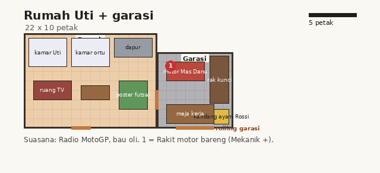

Ukuran 22 x 10 petak. Suasana: Radio MotoGP, bau oli.  
Kelebihan: Belajar mesin dari Uti. Kekurangan: Berisik, oli.

| Objek | Posisi (x, y) | Ukuran | Fungsi |
|---|---|---|---|
| kamar Uti | (0.5, 0.5) | 4 x 3 | - |
| kamar ortu | (5, 0.5) | 4 x 3 | - |
| dapur | (9.5, 0.5) | 4 x 2 | - |
| ruang TV | (1, 5) | 4 x 2 | - |
| poster futsal | (10, 5) | 3 x 3 | - |
| motor Mas Danu | (15, 3) | 4 x 2 | Rakit motor (event) |
| rak kunci | (19.6, 2.4) | 2 x 5 | - |
| meja kerja | (15, 7.5) | 5 x 2 | - |
| kandang ayam Rossi | (20, 8) | 1.6 x 1.6 | - |

Titik interaksi: **1** (17, 4) Rakit motor bareng (Mekanik +).

## Rumah Bimo

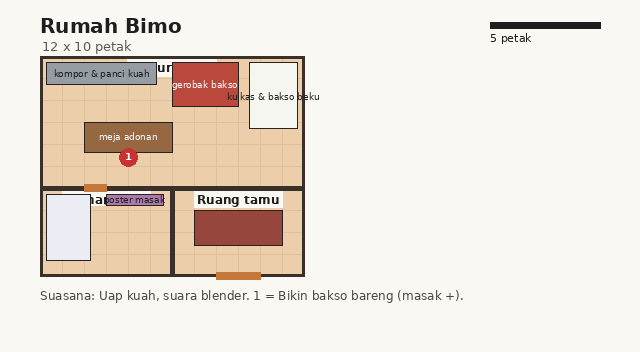

Ukuran 12 x 10 petak. Suasana: Uap kuah, suara blender.  
Kelebihan: Makan gratis. Kekurangan: Bau kaldu menempel.

| Objek | Posisi (x, y) | Ukuran | Fungsi |
|---|---|---|---|
| kompor & panci kuah | (0.3, 0.3) | 5 x 1 | - |
| gerobak bakso | (6, 0.3) | 3 x 2 | - |
| kulkas & bakso beku | (9.5, 0.3) | 2.2 x 3 | - |
| meja adonan | (2, 3) | 4 x 1.4 | Mini game bikin bakso |
| poster masak | (3, 6.3) | 2.6 x 0.5 | - |

Titik interaksi: **1** (4, 4.6) Bikin bakso bareng (masak +).

## Kos Bu Narti

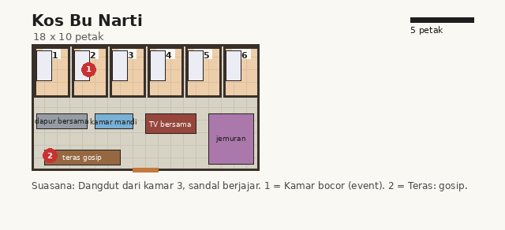

Ukuran 18 x 10 petak. Suasana: Dangdut dari kamar 3, sandal berjajar.  
Kelebihan: Murah (bisa jadi tempat tinggal alternatif). Kekurangan: Bocor, antre kamar mandi.

| Objek | Posisi (x, y) | Ukuran | Fungsi |
|---|---|---|---|
| dapur bersama | (0.4, 5.5) | 4 x 1.2 | - |
| kamar mandi | (5, 5.5) | 3 x 1.2 | - |
| TV bersama | (9, 5.5) | 4 x 1.6 | - |
| jemuran | (14, 5.5) | 3.6 x 4 | - |
| teras gosip | (1, 8.4) | 6 x 1.2 | Bu Narti & anak kos |

Titik interaksi: **1** (4.5, 2) Kamar bocor (event); **2** (3, 9) Teras: gosip.

## Rumah Sekar + loteng

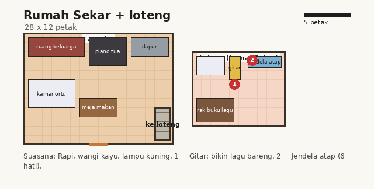

Ukuran 28 x 12 petak. Suasana: Rapi, wangi kayu, lampu kuning.  
Kelebihan: Event musik. Kekurangan: Ortu Sekar tegas: pulang 21.00.

| Objek | Posisi (x, y) | Ukuran | Fungsi |
|---|---|---|---|
| ruang keluarga | (0.5, 0.5) | 6 x 2 | - |
| piano tua | (7, 0.5) | 4 x 3 | - |
| dapur | (11.5, 0.5) | 4 x 2 | - |
| kamar ortu | (0.5, 5) | 5 x 3 | - |
| meja makan | (6, 7) | 4 x 2 | - |
| ke loteng | (14, 8) | 1.8 x 3.6 | pindah lantai |
| gitar | (22, 2.5) | 1.2 x 2.5 | Tulis lagu |
| jendela atap | (24, 2.5) | 3.6 x 1.2 | Event 6 hati: lihat bintang |
| rak buku lagu | (18.5, 7) | 4 x 2.6 | - |

Titik interaksi: **1** (22.6, 5.5) Gitar: bikin lagu bareng; **2** (25.8, 3) Jendela atap (6 hati).

## Rumah Nadia (2 lantai)

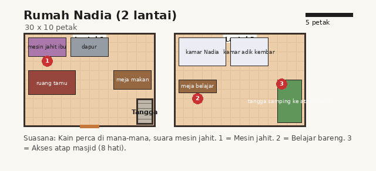

Ukuran 30 x 10 petak. Suasana: Kain perca di mana-mana, suara mesin jahit.  
Kelebihan: Belajar bareng: nilai naik. Kekurangan: Ibu Nadia ketat.

| Objek | Posisi (x, y) | Ukuran | Fungsi |
|---|---|---|---|
| mesin jahit ibu | (0.5, 0.5) | 4 x 2 | Bantu jahit (uang) |
| dapur | (5, 0.5) | 4 x 2 | - |
| ruang tamu | (0.5, 4) | 5 x 2.6 | - |
| meja makan | (9.6, 4) | 4 x 2 | - |
| Tangga | (12, 7) | 1.8 x 2.8 | pindah lantai |
| kamar Nadia | (16.5, 0.5) | 5 x 3 | Meja belajar penuh catatan OSIS |
| kamar adik kembar | (22, 0.5) | 4 x 3 | - |
| meja belajar | (16.5, 5) | 4 x 1.4 | Belajar bareng (nilai +) |
| tangga samping ke atap masjid | (27, 5) | 2.6 x 4.6 | - |

Titik interaksi: **1** (2.5, 3) Mesin jahit; **2** (18.5, 7) Belajar bareng; **3** (28.3, 7) Akses atap masjid (8 hati).

## Rumah Bram (lantai 1 & 2)

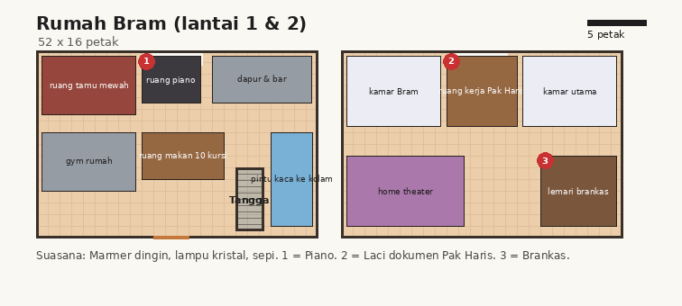

Ukuran 52 x 16 petak. Suasana: Marmer dingin, lampu kristal, sepi.  
Kelebihan: Event Bram, misi dokumen. Kekurangan: CCTV: ketahuan = gagal misi.

| Objek | Posisi (x, y) | Ukuran | Fungsi |
|---|---|---|---|
| ruang tamu mewah | (0.5, 0.5) | 8 x 5 | - |
| ruang piano | (9, 0.5) | 5 x 4 | Event Bram |
| dapur & bar | (15, 0.5) | 8.5 x 4 | - |
| gym rumah | (0.5, 7) | 8 x 5 | Latihan (lebih mahal efek) |
| ruang makan 10 kursi | (9, 7) | 7 x 4 | - |
| Tangga | (17, 10) | 2.4 x 5.4 | pindah lantai |
| pintu kaca ke kolam | (20, 7) | 3.6 x 8 | - |
| kamar Bram | (26.5, 0.5) | 8 x 6 | Trofi, poster balap |
| ruang kerja Pak Haris | (35, 0.5) | 6 x 6 | Laci dokumen (Bab 12) |
| kamar utama | (41.5, 0.5) | 8 x 6 | - |
| home theater | (26.5, 9) | 10 x 6 | - |
| lemari brankas | (43, 9) | 6.5 x 6 | Kode dari Sasha |

Titik interaksi: **1** (11, 2.5) Piano; **2** (37, 4.5) Laci dokumen Pak Haris; **3** (45, 12) Brankas.

## Bengkel Wijaya Motor + rumah Kirana

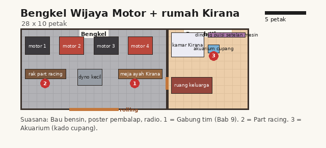

Ukuran 28 x 10 petak. Suasana: Bau bensin, poster pembalap, radio.  
Kelebihan: Part racing, tim resmi. Kekurangan: Kobar sering ada: tegang.

| Objek | Posisi (x, y) | Ukuran | Fungsi |
|---|---|---|---|
| motor 1 | (0.6, 1) | 3 x 2.2 | Servis |
| motor 2 | (4.8, 1) | 3 x 2.2 | Servis |
| motor 3 | (9, 1) | 3 x 2.2 | Servis |
| motor 4 | (13.2, 1) | 3 x 2.2 | Servis |
| rak part racing | (0.6, 5) | 5 x 1.2 | Beli part (balap) |
| dyno kecil | (7, 5) | 3 x 2 | - |
| meja ayah Kirana | (12, 5) | 5.4 x 1.2 | Daftar tim balap |
| kamar Kirana | (18.5, 0.5) | 4 x 3 | - |
| dinding puisi setelan mesin | (23, 0.5) | 4.6 x 0.6 | - |
| akuarium cupang | (23, 2) | 1.4 x 1 | - |
| ruang keluarga | (18.5, 6) | 5 x 2 | - |

Titik interaksi: **1** (14, 6.8) Gabung tim (Bab 9); **2** (3, 6.8) Part racing; **3** (23.7, 3.4) Akuarium (kado cupang).

## Warung Mak Iyah (belakang sekolah)

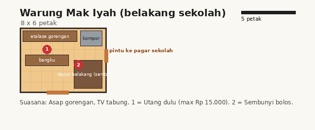

Ukuran 8 x 6 petak. Suasana: Asap gorengan, TV tabung.  
Kelebihan: Persembunyian bolos, utang. Kekurangan: Ketahuan guru = BK.

| Objek | Posisi (x, y) | Ukuran | Fungsi |
|---|---|---|---|
| etalase gorengan | (0.3, 0.3) | 5 x 1 | - |
| kompor | (5.6, 0.3) | 2 x 1.4 | - |
| bangku | (0.5, 2.5) | 4 x 1 | - |
| dapur belakang (sembunyi) | (5, 3) | 2.6 x 2.6 | Sembunyi saat razia guru |

Titik interaksi: **1** (2.5, 2) Utang dulu (max Rp 15.000); **2** (6.3, 4.3) Sembunyi bolos.

## Stasiun (Wirabumi / Lintang)

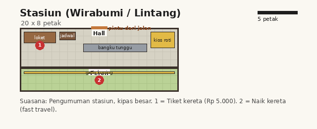

Ukuran 20 x 8 petak. Suasana: Pengumuman stasiun, kipas besar.  
Kelebihan: Fast travel murah. Kekurangan: Jadwal tiap 2 jam.

| Objek | Posisi (x, y) | Ukuran | Fungsi |
|---|---|---|---|
| loket | (0.5, 0.5) | 4 x 1.4 | Beli tiket |
| jadwal | (5, 0.5) | 2 x 1 | - |
| bangku tunggu | (8, 2) | 8 x 1 | - |
| kios roti | (16.5, 0.5) | 3 x 2 | - |
| garis kuning | (0.5, 5.5) | 19 x 0.3 | - |

Titik interaksi: **1** (2.5, 2.2) Tiket kereta (Rp 5.000); **2** (10, 6.6) Naik kereta (fast travel).

## Basecamp pendakian Sangkala

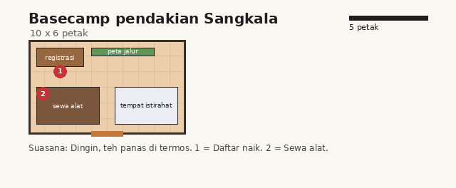

Ukuran 10 x 6 petak. Suasana: Dingin, teh panas di termos.  
Kelebihan: Persiapan naik. Kekurangan: Tutup 15.00.

| Objek | Posisi (x, y) | Ukuran | Fungsi |
|---|---|---|---|
| registrasi | (0.5, 0.5) | 3 x 1.2 | - |
| peta jalur | (4, 0.5) | 4 x 0.5 | - |
| sewa alat | (0.5, 3) | 4 x 2.4 | Tenda, sleeping bag, senter |
| tempat istirahat | (5.5, 3) | 4 x 2.4 | - |

Titik interaksi: **1** (2, 2) Daftar naik; **2** (2.5, 4) Sewa alat.

## Warung Seafood Bu Tinah (Pantai Lintang)

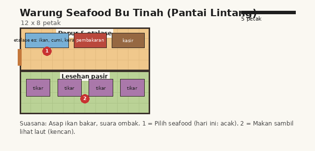

Ukuran 12 x 8 petak. Suasana: Asap ikan bakar, suara ombak.  
Kelebihan: Kencan pantai. Kekurangan: Harga per kilo mahal.

| Objek | Posisi (x, y) | Ukuran | Fungsi |
|---|---|---|---|
| etalase es: ikan, cumi, kerang | (0.5, 0.5) | 4 x 1.4 | Pilih ikan |
| pembakaran | (5, 0.5) | 3 x 1.4 | - |
| kasir | (8.5, 0.5) | 3 x 1.4 | - |
| tikar | (0.6, 4.8) | 2.2 x 1.6 | Makan lesehan |
| tikar | (3.5, 4.8) | 2.2 x 1.6 | Makan lesehan |
| tikar | (6.4, 4.8) | 2.2 x 1.6 | Makan lesehan |
| tikar | (9.3, 4.8) | 2.2 x 1.6 | Makan lesehan |

Titik interaksi: **1** (2.5, 2.2) Pilih seafood (hari ini: acak); **2** (6, 6.6) Makan sambil lihat laut (kencan).

## Rumah pohon & pondok penebang

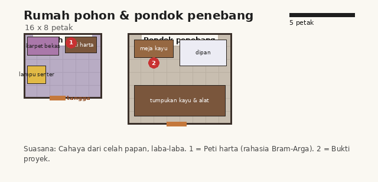

Ukuran 16 x 8 petak. Suasana: Cahaya dari celah papan, laba-laba.  
Kelebihan: Rahasia cerita. Kekurangan: Lapuk, gelap.

| Objek | Posisi (x, y) | Ukuran | Fungsi |
|---|---|---|---|
| karpet bekas | (0.3, 0.3) | 2.4 x 1.4 | - |
| peti harta | (3.2, 0.3) | 2.4 x 1.2 | Foto Bram & Arga kecil |
| lampu senter | (0.3, 2.5) | 1.4 x 1.4 | - |
| meja kayu | (8.5, 0.5) | 3 x 1.4 | Peta proyek palsu (Bab 12) |
| dipan | (12, 0.5) | 3.6 x 2 | - |
| tumpukan kayu & alat | (8.5, 4) | 7 x 2.4 | - |

Titik interaksi: **1** (4.4, 1) Peti harta (rahasia Bram-Arga); **2** (10, 2.3) Bukti proyek.

## Kontainer kantor proyek

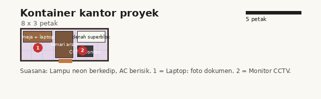

Ukuran 8 x 3 petak. Suasana: Lampu neon berkedip, AC berisik.  
Kelebihan: Bukti utama Bab 13. Kekurangan: Satpam & anjing patroli tiap 40 dtk.

| Objek | Posisi (x, y) | Ukuran | Fungsi |
|---|---|---|---|
| meja + laptop | (0.3, 0.3) | 2.6 x 1 | Foto dokumen (Bab 13) |
| lemari arsip | (3.2, 0.3) | 1.6 x 2.4 | - |
| denah superblok | (5.2, 0.3) | 2.5 x 1 | - |
| CCTV monitor | (5.2, 1.6) | 1.4 x 1 | Matikan CCTV |

Titik interaksi: **1** (1.6, 1.8) Laptop: foto dokumen; **2** (5.9, 2.4) Monitor CCTV.

## Rumah panggung Wulan (Desa Sukamekar)

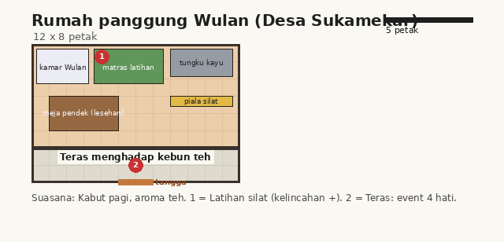

Ukuran 12 x 8 petak. Suasana: Kabut pagi, aroma teh.  
Kelebihan: Event Wulan, latihan silat. Kekurangan: Jauh (bus).

| Objek | Posisi (x, y) | Ukuran | Fungsi |
|---|---|---|---|
| kamar Wulan | (0.3, 0.3) | 3 x 2 | - |
| matras latihan | (3.6, 0.3) | 4 x 2 | Latihan silat |
| tungku kayu | (8, 0.3) | 3.6 x 1.6 | - |
| meja pendek (lesehan) | (1, 3) | 4 x 2 | - |
| piala silat | (8, 3) | 3.6 x 0.6 | - |

Titik interaksi: **1** (5.6, 1.3) Latihan silat (kelincahan +); **2** (6, 7) Teras: event 4 hati.

## Rumah dinas Dimas (Asrama Batalyon)

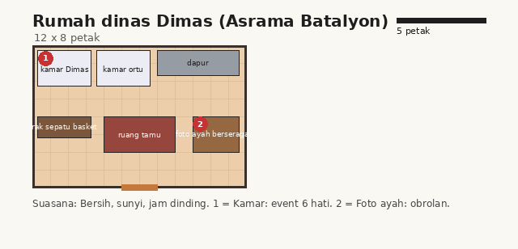

Ukuran 12 x 8 petak. Suasana: Bersih, sunyi, jam dinding.  
Kelebihan: Event Dimas. Kekurangan: Harus diajak, jam malam 21.00.

| Objek | Posisi (x, y) | Ukuran | Fungsi |
|---|---|---|---|
| kamar Dimas | (0.3, 0.3) | 3 x 2 | Rapi ala tentara |
| kamar ortu | (3.6, 0.3) | 3 x 2 | - |
| dapur | (7, 0.3) | 4.6 x 1.4 | - |
| rak sepatu basket | (0.3, 4) | 3 x 1.2 | - |
| ruang tamu | (4, 4) | 4 x 2 | - |
| foto ayah berseragam | (9, 4) | 2.6 x 2 | - |

Titik interaksi: **1** (1.8, 1.5) Kamar: event 6 hati; **2** (10.3, 5) Foto ayah: obrolan.
