# Detail Karakter: Sprite & Portrait

Semua sprite di folder ini **dirender langsung dari renderer voxel sprite-stacking** yang sudah ada
(cabang `claude/relaxed-ride-1e8tfb`, `sprite-stacking/index.html`), jadi bentuknya sama persis dengan yang akan muncul di game.

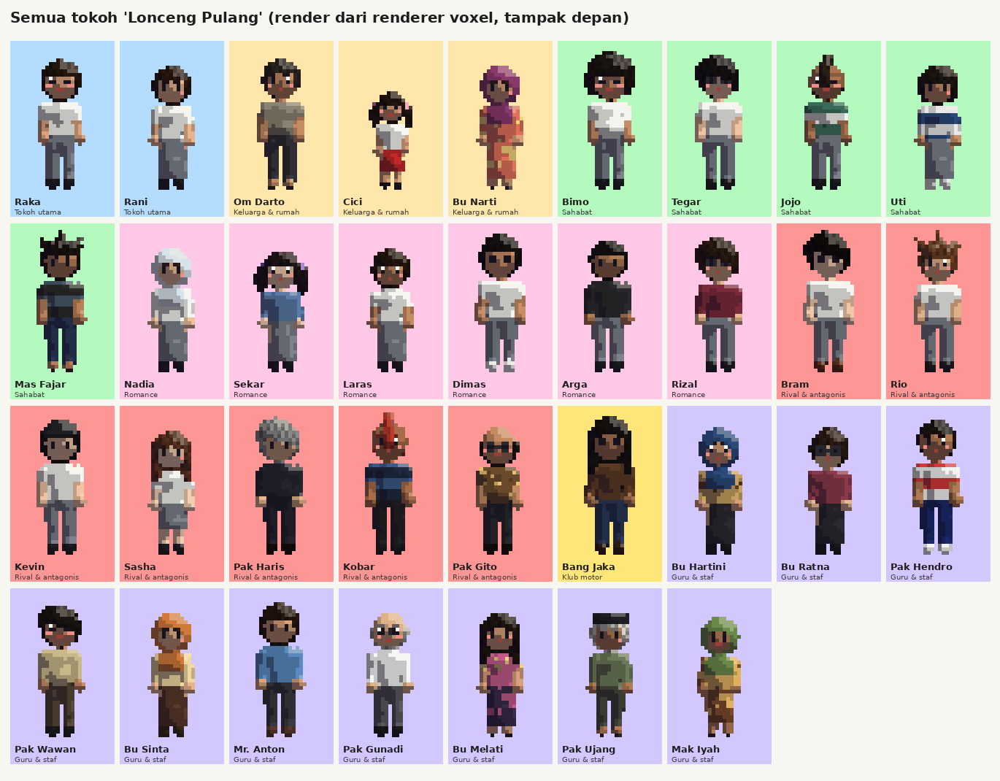

## Isi folder

| File | Isi |
|---|---|
| `npc_styles.js` | Gaya voxel 34 tokoh (format `STYLES`). Tempel ke `STYLES` di renderer dan tokohnya langsung bisa dipakai. |
| `sprite/<id>.png` | Kartu tiap tokoh: portrait, proyeksi depan/samping/belakang, dan tampak di game dari 4 sudut. |
| `sprite/_semua_tokoh.png` | Semua tokoh berjajar, tampak depan. |
| `render.js`, `cards.py` | Skrip untuk merender ulang setelah gaya diubah (lihat bagian akhir). |

## Cara membaca tiap tokoh

- **Sprite**: tinggi (skala tubuh), warna kulit, rambut, baju, dan aksesori. Yang ditandai **(baru)** belum ada di renderer
  dan perlu ditambahkan (contoh: kamera, celemek, rompi).
- **Baju lain**: pakaian di luar jam sekolah atau di event tertentu (jadi variasi `STYLES` terpisah).
- **Gerak khas**: animasi diam/idle atau kebiasaan yang membuat tokoh langsung dikenali dari jauh.
- **Portrait**: panduan untuk portrait dialog. Portrait voxel di kartu adalah versi sementara (diambil dari proyeksi depan);
  untuk versi final dibuat 5 ekspresi: **biasa, senang, marah, sedih, malu/kaget**, ukuran 256x256, gaya pixel art yang
  sama palet warnanya dengan sprite.
- **Ada di mana**: jadwal harian supaya pemain bisa menemukannya.

Seragam SMA semua siswa: kemeja putih `#f4f4f0`, bawahan abu-abu `#7d828c` (celana untuk cowok, rok panjang untuk cewek),
sepatu hitam. Hari Jumat batik sekolah (cokelat-krem), hari Rabu pramuka (cokelat muda + cokelat tua) sebagai variasi.

---

## Tokoh utama

### Raka (pemain cowok) · `raka`
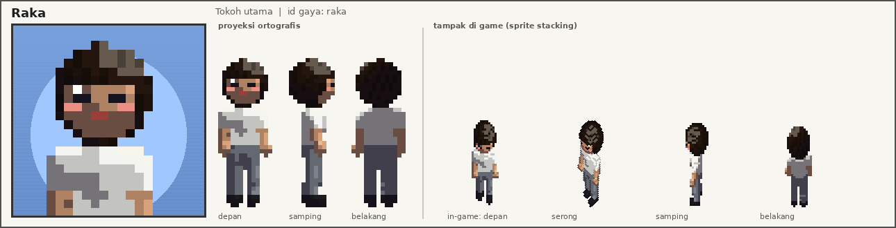
- **Sprite**: skala 1.3, kulit sawo matang `#d9a27a`, rambut `short` hitam-cokelat, seragam rapi (dimasukkan). Bisa diganti
  rambut & warna kulit di awal game.
- **Baju lain**: kaus oblong kuning pudar + celana pendek (rumah), jaket hoodie abu (malam), jaket Lampu Kota hitam berlis kuning (kalau masuk geng).
- **Gerak khas**: idle sering melihat HP, menggaruk kepala saat bingung.
- **Portrait**: wajah anak desa yang polos tapi tajam matanya, alis tebal, sedikit belang matahari di tulang pipi.
  Ekspresi senang = nyengir lebar memperlihatkan gigi.

### Rani (pemain cewek) · `rani`
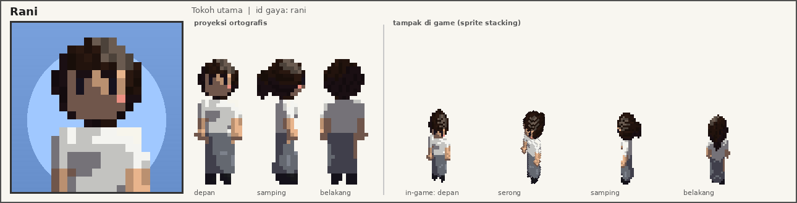
- **Sprite**: skala 1.24, kulit kuning langsat `#e8b48c`, rambut `ponytail` hitam, seragam rok panjang. Opsi hijab di menu awal.
- **Baju lain**: kaus lengan panjang + celana jeans (sore), jaket Lampu Kota.
- **Gerak khas**: merapikan kuncir rambut saat idle.
- **Portrait**: mata besar, poni tipis, senyum miring. Ekspresi marah = pipi menggembung.

---

## Keluarga & rumah

### Om Darto · `omDarto`
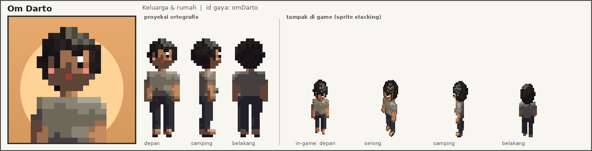
- **Sprite**: skala 1.32, kulit gelap `#c48a60`, rambut `buzz` beruban sedikit, kaus abu belel `#8a8272`, celana kain gelap,
  sandal, perut agak buncit (0.5). **(baru)**: handuk kecil di pundak, gelang karet hitam di tangan.
- **Baju lain**: kemeja batik lusuh (acara sekolah/ambil rapor), jaket kulit tua Lampu Kota (flashback & Bab 13).
- **Gerak khas**: mengelap gelas, menuang kopi dari teko tinggi, tertawa sambil menepuk paha.
- **Portrait**: kumis tipis, kerut di sudut mata, senyum hangat. Ekspresi sedih = menunduk sambil menggigit tusuk gigi.
- **Ada di mana**: warkop dari sore sampai tengah malam, pasar pagi untuk belanja, tidur siang di kursi panjang.

### Cici · `cici`
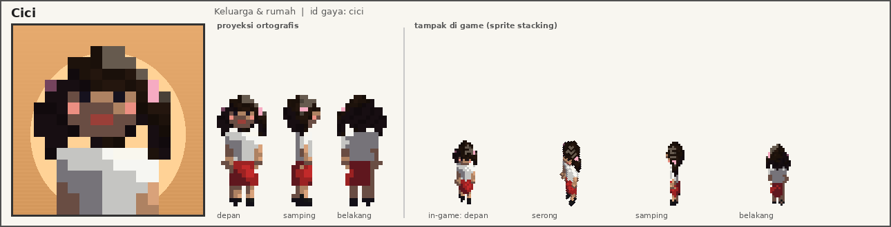
- **Sprite**: skala 0.98 (anak), rambut `twintail` dengan ikat rambut merah muda `#f28ab4`, seragam SD putih-merah.
- **Baju lain**: daster anak bergambar kucing (rumah), mukena putih (Ramadan).
- **Gerak khas**: berlari kecil, lompat-lompat, menarik ujung baju pemain.
- **Portrait**: pipi bulat merah, gigi ompong satu di depan. Ekspresi senang = mata tertutup melengkung.
- **Ada di mana**: sekolah SD pagi, depan rumah main lompat tali sore, warkop malam (ngantuk di kursi).

### Bu Narti · `buNarti`
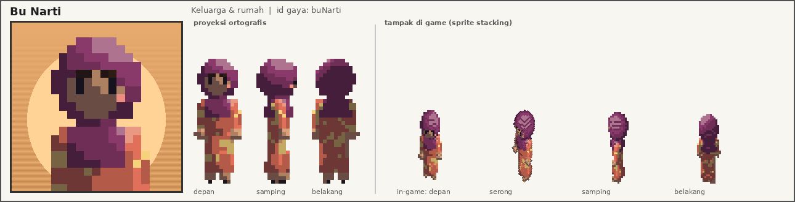
- **Sprite**: skala 1.24, hijab ungu tua `#8a3a6a`, daster batik oranye-kuning, sandal hijau, perut 0.4. **(baru)**: kipas
  bambu di tangan.
- **Baju lain**: gamis hijau untuk arisan dan pengajian.
- **Gerak khas**: berkipas, berbisik dengan tangan menutup mulut (animasi "ngobrol" yang sudah ada).
- **Portrait**: alis terangkat penuh rasa ingin tahu, tahi lalat di dagu. Ekspresi kaget = mulut bulat "O".
- **Ada di mana**: teras kos sepanjang hari, warung kelontong sore, pos ronda saat ada keributan.

---

## Sahabat

### Bimo · `bimo`
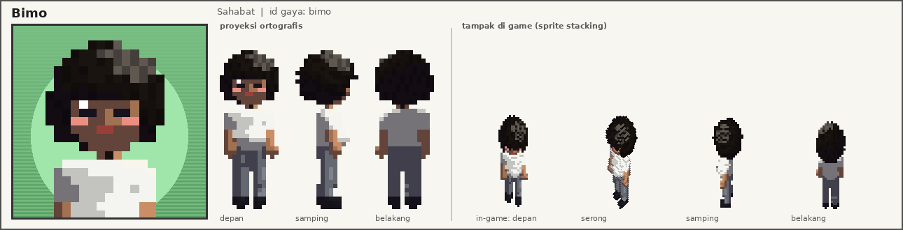
- **Sprite**: skala 1.3, kulit `#c98e66`, rambut `curly` hitam, perut buncit 1.0, seragam kemeja dikeluarkan.
  **(baru)**: kantong plastik jajanan di tangan kiri.
- **Baju lain**: celemek putih bernoda saus (kerja di warkop, setelah Bab 9), kaus bola klub lokal.
- **Gerak khas**: makan sambil jalan, menepuk perut, kaget berlebihan.
- **Portrait**: wajah bulat, mata sipit saat tertawa, remah kerupuk di sudut mulut. Ekspresi takut = keringat besar di dahi.
- **Ada di mana**: kantin setiap istirahat pertama, warung bakso ayahnya di pasar sore.

### Tegar · `tegar`
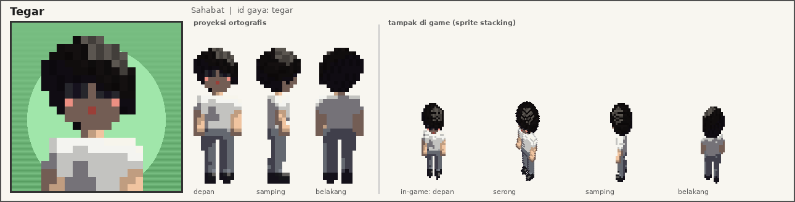
- **Sprite**: skala 1.32, kulit terang `#f0c4a0`, rambut `sidepart` sangat rapi, kacamata, seragam lengkap dan disetrika.
  **(baru)**: badge ketua kelas di saku, buku tebal di tangan.
- **Baju lain**: kemeja kotak-kotak dimasukkan (les), piyama (adegan kabur Bab 11).
- **Gerak khas**: membetulkan kacamata dengan satu jari, berdiri tegak seperti upacara.
- **Portrait**: rahang tegas, kantung mata (makin tebal di kelas XII). Ekspresi stres = kacamata miring, rambut berantakan.
- **Ada di mana**: kelas lebih awal dari semua orang, perpustakaan setelah sekolah, tempat les di Ruko Pelita.

### Jojo · `jojo`
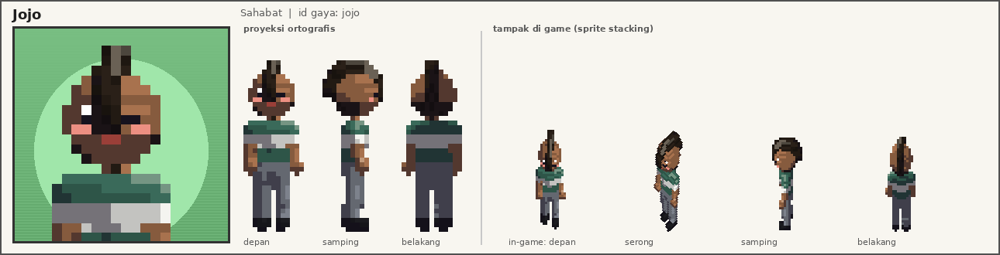
- **Sprite**: skala 1.3, kulit gelap `#a8724e`, rambut `mohawk` pendek, seragam dengan kaus dalam bergaris hijau terlihat.
  **(baru)**: kamera DSLR tergantung di leher, rompi jurnalistik cokelat berkantong banyak.
- **Baju lain**: kemeja pantai bermotif (study tour), jaket parka hijau (liputan malam).
- **Gerak khas**: membidik kamera ke arah pemain, berjongkok mencari sudut foto.
- **Portrait**: senyum licik, satu mata sedikit menyipit seperti membidik. Ekspresi kaget = kamera terangkat di depan wajah.
- **Ada di mana**: mading taman depan pagi, berkeliling sekolah saat istirahat, alun-alun malam.

### Uti · `uti`
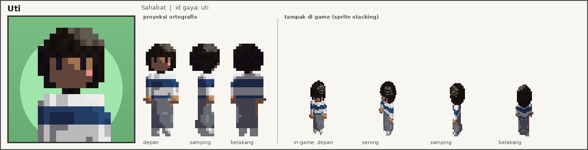
- **Sprite**: skala 1.24, kulit `#c99068`, rambut `bob` pendek, jaket olahraga biru tua bergaris putih di atas seragam,
  rok abu, sepatu putih. **(baru)**: noda oli di pipi kadang-kadang, kunci pas di saku.
- **Baju lain**: jersey futsal putri nomor 7, wearpack montir biru (bengkel).
- **Gerak khas**: memutar kunci motor di jari, tendangan kecil ke kerikil.
- **Portrait**: alis tebal, plester di hidung, senyum percaya diri. Ekspresi sedih (arc motor kakak) = menunduk, rambut menutupi mata.
- **Ada di mana**: parkiran motor sebelum dan sesudah sekolah, lapangan futsal sore, bengkel Mas Fajar.

### Mas Fajar · `fajar`
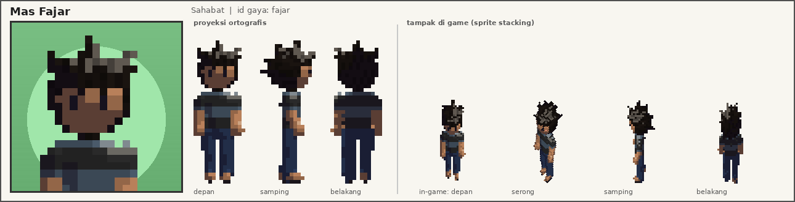
- **Sprite**: skala 1.34 (dewasa muda), kulit `#b8805a`, rambut `spiky`, kaus abu bergaris gelap kotor oli, celana jeans,
  sandal. **(baru)**: lap merah di saku belakang, tato kecil logo lampu di lengan.
- **Baju lain**: jaket Lampu Kota, kemeja putih rapi (hari ujian paket C).
- **Gerak khas**: jongkok memeriksa motor, menyeka tangan dengan lap.
- **Portrait**: bekas luka kecil di alis, tersenyum dengan mata lelah. Ekspresi serius = rahang mengeras.
- **Ada di mana**: bengkel siang sampai sore, markas Lampu Kota malam.

---

## Romance

### Nadia · `nadia`
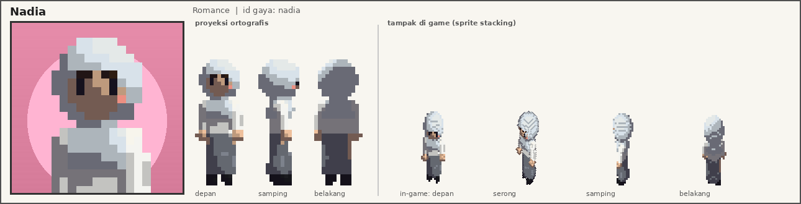
- **Sprite**: skala 1.24, kulit `#eec09c`, hijab putih kebiruan `#d8e2ea`, seragam lengan panjang, rok panjang.
  **(baru)**: pin OSIS di dada, map kampanye.
- **Baju lain**: blazer OSIS biru dongker (setelah menang), gamis pastel (malam perpisahan).
- **Gerak khas**: mengetuk-ngetuk pulpen ke dagu, berjalan cepat dan tegak.
- **Portrait**: mata tajam berbulu mata lentik, senyum tipis. Ekspresi malu = membuang muka, pipi merah.
- **Ada di mana**: ruang OSIS saat istirahat kedua, perpustakaan, toko buku Ruko Pelita akhir pekan.

### Sekar · `sekar`
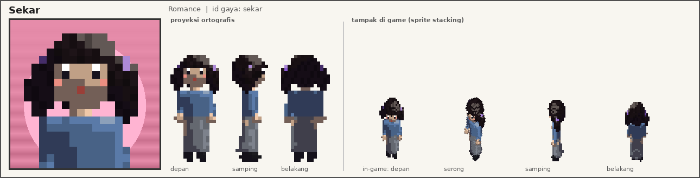
- **Sprite**: skala 1.22, kulit terang `#f0c8a8`, rambut `twintail` hitam dengan ikat rambut ungu, jaket jeans biru di atas
  seragam. **(baru)**: gitar akustik di punggung, buku catatan kecil.
- **Baju lain**: kaus band hitam + rok kotak-kotak (pensi), sweater rajut krem (kencan hujan).
- **Gerak khas**: memetik gitar udara, menulis di buku kecil sambil duduk.
- **Portrait**: mata sayu, poni menutupi sebagian alis, plester musik di jari. Ekspresi senang = senyum kecil malu-malu.
- **Ada di mana**: studio musik sore, atap Gedung B saat istirahat, alun-alun malam Sabtu (kadang mengamen).

### Laras · `laras`
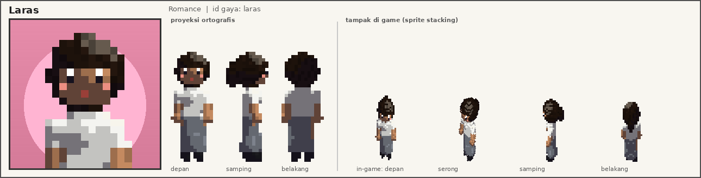
- **Sprite**: skala 1.23, kulit `#c48a60`, rambut `ponytail` tinggi, seragam. **(baru)**: celemek kotak-kotak merah (pasar),
  keranjang anyaman.
- **Baju lain**: kaus oblong + celemek + sandal (subuh di pasar), kebaya sederhana (malam perpisahan).
- **Gerak khas**: menghitung uang kembalian dengan cepat, tangan di pinggang.
- **Portrait**: gigi gingsul saat senyum, bintik di hidung. Ekspresi marah = alis menukik, tangan berkacak pinggang.
- **Ada di mana**: lapak nasi uduk di pasar subuh, kelas (kadang tertidur), alun-alun malam berjualan.

### Dimas · `dimas`
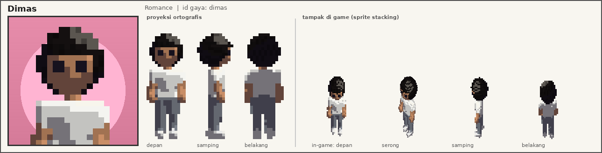
- **Sprite**: skala 1.38 (paling tinggi di angkatan), kulit `#c98e66`, rambut `short`, seragam, sepatu putih.
  **(baru)**: bola basket, ikat kepala.
- **Baju lain**: jersey basket sekolah nomor 10 merah-putih, perban lutut (kelas XI).
- **Gerak khas**: men-dribble bola saat idle, menggaruk tengkuk saat malu.
- **Portrait**: rahang tegas tapi senyum canggung. Ekspresi malu = menutupi muka dengan bola.
- **Ada di mana**: lapangan basket sekolah sore, lapangan basket umum Minggu pagi.

### Arga · `arga`
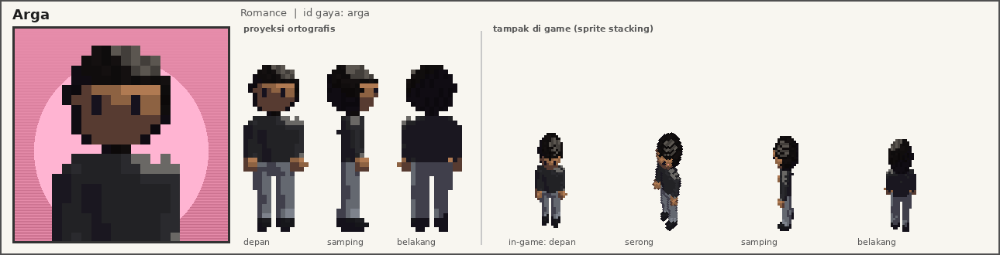
- **Sprite**: skala 1.34, kulit `#b07a52`, rambut `buzz`, jaket kulit hitam lengan panjang di atas seragam. **(baru)**: helm
  half-face di tangan.
- **Baju lain**: jaket Lampu Kota, kaus putih polos (rumah kakeknya).
- **Gerak khas**: bersandar ke motor, memandang jauh, jarang bicara (balon dialog "...").
- **Portrait**: tatapan dingin, bekas luka tipis di dagu. Ekspresi senang langka = senyum sudut bibir.
- **Ada di mana**: parkiran motor, menara pemancar malam, rumah Pak Ujang di belakang sekolah.

### Rizal · `rizal`
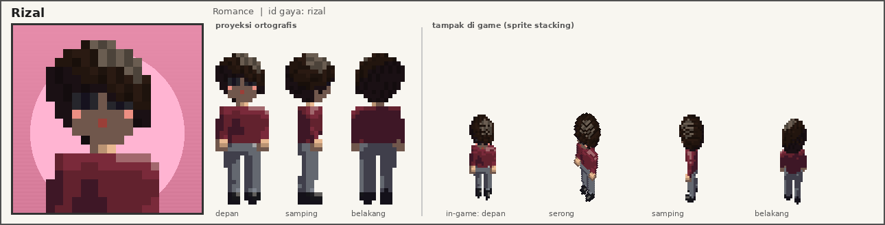
- **Sprite**: skala 1.32, kulit `#e8b890`, rambut `sidepart`, kacamata, sweater marun di atas seragam. **(baru)**: buku
  catatan bersampul kulit, pulpen di telinga.
- **Baju lain**: kemeja flanel (toko buku), jas pinjaman kebesaran (lomba menulis).
- **Gerak khas**: membaca sambil berjalan, mendorong kacamata.
- **Portrait**: wajah lembut, rambut sedikit berantakan di belakang. Ekspresi kesal = bibir dikerucutkan.
- **Ada di mana**: perpustakaan istirahat kedua, ruang OSIS, taman kota sore.

---

## Rival & antagonis

### Bram · `bram`
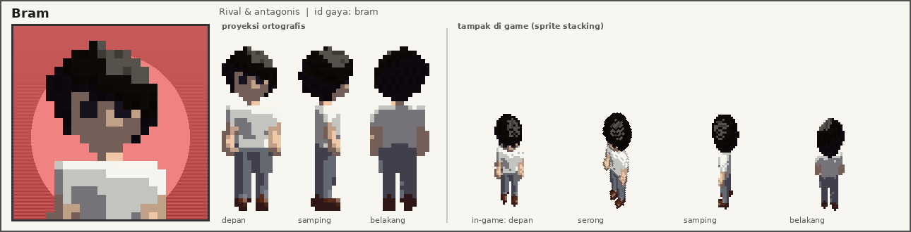
- **Sprite**: skala 1.38, kulit terang `#f0c8a8`, rambut `sidepart` hitam klimis, seragam kemeja keluar dengan lengan dilipat,
  sepatu kulit cokelat. **(baru)**: jam tangan emas, kalung rantai tipis.
- **Baju lain**: jaket varsity merah-hitam (luar sekolah), kemeja hitam mahal (pesta clubhouse).
- **Gerak khas**: memutar-mutar kunci mobil, menunjuk orang dengan dagu.
- **Portrait**: senyum meremehkan, satu alis naik. Ekspresi rapuh (Bab 13) = mata merah, rambut berantakan untuk pertama kali.
- **Ada di mana**: belakang kantin bersama gengnya, parkiran (mobil sport kecil), clubhouse Bukit Asri malam.

### Rio · `rio`
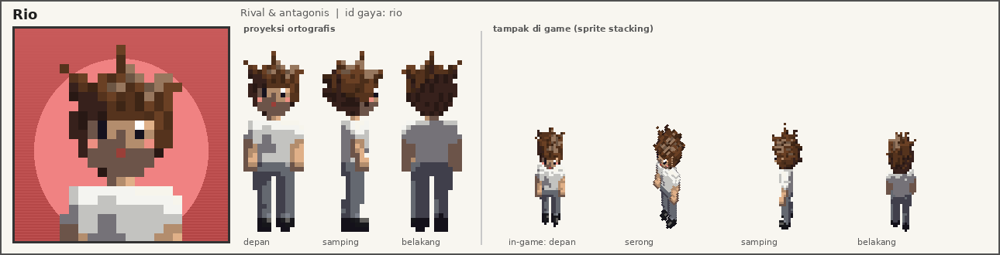
- **Sprite**: skala 1.32, rambut `spiky` cat cokelat, seragam. Calon boneka Bram di pemilihan OSIS.
- **Gerak khas**: tersenyum kampanye berlebihan, salam tos ke semua orang.
- **Portrait**: gigi putih rapi, senyum "politisi". Ekspresi kalah = senyum kaku.

### Kevin · `kevin`
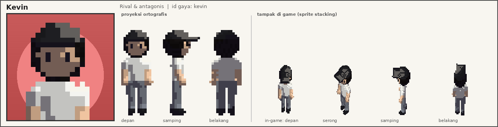
- **Sprite**: skala 1.34, topi `cap` hitam (dipakai di sekolah = melanggar aturan), seragam. Otot geng Bram.
- **Gerak khas**: meretakkan jari, menghalangi jalan.
- **Portrait**: rahang lebar, plester di pipi. Ekspresi bingung = garuk kepala di bawah topi.

### Sasha · `sasha`
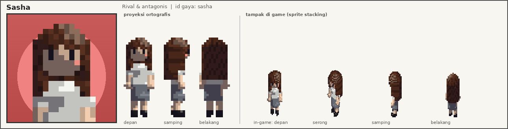
- **Sprite**: skala 1.24, rambut `long` cokelat kemerahan, seragam dengan rok pendek (melanggar aturan). **(baru)**: HP bercasing glitter.
- **Gerak khas**: memotret diri sendiri, mengibaskan rambut.
- **Portrait**: bulu mata tebal, lip tint. Ekspresi mengejek = memutar bola mata.

### Pak Haris Megantara · `pakHaris`
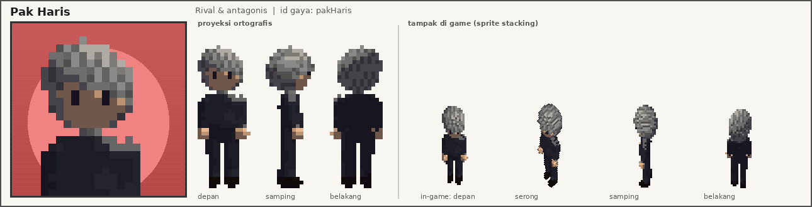
- **Sprite**: skala 1.34, rambut `sidepart` abu-abu, setelan jas hitam, perut 0.5. **(baru)**: dasi merah marun, kacamata hitam
  di saku jas.
- **Gerak khas**: menelepon sambil berjalan, merapikan manset.
- **Portrait**: senyum ramah palsu, mata tidak ikut tersenyum. Ekspresi marah = urat di pelipis.
- **Ada di mana**: hanya di cutscene, lahan proyek, dan rumahnya (Bab 13).

### Kobar · `kobar`
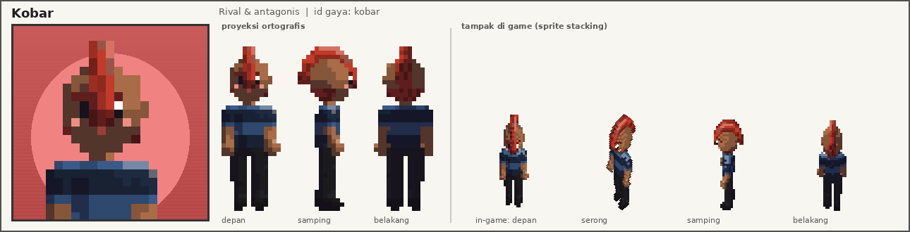
- **Sprite**: skala 1.36, kulit `#a86c48`, rambut `mohawk` merah, kaus biru bergaris (rompi jeans **(baru)**), celana hitam.
- **Baju lain**: jaket Serigala Besi abu dengan bordir kepala serigala.
- **Gerak khas**: memukul telapak tangan sendiri, menendang ban motor.
- **Portrait**: anting di satu telinga, senyum menantang. Ekspresi hormat (setelah damai) = mengangguk sekali.
- **Ada di mana**: gerbang STM sore, jembatan malam.

### Pak Gito · `pakGito`
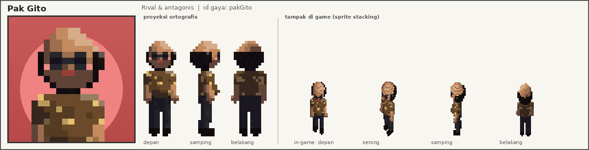
- **Sprite**: skala 1.3, botak, kacamata, kemeja batik cokelat-emas, perut buncit 1.0. **(baru)**: tas pinggang kulit, buku catatan utang.
- **Gerak khas**: menjilat jari lalu menghitung uang.
- **Portrait**: gigi emas, kumis tipis. Ekspresi kesal = kacamata melorot.

---

## Klub motor

### Bang Jaka · `bangJaka`
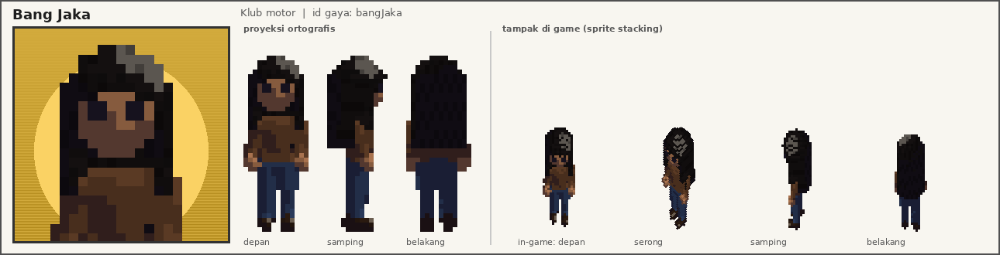
- **Sprite**: skala 1.38, kulit `#a8724e`, rambut `long` gondrong hitam, jaket kulit cokelat, celana jeans, sepatu boots.
  **(baru)**: bandana di pergelangan, emblem Lampu Kota (bohlam kuning) di punggung jaket.
- **Baju lain**: kaus putih + celana training (latihan di markas).
- **Gerak khas**: duduk di atas motor dengan kaki di setang, menepuk bahu anggota.
- **Portrait**: rahang berbulu tipis, mata tenang. Ekspresi marah = diam dan menatap lurus (paling menakutkan).
- **Ada di mana**: markas malam, warkop Om Darto tengah malam (bernostalgia).

**Anggota umum Lampu Kota & Serigala Besi**: pakai variasi gaya `pemuda`/`anakPunk` yang sudah ada + jaket geng
(Lampu Kota: hitam berlis kuning, Serigala Besi: abu dengan bordir merah).

---

## Guru & staf

| Tokoh | Sprite | Gerak khas | Portrait | Ada di mana |
|---|---|---|---|---|
| **Bu Hartini** · `buHartini` 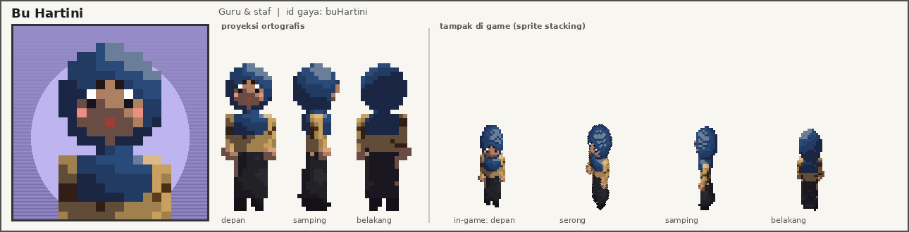 | Skala 1.26, hijab biru dongker, kebaya batik krem-cokelat, rok gelap. **(baru)**: bros emas. | Berdiri dengan tangan terlipat di depan | Wajah keibuan, garis senyum dalam | Ruang kepsek, lapangan saat upacara |
| **Bu Ratna** · `buRatna` 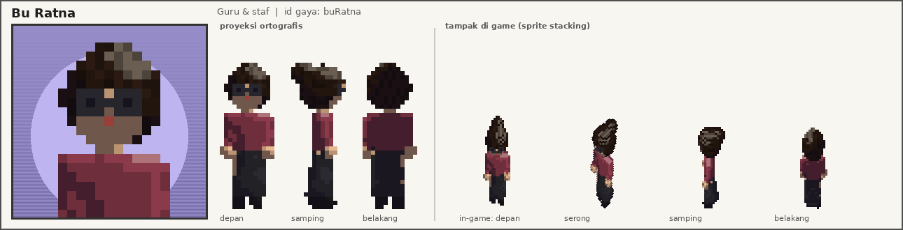 | Skala 1.26, rambut `bun`, kacamata, blus marun, rok gelap. **(baru)**: penggaris kayu panjang. | Mengetuk papan tulis dengan penggaris | Alis tipis tegas, bibir rapat; senyum langka saat pemain dapat nilai 100 | Kelas X-2 (wali kelas), ruang guru |
| **Pak Hendro** · `pakHendro` 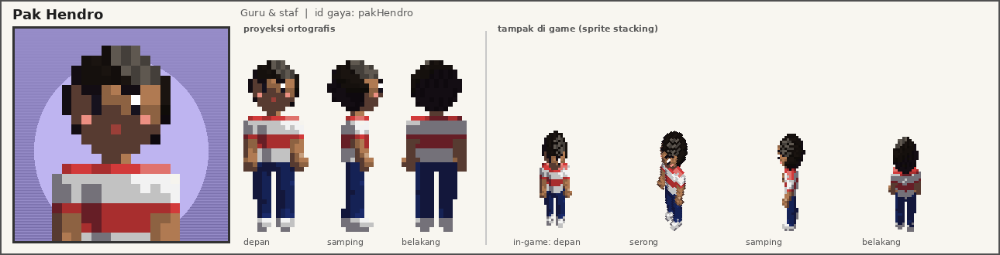 | Skala 1.36, `buzz`, kaus training merah bergaris putih, celana training biru, sepatu putih. **(baru)**: peluit di leher, topi pet. | Meniup peluit, push-up mendadak | Kulit terbakar matahari, senyum lebar | Lapangan pagi, GOR sore, sirkuit Minggu |
| **Pak Wawan** · `pakWawan` 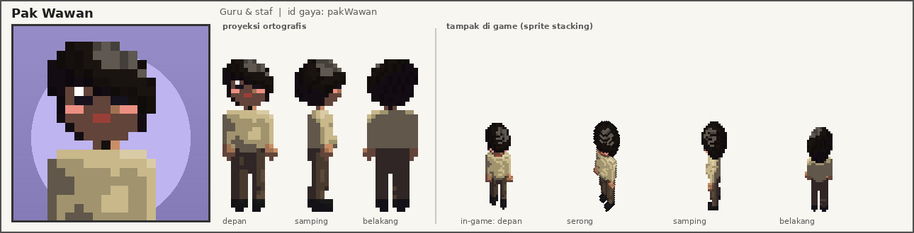 | Skala 1.3, `sidepart`, seragam PNS khaki, perut 0.7. **(baru)**: kumis tebal, buku catatan pelanggaran. | Mengintip dari balik tiang, menunjuk "KAMU!" | Mata menyipit curiga; ekspresi lucu saat terpeleset | Patroli koridor, gerbang pagi, ruang BK |
| **Bu Sinta** · `buSinta` 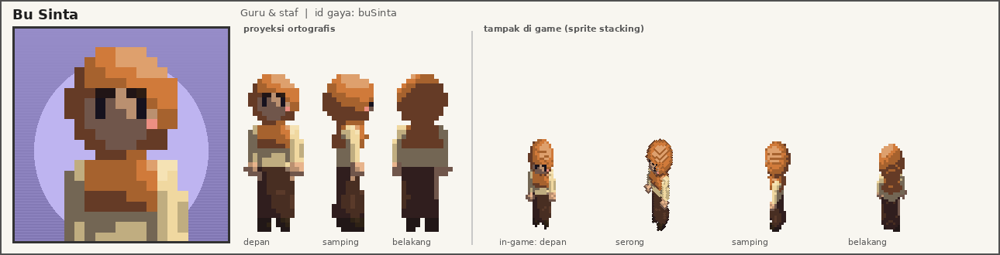 | Skala 1.24, hijab oranye, blus krem, rok cokelat. **(baru)**: tumpukan kertas tugas. | Membaca keras-keras dengan gaya puisi | Senyum ramah, kacamata baca di ujung hidung | Kelas Bahasa, mading |
| **Mr. Anton** · `mrAnton` 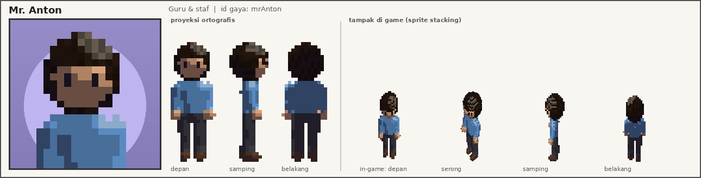 | Skala 1.34, `short`, kemeja biru lengan panjang digulung, sepatu cokelat. **(baru)**: earphone di leher. | Memberi tos ke siswa | Senyum gaul, alis aktif | Kelas Inggris, kafe Ruko Pelita malam |
| **Pak Gunadi** · `pakGunadi` 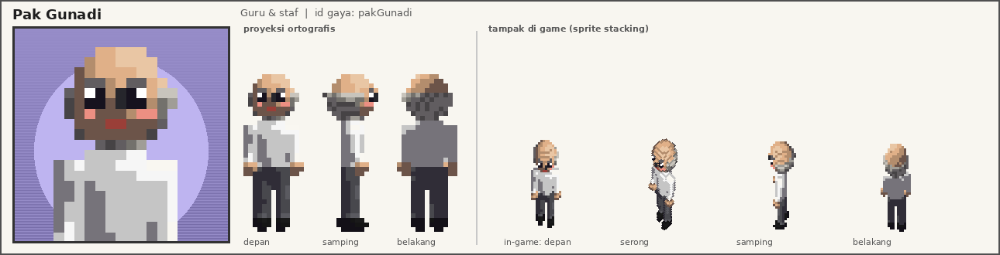 | Skala 1.28, botak beruban, kacamata, jas lab putih. **(baru)**: rambut samping mengembang, noda gosong di jas. | Eksperimen "meledak" kecil, menunjuk ke atas "Eureka!" | Rambut samping jabrik, mata berbinar | Lab fisika & kimia |
| **Bu Melati** · `buMelati` 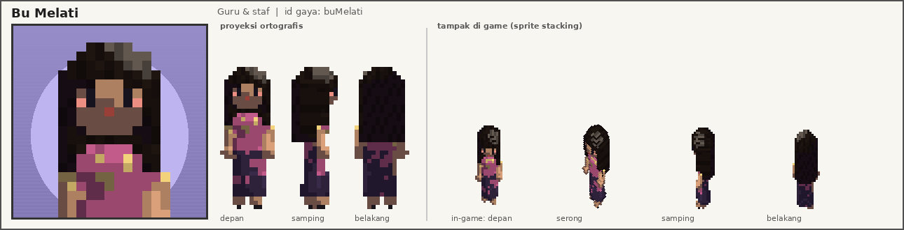 | Skala 1.25, rambut `long`, blus & rok batik merah muda. **(baru)**: selendang, gelang kayu. | Menari kecil, mengetuk irama | Anggun, bibir merah | Ruang seni, aula saat pensi |
| **Pak Ujang** · `pakUjang` 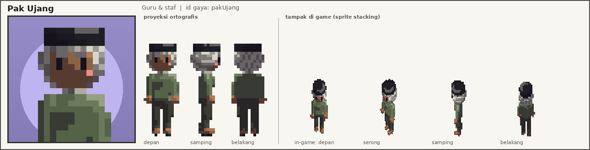 | Skala 1.24, peci, rambut putih, baju kerja hijau lumut, sandal. **(baru)**: kunci serenceng di pinggang, sapu lidi. | Menyapu (animasi sapu yang ada), duduk minum teh | Keriput dalam, mata jenaka | Seluruh sekolah, gudang, Gedung Lama |
| **Mak Iyah** · `makIyah` 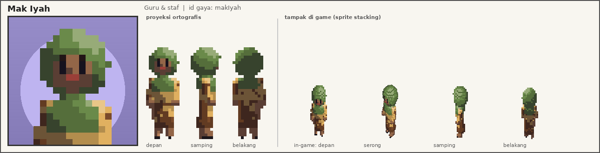 | Skala 1.2, kerudung hijau, kebaya batik kuning, sarung batik, perut 0.6. **(baru)**: wajan & sutil. | Menggoreng, melambai memanggil "Sini, Nak!" | Senyum ompong, pipi tembam | Warung belakang sekolah |

---

## Merender ulang

```bash
# 1. ambil renderer
git show origin/claude/relaxed-ride-1e8tfb:sprite-stacking/index.html > index.html
# 2. render sprite mentah (butuh Node + Playwright)
node render.js raw npc_styles.js index.html
# 3. susun kartu & lineup (butuh Python + Pillow)
python cards.py raw sprite
```

Ubah warna/rambut di `npc_styles.js`, jalankan ulang, dan semua kartu ikut berubah.
